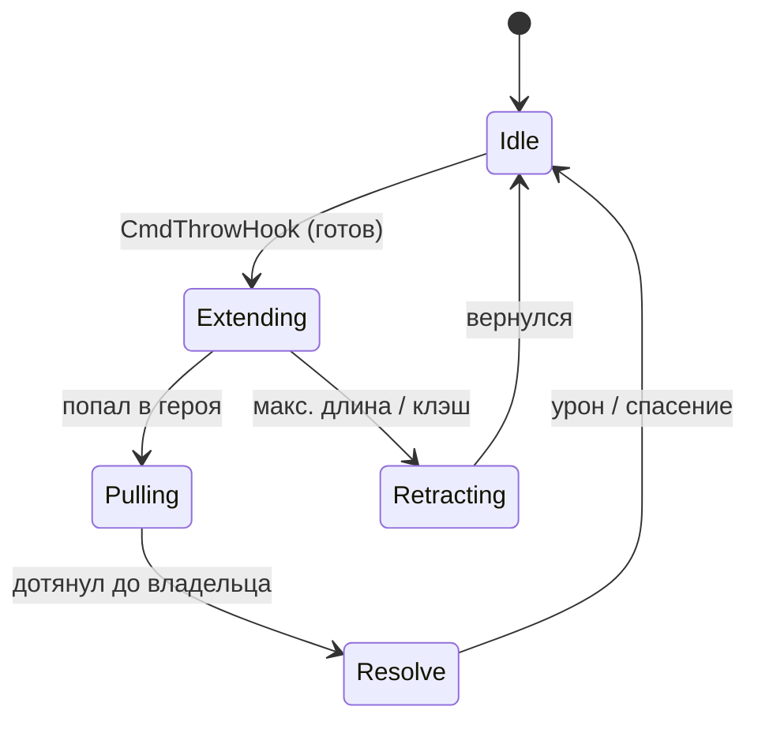
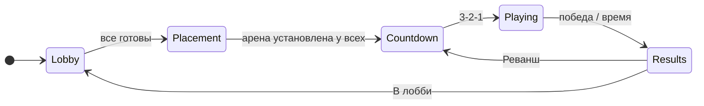
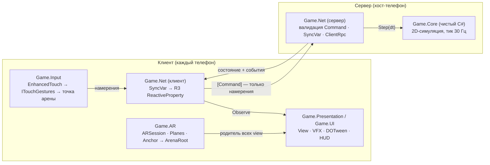

# Pudge Wars AR — технический дизайн-документ

Мультиплеерная дуэль на крюках в дополненной реальности. Обзор аналогов, требования, обоснование стека, архитектура, сетевой протокол.

- **Версия:** 1.29
- **Статус:** Утверждён к реализации (учебный проект)
- **Дата:** 13 ноября 2026
- **Платформа:** Android (ARCore). iOS не поддерживается.
- **Движок и стек:** Unity 6.6 · URP · AR Foundation · Mirror · VContainer · R3 · UniTask · DOTween · Alchemy · Input System (EnhancedTouch)
- **Связанный документ:** «Pudge Wars AR — план реализации и чек-лист по этапам» (`pudge_wars_ar_checklist.md`)

## Содержание

- [1. Введение](#1-введение)
- [2. Обзор продукта](#2-обзор-продукта)
- [3. Обзор существующих решений](#3-обзор-существующих-решений)
- [4. Рамки проекта](#4-рамки-проекта)
- [5. Функциональные требования](#5-функциональные-требования)
- [6. Игровой дизайн](#6-игровой-дизайн)
- [7. Нефункциональные требования](#7-нефункциональные-требования)
- [8. Технологический стек](#8-технологический-стек)
- [9. Обоснование выбора технологий](#9-обоснование-выбора-технологий)
- [10. Архитектура](#10-архитектура)
- [11. Модули](#11-модули)
- [12. Сетевой протокол](#12-сетевой-протокол)
- [13. Данные и конфигурация](#13-данные-и-конфигурация)
- [14. UX в дополненной реальности](#14-ux-в-дополненной-реальности)
- [15. Тестирование](#15-тестирование)
- [16. Риски](#16-риски)
- [17. Этапы реализации](#17-этапы-реализации)

## 1. Введение

### 1.1 Назначение документа

Документ фиксирует требования к игре Pudge Wars AR и технические решения, на которых строится реализация: анализ аналогов, обоснование выбора технологий, архитектуру, состав модулей, сетевой протокол и модели данных. Порядок работ и пошаговые действия вынесены в отдельный документ «План реализации и чек-лист по этапам».

Требования имеют идентификаторы (FR-…, NFR-…) и приоритет по MoSCoW: **M** — обязательно для MVP, **S** — желательно, **C** — при наличии времени. Колонка «Этап» ссылается на этапы плана реализации.

### 1.2 Цели проекта

- Сделать играбельный матч Pudge Wars для 2–6 игроков у одного стола в AR по локальной сети.
- Отработать на практике чистую архитектуру Unity-проекта: DI, реактивные биндинги, асинхронные сценарии, разделение симуляции и представления.
- Получить опыт серверно-авторитарного мультиплеера и AR-разработки под мобильные устройства.

### 1.3 Термины и сокращения

| Термин | Определение |
|---|---|
| Арена | Игровое поле 24×14 игровых единиц, разделённое рекой на две половины. |
| ArenaRoot | Корневой Transform арены в сцене. Все игровые объекты — его дочерние. В AR его позицию и масштаб задаёт игрок. |
| Игровая единица (ед.) | Единица длины симуляции. Не равна метру; соответствие задаётся масштабом ArenaRoot. |
| Координаты арены | 2D-координаты (x, y) в плоскости арены: x — локальная ось X, y — локальная ось Z ArenaRoot. |
| Хост | Устройство, на котором одновременно работают сервер и клиент Mirror. |
| Тик | Один шаг серверной симуляции фиксированной длительности (1/30 с). |
| Намерение | Действие, которое клиент просит выполнить сервер (переместиться, бросить хук, купить улучшение). |
| Хук | Крюк: снаряд, который летит по прямой и притягивает героя, в которого попал. |
| Клэш | Столкновение двух летящих хуков; оба возвращаются. |
| Плоский режим | Режим без AR: арена в начале координат, обычная камера сверху. Для разработки и как запасной вариант. |
| MPPM | Multiplayer Play Mode — запуск нескольких игроков в одном редакторе Unity. |
| MVP | Минимальная играбельная версия: всё с приоритетом M. |

### 1.4 История изменений

| Версия | Дата | Изменения |
|---|---|---|
| 1.29 | 13.11.2026 | Android: фиксированная Landscape Left; uGUI Scale With Screen Size, reference 1920×1080, Match Width Or Height 0.5 для Boot/Menu/Gameplay и диагностического оверлея. Разрешение рендера устройства не фиксируется. |
| 1.28 | 13.11.2026 | 2.12: интервальные счётчики Mirror/transport payload, автоматические development CSV 10 с warmup + 60 с измерений ×3, сценарий и метаданные сборки, proxy input-to-view latency. UDP packets и измеренная потеря — N/A без прямого источника; PowerShell summary mean/p95 и единая ручная приёмка. Протокол 9 не меняется. |
| 1.27 | 13.11.2026 | 2.11: протокол 9, фиксированные MovementBatch (до 4 кадров), адресные снимки, серверный TickCount и валидация epoch/sequence/tick. Клиентский ring history 120 тиков, общий HeroMovement, сверка на ServerTick и replay после него. Локальный визуал отдельно от сетевого корня, host не предсказывается повторно. Диагностика и Prediction Enabled в инспекторе, независимые send/snapshot rates. |
| 1.26 | 12.11.2026 | 2.10: reconnect выдаёт 128-битный токен, ротирует его и epoch, восстанавливает владение тем же героем до deadline 30 с; токен клиента привязан к IP и очищается при явном выходе. ProtocolVersion = 8: добавлен ReconnectInUse, чтобы временно живое старое соединение не инвалидировало токен клиента; после обнаружения обрыва клиент может повторить попытку. |
| 1.25 | 12.11.2026 | Этап 2.9: ProtocolVersion = 7; AuthRequest/AuthResponse с ограниченными строками и кодами отказа, серверный SessionRoster резервирует ник/ID/слот до спавна, SyncList<PlayerInfo>. Явные ограниченные readers/writers PlayerInfo/Hook/Movement, адресные ответы броска и недоступной до этапа 3 покупки. Восстановление по токену остаётся 2.10; в 2.9 optional token уже описан, любой переданный токен получает InvalidReconnectToken. |
| 1.24 | 12.11.2026 | Завершение реализации 2.7: LAN Discovery на UDP 47777 со стабильным handshake, дедупликацией ServerId и удалением записей через 10 с; поиск прекращается при подключении/отмене. Mirror уже получает Android MulticastLock и добавляет разрешение при сборке. После неожиданной потери установленного соединения показывается модальный экран Host disconnected с подтверждением возврата в Menu; отмена/выход/отказ handshake его не вызывают. Development Overlay показывает роль и RTT. Протокол остаётся 6 (Discovery использует штатный ServerResponse Mirror); ник и reconnect — 2.9. |
| 1.23 | 11.11.2026 | Инкремент 2.7: VersionAuthenticator проверяет версию до спавна; VersionAuthRequest(int ProtocolVersion), VersionAuthResponse(int ProtocolVersion). Несовпадение отображается в меню; сервер отключает отвергнутое соединение через 1 с, handshake ограничен 5 с. ProtocolVersion = 6. Ник и reconnect остаются в 2.9. |
| 1.22 | 11.11.2026 | Подтверждена ручная приёмка 2.6. Первый инкремент 2.7: uGUI-меню создания хоста и подключения по IPv4, валидация адреса, отмена и тайм-аут 5 с. Root-scoped контроллер сохраняет состояние при переходах сцен; Discovery и VersionAuthenticator остаются следующими частями 2.7. Протокол остаётся 5. |
| 1.21 | 10.11.2026 | Разработчик подтвердил приёмку 2.5. Этап 2.6: локальный призрак, RequestId/SessionEpoch в броске и HookNetState, адресный результат после фактического шага симуляции и тайм-аут 2 с. ProtocolVersion = 5; HookNetState = 49 байт. |
| 1.20 | 10.11.2026 | Проверка 2.5 выявила зависимость размера HookNetState от автоматических varuint readers/writers Mirror. EditMode round-trip переведён с generic Write/Read, требующих регистрации runtime-делегатов Mirror, на прямые вызовы. Добавлены явные readers/writers: Phase byte, Origin/Dir Vector2, StartTime/TurnTime double, TurnLength float, TargetNetId uint фиксированной длины; 41 байт. ProtocolVersion остаётся 4 для ещё не принятого инкремента 2.5. |
| 1.19 | 10.11.2026 | Ручная проверка ввода 2.4 подтверждена разработчиком. Начат 2.5: локальные координаты NetworkTransformUnreliable, HookNetState, HP через R3 и RPC попадания/клэша. ProtocolVersion = 4. До predictor серверные снимки отображаются также для владельца. |
| 1.18 | 10.11.2026 | Начало 2.4: HeroNet отправляет намерения через Command; локальный DI-мост связывает InputRouter с OnStartLocalPlayer. Сервер проверяет владельца, состояние, координаты и частоту; намерения ограничены одним move/throw на тик. ProtocolVersion = 3. |
| 1.17 | 10.11.2026 | Разработчик подтвердил ручную приёмку 2.3. Устранено устаревшее описание удаления героя при временном disconnect в разделе 10.5; актуализированы статусы README, чеклиста и документации тестов. Следующий пункт — 2.4. |
| 1.16 | 09.11.2026 | Этап 2.3: серверный runner 30 Гц, sink, регистрация героев при спавне, резерв 30 с и очистка сеанса. Явный выход: LeaveSessionMessage без полей (аутентифицированное соединение определяет игрока), ожидание server disconnect до 1 с. ProtocolVersion = 2 из-за новых SyncVar HeroNet и сообщения выхода. |
| 1.15 | 09.11.2026 | Уточнён этап 2.3: динамический состав, явное время шага, перенос состояния после каждого шага; резерв героя отделён от восстановления подключения в 2.10. Реализация начинается с Core; подключение к сети ещё предстоит. |
| 1.0 | 10.10.2026 | Первая версия. Ввод на EnhancedTouch (LeanTouch отклонён, раздел 7.2). |
| 1.1 | 11.10.2026 | Убрана поддержка iOS: единственная платформа — Android (ARCore). Корень игровых файлов — `Assets/Game/` вместо `Assets/_Project/` (раздел 8.3). В стек добавлены ObservableCollections, Eflatun.SceneReference, Unity Pipeline (раздел 7.1). |
| 1.2 | 11.10.2026 | Папки тестов — `Edit Mode/` и `Play Mode/` (с пробелом, как создаёт Unity; раздел 8.3). Game.Core оставлена с Override References = выкл.: предкомпилированные DLL (R3, ObservableCollections, DOTween) ей видны, запрет на них держится договорённостью и ревью (раздел 8.2, NFR-09). Game.Core ссылается на Alchemy — для атрибутов инспектора на ScriptableObject-конфигах (разделы 7.1, 8.2). |
| 1.3 | 16.10.2026 | Добавлены обзор существующих решений (раздел 3) и обоснование выбора технологий (раздел 9); разделы перенумерованы. Убраны трудно проверяемые нефункциональные требования (FPS на «среднем» устройстве, нагрев, «управляемость» при плохой сети, точность совмещения в сантиметрах), оставшиеся NFR перенумерованы. Убраны критерии приёмки MVP. Примеры кода и приложения А–Г заменены описанием решений в разделах 10–12. |
| 1.4 | 24.10.2026 | Ввод: добавлен интерфейс `ILocalHero` (позиция своего героя для InputRouter), уточнены члены `IArenaSpace`, InputRouter публикует состояние прицела для AimLineView, второй палец отменяет свайп (раздел 11.3). DragThreshold задаётся в dp (раздел 13). Game.Tests ссылается и на Game.Input — для тестов InputRouter (раздел 10.2). |
| 1.5 | 03.11.2026 | Каркас этапа 0: описаны сервисы, фактическая композиция сцен, оверлей и версия протокола; уточнены значения и снимки конфигов. |
| 1.6 | 03.11.2026 | Development-оверлей вынесен в редактируемый uGUI-префаб в Boot; автоматическое создание из кода удалено. |
| 1.7 | 03.11.2026 | Этап 1: определены структуры состояний, намерений и событий; SweptCircle возвращает время первого контакта, уточнены геометрические контракты. |
| 1.8 | 03.11.2026 | Первый офлайн-прототип: движение, симуляция хуков и урона, очередь намерений, плоская арена и ввод; уточнено поведение манекена и освобождения цели. |
| 1.9 | 03.11.2026 | После притягивания цель остаётся у владельца хука; ограничивается цель обычного движения, без телепортации позиции на свою половину. |
| 1.10 | 03.11.2026 | Отладка песочницы: Gizmos состояния симуляции и границ, переключаемый лимит 20 FPS с восстановлением настроек. |
| 1.11 | 03.11.2026 | Лимит FPS песочницы заменён числовым параметром Frame Rate Limit: 0 восстанавливает исходные настройки, положительное значение задаёт FPS. |
| 1.12 | 03.11.2026 | Расширен план сети: ники, reconnect 30 с, адресные ответы, сериализация, prediction/reconciliation (лабораторная 3), измерения и CI Android. Изменения запланированы, код пока не реализован. |
| 1.13 | 04.11.2026 | Начало этапа 2: сетевые переходы сцен делегируются SceneService через INetworkSceneLoader; Boot остаётся загруженной. Отключены штатные Single/offline-переходы Mirror, готовность возобновляется после завершения аддитивной загрузки. |
| 1.14 | 04.11.2026 | Этап 2.2: каталог Hero/MatchState, фабрика DI-спавна в GameplayScope, ручной запрос локального игрока после готовности сцены. AddPlayerForConnection спавнит героя самостоятельно; отдельный Spawn для героя не вызывается. Временное распределение по четырём слотам до реализации лобби и reconnect. |

## 2. Обзор продукта

### 2.1 Концепция

Две команды героев-мясников стоят на противоположных берегах реки, которую нельзя пересечь. Единственный способ взаимодействия — бросок крюка. Попадание во врага притягивает его и наносит урон; попадание в союзника спасает его. За убийства начисляется золото, которое тратится на улучшения крюка.

Арена размещается на реальном столе с помощью AR. Игроки стоят вокруг стола и управляют своими героями касаниями экрана телефона.

### 2.2 Сценарий использования

1. Хост создаёт игру в меню. Остальные игроки в той же Wi-Fi-сети видят её в списке и подключаются.
2. В лобби игроки выбирают команду и нажимают «Готов».
3. Каждый игрок сканирует стол и ставит арену (или все совмещают её по маркеру).
4. Отсчёт 3-2-1, матч длится до 15 убийств команды или 8 минут.
5. Экран результатов: «Реванш» или «В лобби».

### 2.3 Игровой цикл

Перемещение по своей половине → прицеливание и бросок крюка → притягивание и урон → убийство и золото → улучшение крюка → снова бросок.

### 2.4 Целевые устройства

| Платформа | Требование |
|---|---|
| Android | Устройство из списка поддерживаемых ARCore; минимальная версия Android — по XR Project Validation (не ниже API 24). Единственная целевая платформа. |
| Редактор | Плоский режим + MPPM для сетевой отладки; XR Simulation для потока установки арены. |

## 3. Обзор существующих решений

Проект стоит на пересечении трёх областей: игры с механикой крюка, мобильные арены с прицельными умениями и многопользовательский AR за одним столом. Ниже разобраны представители каждой области и технологии совместного AR, а в конце — выводы для проекта.

### 3.1 Оригинальная механика: Pudge Wars

**Pudge Wars** — пользовательская карта для Warcraft III, позже перенесённая в Dota 2 как пользовательская игра (Arcade). Две команды Pudge разделены рекой и сражаются только крюками; за убийства начисляется золото на улучшения и предметы.

| Достоинства | Недостатки |
|---|---|
| Простое правило «один бросок — один исход», понятное за минуту | Только ПК, нужен клиент игры-основы |
| Высокий потолок мастерства: упреждение, клэши, спасение союзников | Управление рассчитано на мышь и горячие клавиши |
| Короткий цикл «бросок → результат», интересно наблюдать | Игроки не находятся в одном физическом пространстве |
| Механика проверена годами существования сообщества | Использует чужую интеллектуальную собственность (персонажи, ассеты) |

**Что берём:** правила арены с рекой, машину состояний хука, клэш, экономику улучшений крюка. **Чего избегаем:** персонажей и ассетов Dota 2, сложной системы предметов в MVP.

### 3.2 Мобильные арены с прицельными умениями

**Brawl Stars** (Supercell) — командные бои 3×3 с короткими матчами и прицеливанием виртуальным стиком. **League of Legends: Wild Rift** (Riot Games) — мобильная MOBA, где есть прямые аналоги крюка (например, захват Блицкранка), а прицеливание сделано перетаскиванием от кнопки умения с линией траектории.

| Достоинства | Недостатки |
|---|---|
| Отработанные схемы сенсорного прицеливания: линия траектории, отмена броска возвратом пальца | Игра только через интернет, нужны серверы и матчмейкинг |
| Короткие матчи и быстрый вход — подходят для телефона | Камера и поле фиксированы, нет связи с реальным пространством |
| Помощь в прицеливании и щедрые хитбоксы компенсируют неточность пальца | Большой объём контента и монетизации, недостижимый для учебного проекта |

**Что берём:** свайп с линией прицела и отменой (FR-IN-02, FR-IN-03), помощь в прицеливании (FR-IN-05), увеличенный радиус хука. **Чего избегаем:** виртуальных стиков — в AR экран занят видом стола, а стик закрывает арену.

### 3.3 Настольные AR-игры

| Приложение | Суть | Достоинства | Недостатки |
|---|---|---|---|
| **The Machines** (Directive Games, 2017, iOS) | Стратегия в реальном времени на столе, мультиплеер | Показала, что соревновательная игра на столе в AR возможна; арена как «миниатюра» хорошо читается | Только iOS; быстро потеряла аудиторию — AR-режим воспринимался как демонстрация технологии |
| **Angry Birds AR: Isle of Pigs** (Rovio / Resolution Games, 2019) | Головоломка с разрушаемыми конструкциями на столе | Хорошо использует обход объекта с телефоном — разные ракурсы дают преимущество | Одиночная игра; длительное удержание телефона утомляет |
| **Minecraft Earth** (Mojang / Microsoft, 2019–2021) | Строительство на столе и совместная игра в AR | Совместное AR-пространство для нескольких игроков | Закрыта в 2021 году; зависимость от облачных сервисов и выхода на улицу |
| **Spaceteam** (2012, iOS / Android) | Кооперативная игра для компании в одной комнате по локальной сети | Доказывает ценность игры «лицом к лицу» с телефонами; подключение без аккаунтов | Нет AR и общего игрового поля |

**Выводы:** у настольных AR-игр три типичные проблемы — утомление от удержания телефона, зависимость от облака и ощущение «технодемо». Поэтому матч ограничен 8 минутами, игра не требует интернета и аккаунтов, а AR служит способом собрать игроков вокруг стола, а не самоцелью: та же игра доступна в плоском режиме.

### 3.4 Технологии совместного AR

Чтобы все игроки видели арену в одном месте стола, нужно согласовать системы координат устройств.

| Подход | Принцип | Достоинства | Недостатки |
|---|---|---|---|
| **Независимая установка** (каждый ставит арену сам) | Синхронизируются только координаты арены | Не требует ничего, кроме локальной сети; устойчиво к ошибкам трекинга | Арены на телефонах не совпадают физически |
| **Маркер** (распознавание изображения) | Арена ставится по позе напечатанной картинки | Работает офлайн, точность достаточная для стола, есть в AR Foundation | Нужен распечатанный маркер; качество зависит от освещения |
| **ARCore Cloud Anchors** | Якорь сохраняется в облаке Google и находится другими устройствами | Без маркера, кроссплатформенно | Нужен интернет, проект Google Cloud и ключ API; задержка резолва |
| **ARKit Collaborative Session** | Устройства обмениваются картами окружения | Точное общее пространство без облака | Только iOS |
| **Niantic Lightship (Shared AR)** | Готовый сервис совместных сессий поверх AR Foundation | Комнаты, синхронизация, совместное позиционирование «из коробки» | Внешний сервис с регистрацией и лицензионными условиями; привязка к поставщику |

**Решение:** в MVP — независимая установка (раздел 10.1), затем маркер (этап 5), Cloud Anchors — по желанию (этап 7). Архитектура «AR — проектор» делает совмещение улучшением, а не условием работы игры.

### 3.5 Итог: место проекта среди аналогов

| Критерий | Pudge Wars (ПК) | Мобильные арены | Настольные AR-игры | **Pudge Wars AR** |
|---|---|---|---|---|
| Игроки в одном физическом месте | Нет | Нет | Частично | **Да** |
| Работа без интернета | Нет | Нет | Редко | **Да (LAN)** |
| Механика крюка | Да | Частично | Нет | **Да** |
| Управление под касания | Нет | Да | Да | **Да** |
| Порог входа (аккаунты, установка) | Высокий | Средний | Средний | **Низкий** |

Ниша проекта — короткая соревновательная игра для компании за одним столом: проверенная механика Pudge Wars, адаптированное под палец управление и AR как способ общего физического присутствия.

## 4. Рамки проекта

| Входит в MVP | Следующие версии | Вне рамок проекта |
|---|---|---|
| Матч 1×1 и 2×2 по Wi-Fi<br>Хук, движение, HP, смерть, респавн<br>Счёт и условия победы<br>4 улучшения крюка<br>Лобби с поиском игр в сети<br>AR-установка арены каждым игроком<br>Плоский режим | Матчи 3×3<br>Совмещение арены по маркеру<br>Препятствия на арене<br>Предметы (Blink, Shield)<br>Headshot<br>Компенсация лагов<br>Cloud Anchors | Игра через интернет, матчмейкинг<br>Миграция хоста<br>Античит<br>Аккаунты, прогрессия, монетизация<br>Персонажи и ассеты Dota 2 (чужая IP) |

> **Обоснование.** Игра по интернету исключена сознательно. Она требует relay-сервера, обхода NAT, предсказания и компенсации лагов. Для AR-игры у одного стола локальной сети достаточно. Архитектура не закрывает путь к онлайну: симуляция не зависит от сетевой библиотеки.

## 5. Функциональные требования

### 5.1 AR и размещение арены

| ID | Требование | Пр. | Этап |
|---|---|---|---|
| FR-AR-01 | При запуске игра проверяет поддержку AR (`ARSession.CheckAvailability`). Если AR недоступен — предлагает плоский режим. | M | 4 |
| FR-AR-02 | Экран сканирования показывает подсказку и ждёт обнаружения горизонтальной плоскости. | M | 4 |
| FR-AR-03 | Полупрозрачный контур арены следует за точкой пересечения луча из центра экрана с плоскостью. | M | 4 |
| FR-AR-04 | Тап фиксирует позицию арены; к ArenaRoot добавляется ARAnchor. | M | 4 |
| FR-AR-05 | До подтверждения игрок может менять масштаб (pinch) в диапазоне 1 ед. = 2…8 см и поворачивать арену (twist). | M | 4 |
| FR-AR-06 | После подтверждения визуализация плоскостей скрывается, ARPlaneManager выключается. | M | 4 |
| FR-AR-07 | До установки арены игровые объекты скрыты (ArenaRoot неактивен визуально). | M | 4 |
| FR-AR-08 | При потере трекинга экран затемняется и показывается подсказка; матч на сервере продолжается. | M | 4 |
| FR-AR-09 | Режим совмещения по маркеру: ArenaRoot ставится по позе распознанного изображения. | S | 5 |
| FR-AR-10 | Кнопка «Перевыровнять» повторно привязывает арену к маркеру во время матча. | S | 5 |
| FR-AR-11 | Совмещение через Cloud Anchors. | C | 7 |

### 5.2 Сеть и лобби

| ID | Требование | Пр. | Этап |
|---|---|---|---|
| FR-NET-01 | Игрок может создать игру (режим хоста). | M | 2 |
| FR-NET-02 | Список игр в локальной сети обновляется автоматически (NetworkDiscovery). | M | 2 |
| FR-NET-03 | Подключение по ручному вводу IP-адреса. | M | 2 |
| FR-NET-04 | При подключении сверяется версия протокола; при несовпадении клиент получает понятную ошибку. | M | 2 |
| FR-NET-05 | В лобби отображаются игроки, их команды и готовность. Игрок выбирает команду и отмечает «Готов». | M | 3 |
| FR-NET-06 | Хост запускает матч, когда все готовы и в каждой команде есть хотя бы один игрок. | M | 3 |
| FR-NET-07 | При отключении хоста клиенты видят экран «Хост отключился» и возвращаются в меню. | M | 2 |
| FR-NET-08 | При обрыве соединения слот и состояние сохраняются 30 с; после истечения срока герой удаляется, матч продолжается; если команда опустела — победа другой команды. Явный выход освобождает слот сразу. | M | 3 |
| FR-NET-09 | Максимум 6 игроков (3×3); MVP проверяется на 2×2. | S | 3 |
| FR-NET-10 | Перед подключением игрок вводит ник (2–16 символов после Trim, без управляющих символов); сервер проверяет уникальность без учёта регистра среди подключённых и зарезервированных участников. | M | 2 |
| FR-NET-11 | Сервер выдаёт reconnect-токен; при обрыве соединения игрок может вернуться в течение 30 с с тем же слотом, командой и актуальным состоянием героя. | M | 2 |
| FR-NET-12 | Отклонённое игровое действие получает адресный TargetRpc-ответ с RequestId и кодом причины; остальные игроки этот ответ не получают. | M | 2 |
| FR-NET-13 | PlayerInfo, HookNetState, MovementFrame и MovementSnapshot имеют явный формат сериализации и EditMode-тесты round-trip и некорректных входов. | M | 2 |
| FR-NET-14 | Свой герой локально предсказывает движение на 30 Гц, отправляя серверу намерения, а не авторитетные позиции; сервер остаётся источником истины. | M | 2 |
| FR-NET-15 | При серверном снимке клиент восстанавливает авторитетное состояние и повторяет неподтверждённые шаги движения; старые снимки не откатывают новое состояние. | M | 2 |
| FR-NET-16 | Development-оверлей показывает ошибку предсказания в единицах арены, зелёный/красный индикатор и число коррекций; есть режим без prediction для сравнения. | M | 2 |
| FR-NET-17 | Учебный прогон сохраняет RTT, байты/с, сообщения/с и транспортные пакеты/с при доступности счётчиков, задержку визуального отклика и ошибку prediction; частоты отправки 10/20/30 Гц сравниваются при фиксированном тике 30 Гц. | M | 2 |
| FR-NET-18 | GitHub Actions на PR и push в main запускает EditMode-тесты и собирает Android development APK; отчёты тестов и APK публикуются артефактами. | M | 6 |

### 5.3 Геймплей

| ID | Требование | Пр. | Этап |
|---|---|---|---|
| FR-GP-01 | Герой движется к указанной точке со скоростью из HeroConfig; точка ограничивается половиной арены его команды. | M | 1 |
| FR-GP-02 | Бросок хука в указанном направлении при готовности (перезарядка истекла, герой жив и не притягивается). | M | 1 |
| FR-GP-03 | Хук летит по прямой со скоростью Speed до дальности Range; коллизии проверяются по всему пути за тик (swept). | M | 1 |
| FR-GP-04 | Попадание во врага: урон Damage, цель прикрепляется к кончику хука и притягивается к владельцу. | M | 1 |
| FR-GP-05 | Попадание в союзника: притягивание без урона. | M | 1 |
| FR-GP-06 | Притягиваемый герой не может двигаться и бросать хук. | M | 1 |
| FR-GP-07 | Клэш: если кончики двух летящих хуков сближаются меньше суммы радиусов, оба переходят в возврат. | M | 1 |
| FR-GP-08 | Хук возвращается к текущей позиции владельца (владелец может двигаться, пока хук в полёте). | M | 1 |
| FR-GP-09 | При HP ≤ 0 герой погибает, через RespawnTime возрождается в точке своей команды с полным HP. | M | 3 |
| FR-GP-10 | Убийца получает KillGold, участники помощи (урон по жертве за последние 10 с) — AssistGold. | M | 3 |
| FR-GP-11 | Улучшения: дальность, скорость, радиус, урон — по 4 уровня, цены из EconomyConfig. Покупка возможна в любой момент матча. | M | 3 |
| FR-GP-12 | Победа: команда набрала KillsToWin убийств или по истечении MatchDuration — команда с большим счётом (ничья допустима). | M | 3 |
| FR-GP-13 | Headshot: попадание в героя, которого уже тянет другой хук, — мгновенное убийство. | C | 7 |
| FR-GP-14 | Препятствия (колонны), от которых хук возвращается. | C | 7 |

### 5.4 Управление

| ID | Требование | Пр. | Этап |
|---|---|---|---|
| FR-IN-01 | Тап по арене — движение героя в точку. | M | 1 |
| FR-IN-02 | Свайп, начатый рядом со своим героем (радиус захвата ~1.5 ед.), показывает линию прицела длиной Range; отпускание — бросок. | M | 1 |
| FR-IN-03 | Возврат пальца к герою во время прицеливания отменяет бросок. | S | 1 |
| FR-IN-04 | Альтернативная схема: кнопка «Хук» + тап по точке. Переключается в настройках. | S | 6 |
| FR-IN-05 | Помощь в прицеливании: направление подтягивается к ближайшему врагу в конусе ±4°. Отключается в настройках. | S | 6 |
| FR-IN-06 | Касания, начатые над UI, не передаются в игровой ввод. | M | 1 |
| FR-IN-07 | В редакторе мышь эмулирует касание (TouchSimulation). | M | 0 |

### 5.5 Интерфейс

| ID | Требование | Пр. | Этап |
|---|---|---|---|
| FR-UI-01 | Главное меню: «Создать игру», «Найти игру», «Подключиться по IP», «Настройки», переключатель AR / плоский режим. | M | 2 |
| FR-UI-02 | Экран лобби (FR-NET-05). | M | 3 |
| FR-UI-03 | Подсказки установки арены: сканирование, наведение, подтверждение. | M | 4 |
| FR-UI-04 | HUD: HP, индикатор перезарядки хука, золото, счёт команд, таймер матча. | M | 3 |
| FR-UI-05 | Магазин улучшений с текущими уровнями и ценами; недоступные позиции неактивны. | M | 3 |
| FR-UI-06 | Лента убийств. | S | 3 |
| FR-UI-07 | Экран результатов: победитель, статистика игроков (убийства, смерти, попадания хуком), кнопки «Реванш» и «В лобби». | M | 3 |
| FR-UI-08 | Индикатор своего героя за краем экрана; кольцо цвета команды под ногами. | S | 6 |
| FR-UI-09 | HP-бары над героями, повёрнутые к камере. | M | 3 |
| FR-UI-10 | Отладочный оверлей (только development-сборки): FPS, пинг, тик, фаза матча, состояние трекинга. | M | 0 |

## 6. Игровой дизайн

### 6.1 Арена

```text
          ←────────────────── 24 ед. ──────────────────→
        ┌──────────────────────┬──────┬──────────────────────┐  ↑
        │      Команда A       │      │      Команда B       │  │
        │          ●           │ Р    │           ●          │  │
        │          ● ─ ─ ─ ─ ─ │ Е ─ ─│─ ─ ─ ─ ─ ●   (хук)   │ 14 ед.
        │          ●           │ К    │           ●          │  │
        │                      │ А    │                      │  │
        └──────────────────────┴──────┴──────────────────────┘  ↓
                        река: 3.5 ед., |x| < 1.75
        ≈ 96 × 56 см на столе при масштабе 1 ед. = 4 см
```

- Размер 24×14 ед. Центр арены — начало координат арены; ось x направлена от команды A к команде B.
- Река: полоса шириной 3.5 ед. по центру (|x| < 1.75). Герои в неё не заходят, хуки над ней летят свободно.
- Половина команды A: x ∈ [−12 + r; −1.75 − r], команды B: x ∈ [1.75 + r; 12 − r], y ∈ [−7 + r; 7 − r], где r — радиус героя.
- Точки появления: по 3 на команду, x = ±8, y ∈ {−4, 0, 4}.

### 6.2 Машина состояний хука



| Фаза | Поведение | Выход |
|---|---|---|
| Idle | Хук у владельца, идёт перезарядка | CmdThrowHook при готовности → Extending |
| Extending | Длина растёт на Speed·dt; проверяются коллизии отрезка «прошлый кончик → новый» с героями и кончиками других хуков | Попадание → Pulling; клэш или Range → Retracting |
| Pulling | Кончик движется к текущей позиции владельца со скоростью Speed; цель жёстко привязана к кончику | Расстояние до владельца ≤ сумме радиусов → Resolve |
| Retracting | Пустой кончик возвращается к владельцу | Дошёл до владельца → Idle |
| Resolve | Мгновенная фаза: урон (враг) или ничего (союзник), снятие обездвиживания | → Idle |

Урон наносится в момент попадания (вход в Pulling), а не в Resolve: так ощущение удара совпадает с визуальным контактом. Если цель погибла от урона — фаза Pulling продолжается с телом для зрелищности, а затем Resolve без эффекта.

### 6.3 Баланс (стартовые значения)

| Параметр | Значение | Улучшение (за уровень, 4 ур.) |
|---|---|---|
| HP героя | 1000 | — |
| Скорость героя | 3.2 ед/с | — |
| Радиус героя | 0.5 ед | — |
| Дальность хука | 12 ед | +1.5 |
| Скорость хука | 20 ед/с | +4 |
| Радиус хука | 0.35 ед | +0.08 |
| Урон хука | 175 | +75 |
| Перезарядка хука | 3.0 с | — |
| Респавн | 4 с | — |
| Золото за убийство / помощь | 150 / 50 | — |
| Стартовое золото | 0 | — |
| Цена уровня улучшения | 100 / 200 / 300 / 400 | — |
| Победа | 15 убийств или 8 минут | — |

> **Примечание.** Значения — отправная точка, все хранятся в ScriptableObject-конфигах. Целиться пальцем в AR сложнее, чем мышью, поэтому радиус хука щедрее, чем в оригинальной карте. Баланс правится по результатам плейтестов на этапе 6.

### 6.4 Фазы матча



| Фаза | Сервер | Клиенты |
|---|---|---|
| Lobby | Принимает подключения, назначает слоты и команды | Выбор команды, «Готов» |
| Placement | Ждёт сообщения «арена установлена» от всех клиентов (таймаут 120 с — затем исключает не успевших) | Установка арены (FR-AR-*) |
| Countdown | Создаёт героев, задаёт CountdownEnd (NetworkTime) | Отсчёт 3-2-1 |
| Playing | Тик симуляции, валидация команд, MatchEnd (NetworkTime) | Ввод, отображение, HUD |
| Results | Фиксирует победителя и статистику | Экран результатов |

## 7. Нефункциональные требования

В документ включены только требования, которые проверяются однозначно: тестом, настройкой проекта или замером штатным инструментом.

| ID | Требование | Метрика / проверка |
|---|---|---|
| NFR-01 | Отсутствие аллокаций в кадре во время матча | ≈ 0 B GC Alloc в Profiler в фазе Playing |
| NFR-02 | Draw calls / треугольники в кадре | < 100 / < 150 тыс. (Frame Debugger, статистика рендера) |
| NFR-03 | Сетевой трафик | < 20 КБ/с на клиента в матче 3×3 (статистика Mirror) |
| NFR-04 | Детерминированность симуляции | Одинаковые входные данные дают одинаковое состояние (EditMode-тест) |
| NFR-05 | Покрытие ядра тестами | Все правила Game.Core из раздела 6 покрыты EditMode-тестами |
| NFR-06 | Границы модулей | Game.Core не ссылается на Mirror, AR Foundation, Input System; проверяется настройками asmdef. Предкомпилированные DLL (R3, ObservableCollections, DOTween) Core видит автоматически — их отсутствие проверяется ревью (раздел 10.2) |
| NFR-07 | Время от запуска до лобби | < 5 с на устройстве |
| NFR-08 | Язык интерфейса | Русский; строки вынесены в отдельный ресурс для будущей локализации |

## 8. Технологический стек

| Технология | Назначение | Правила использования |
|---|---|---|
| **Unity 6.6, URP** | Движок и рендер | AR Background Renderer Feature в мобильном URP-ассете. Настройки по XR Project Validation. |
| **AR Foundation** + ARCore | Плоскости, raycast, якоря, распознавание изображений | Только в Game.AR. XR Simulation для редактора. |
| **Mirror** (KCP-транспорт) | Мультиплеер: хост, синхронизация, RPC, NetworkDiscovery | Только в Game.Net. Сервер авторитарен. |
| **VContainer** | DI, композиция приложения | Иерархия LifetimeScope (раздел 10.4). Сетевые объекты создаются через IObjectResolver. |
| **R3** | Состояние → UI/View, шина событий, потоки ввода | Не используется внутри серверного тика. |
| **UniTask** | Асинхронные сценарии (загрузка, AR, подключение, отсчёт) | Всегда с CancellationToken. Не используется как игровой таймер. |
| **DOTween** | Косметические анимации, UI | Не двигает объекты, влияющие на геймплей. SetLink на каждый твин. |
| **Alchemy** | Атрибуты инспектора, отладочные кнопки | Сериализация Alchemy в сети не используется. В Game.Core — только атрибуты инспектора на ScriptableObject-конфигах; симуляция Alchemy не использует. |
| **Input System** (EnhancedTouch) | Касания и жесты | Доступ только через ITouchGestures (раздел 11.3). |
| **Unity.Mathematics** | 2D-математика симуляции | float2 и math.* в Game.Core. |
| **Unity Test Framework** | EditMode / PlayMode тесты | Game.Tests. |
| **Multiplayer Play Mode** | Несколько игроков в одном редакторе | Основной инструмент отладки этапов 2–3. |
| **ObservableCollections** (+ R3) | Реактивные коллекции для UI (списки лобби, лента убийств) | Ставится через NuGetForUnity вместе с ядром R3. Не используется в Game.Core. |
| **Eflatun.SceneReference** | Ссылки на сцены в инспекторе и конфигах | Используется SceneLoader'ом вместо строковых имён сцен. |
| **Unity Pipeline** (экспериментальный) | Управление редактором из CLI / агента: сборка, тесты, Play Mode | Только инструмент разработки, в коде игры не используется. |

## 9. Обоснование выбора технологий

Общие критерии выбора: работа на Android с ARCore; бесплатность и открытая лицензия; отсутствие обязательных облачных сервисов; совместимость с архитектурой «DI + реактивные биндинги + чистое ядро»; зрелость и наличие документации; минимум аллокаций в игровом цикле. Для каждой технологии ниже указаны задача, альтернативы и причина выбора.

### 9.1 Движок: Unity 6.6

**Задача:** кроссплатформенный игровой движок с поддержкой мобильного AR, сцен, анимаций, UI и сборки под Android.

| Альтернатива | Достоинства | Недостатки для проекта |
|---|---|---|
| Unreal Engine 5 | Мощный рендер, Blueprints, встроенная сетевая репликация | Тяжёлые мобильные сборки; AR-плагины развиваются медленнее; C++ и долгая итерация для одного разработчика |
| Godot 4 | Открытый, лёгкий, быстрый запуск | Поддержка ARCore — сторонние плагины без гарантии развития; меньше готовых сетевых и DI-библиотек |
| Нативная разработка (Kotlin + ARCore SDK) | Минимальный размер, прямой доступ к ARCore | Нет игрового движка: рендер, анимации, UI и сеть пришлось бы писать самому; Sceneform больше не развивается |

**Почему Unity:** официальная поддержка ARCore через AR Foundation, XR Simulation и Multiplayer Play Mode позволяют вести большую часть работы в редакторе без телефона; C# и экосистема открытых библиотек (Mirror, VContainer, R3, UniTask) дают нужную архитектуру без собственных фреймворков. Версия 6.x выбрана как актуальная линейка с поддержкой Android-инструментария и новых пакетов (MPPM, XR).

### 9.2 Рендер: Universal Render Pipeline

| Альтернатива | Недостатки для проекта |
|---|---|
| Built-in Render Pipeline | Развитие свёрнуто, новые возможности Unity (Render Graph, ряд AR-функций, Shader Graph-примеры) выходят для URP |
| High Definition RP | Не поддерживает мобильные устройства |

**Почему URP:** штатный конвейер для мобильных платформ, SRP Batcher снижает число draw calls (NFR-02), AR Background Renderer Feature выводит изображение камеры, Shader Graph позволяет сделать воду и материалы команд без ручных шейдеров.

### 9.3 AR: AR Foundation + ARCore

| Альтернатива | Достоинства | Недостатки для проекта |
|---|---|---|
| ARCore SDK for Unity | Прямой доступ к ARCore | Объявлен устаревшим в пользу AR Foundation + ARCore Extensions |
| Vuforia Engine | Сильное распознавание изображений и объектов | Коммерческое лицензирование, водяной знак в бесплатной версии, свой стек поверх ARCore |
| Niantic Lightship ARDK | Meshing, семантика, совместные сессии | Требует регистрации и ключа, условия использования сервиса; функции сверх нужного проекту |
| WebAR (браузерные решения) | Без установки приложения | Ограниченная производительность и трекинг; нет локальной сети между браузерами без сервера |

**Почему AR Foundation:** официальный пакет Unity, покрывает все нужные функции (плоскости, raycast, якоря, распознавание изображений), имеет XR Simulation для отладки в редакторе, а ARCore Extensions добавляют Cloud Anchors без смены API. Абстракция AR Foundation оставляет возможность вернуть iOS без переписывания Game.AR.

### 9.4 Сеть: Mirror с транспортом KCP

| Альтернатива | Достоинства | Недостатки для проекта |
|---|---|---|
| Netcode for GameObjects | Официальный, интеграция с Unity Relay и Lobby | Для LAN с хостом-телефоном выигрыша нет; поиск игр в локальной сети нужно делать самому. Имеет смысл при переходе к онлайну |
| FishNet | Встроенное предсказание на клиенте, высокая производительность | Главное преимущество нужно при пинге 80+ мс; в LAN базово достаточно интерполяции; собственный prediction/reconciliation добавлен как обязательная учебная задача лабораторной 3 |
| Photon Fusion / PUN 2 | Облачная инфраструктура, матчмейкинг | Зависимость от облака даже для игры за одним столом; лимиты бесплатного тарифа; тяжёлая модель программирования (Fusion) |
| Свой протокол на Unity Transport / LiteNetLib | Полный контроль над трафиком | Синхронизацию, RPC, спавн объектов и поиск игр пришлось бы писать вручную |

**Почему Mirror:** открытая библиотека (MIT) с многолетней историей и большим сообществом; серверно-авторитарная модель с режимом хоста; встроенные NetworkDiscovery (UDP broadcast для FR-NET-02), NetworkAuthenticator (FR-NET-04), NetworkTransform с интерполяцией и LatencySimulation для проверки плохой сети. Spawn-хендлеры позволяют создавать сетевые объекты через DI (раздел 10.5).

**Транспорт KCP** выбран вместо Telepathy (TCP) — у TCP при потерях растёт задержка из-за повторной передачи всего потока — и вместо сторонних UDP-транспортов: KCP входит в Mirror по умолчанию, даёт надёжный и ненадёжный каналы поверх UDP и низкую задержку.

### 9.5 Внедрение зависимостей: VContainer

| Альтернатива | Недостатки для проекта |
|---|---|
| Zenject / Extenject | Медленнее при разрешении зависимостей, больше аллокаций, развитие практически остановилось |
| Reflex | Быстрый, но меньше сообщество и примеров интеграции |
| Ручная композиция / Service Locator | Скрытые зависимости, ручное управление временем жизни, сложнее тестировать |

**Почему VContainer:** высокая скорость разрешения и минимум аллокаций, иерархия LifetimeScope совпадает с иерархией сцен (Root → Menu → Match), точки входа (IStartable, ITickable, IDisposable) избавляют от лишних MonoBehaviour, есть официальная интеграция с UniTask, а метод `IObjectResolver.Instantiate` решает задачу внедрения в сетевые префабы.

### 9.6 Реактивность: R3 и ObservableCollections

| Альтернатива | Недостатки для проекта |
|---|---|
| UniRx | Предшественник R3 от того же автора, больше не развивается |
| События C# / UnityEvent | Нет операторов (фильтрация, объединение, троттлинг), ручная отписка, легко получить утечку подписок |
| Опрос состояния в Update | Лишняя работа каждый кадр, логика UI размазана по MonoBehaviour |

**Почему R3:** современная реализация реактивных расширений, переработанная с упором на производительность и интеграцию с Unity (FrameProvider, TimeProvider); ReactiveProperty естественно продолжает SyncVar-хуки Mirror (раздел 11.4), а Observable подходит для потоков жестов. **ObservableCollections** из той же экосистемы дают реактивные списки для лобби и ленты убийств без ручного сравнения коллекций; стандартный `ObservableCollection<T>` из .NET с R3 не интегрирован.

### 9.7 Асинхронность: UniTask

| Альтернатива | Недостатки для проекта |
|---|---|
| Корутины | Нет возвращаемого значения и нормальной обработки исключений, отмена только через остановку MonoBehaviour |
| System.Threading.Tasks.Task | Аллокации на каждый вызов, продолжения через контекст синхронизации, нет привязки к PlayerLoop |
| Awaitable (встроен в Unity) | Меньше комбинаторов (WhenAll, WhenAny, таймауты), меньше интеграций со сторонними библиотеками |

**Почему UniTask:** структурный тип без аллокаций, работает на PlayerLoop Unity, поддерживает CancellationToken во всех операциях, имеет интеграции с VContainer и DOTween. Подходит для линейных сценариев «сканировать → поставить арену → дождаться остальных → отсчёт».

### 9.8 Анимации: DOTween

| Альтернатива | Достоинства | Недостатки для проекта |
|---|---|---|
| PrimeTween | Создание твинов без аллокаций | Моложе, меньше примеров и интеграций |
| LeanTween | Простой API | Практически не развивается |
| Animator / Timeline | Визуальная настройка | Избыточны для коротких процедурных эффектов UI и всплывающих цифр |

**Почему DOTween:** зрелая библиотека с последовательностями, широким набором easing-функций и `SetLink`, привязывающим твин к времени жизни объекта. Используется только для косметики, поэтому на геймплей не влияет. Чтобы соблюсти NFR-01, включается переиспользование твинов; если профайлер покажет аллокации в фазе Playing, замена на PrimeTween затронет только Presentation и UI.

### 9.9 Инспектор: Alchemy

| Альтернатива | Недостатки для проекта |
|---|---|
| Odin Inspector | Платная лицензия |
| NaughtyAttributes | Построен на IMGUI, развивается медленно |
| Собственные редакторы (CustomEditor) | Много шаблонного кода на каждый конфиг |

**Почему Alchemy:** бесплатная библиотека атрибутов (MIT) на UI Toolkit: группировка, кнопки отладки, условное отображение полей конфигов без написания редакторов. Атрибуты не меняют рантайм-поведение, поэтому их использование в ScriptableObject-конфигах Game.Core не нарушает чистоту симуляции.

### 9.10 Ввод: Input System (EnhancedTouch)

| Альтернатива | Недостатки для проекта |
|---|---|
| Старый Input Manager | Устаревший API, нет TouchSimulation и событийной модели |
| LeanTouch | Статические события и MonoBehaviour-компоненты плохо стыкуются с DI и R3; готовые компоненты для игрового ввода не нужны |
| Платные пакеты жестов | Лицензия; закрытые распознаватели, которые сложно настроить под AR |

**Почему EnhancedTouch:** штатный API Input System с опросом активных касаний и эмуляцией касаний мышью в редакторе (FR-IN-07). Собственный распознаватель жестов за интерфейсом ITouchGestures покрывает тап, свайп, pinch и twist, пороги задаются в InputConfig, а реализацию легко подменить в тестах.

### 9.11 Математика симуляции: Unity.Mathematics и собственная геометрия

| Альтернатива | Недостатки для проекта |
|---|---|
| Vector2 / Mathf | Привязаны к UnityEngine, неудобны в чистом ядре |
| System.Numerics | Хуже интеграция с остальным API Unity |
| Unity Physics / Physics2D для коллизий хука | Чувствительны к масштабу арены в AR, привязаны к Transform и FixedUpdate, избыточны для проверки «круг против отрезка» |

**Почему Unity.Mathematics:** типы float2 и функции math.* с HLSL-подобным синтаксисом, независимые от сцены; совместимость с Burst на случай оптимизации. Коллизии реализуются собственной 2D-геометрией (Geo2D): несколько функций, полностью покрытых тестами и работающих в координатах арены. Симуляция выполняется только на сервере, поэтому побитовая детерминированность между устройствами не требуется — достаточно воспроизводимости на одном устройстве (NFR-04).

### 9.12 Инструменты разработки и тестирования

| Инструмент | Альтернативы | Почему выбран |
|---|---|---|
| **Unity Test Framework** | Внешний NUnit-проект вне Unity; ручное тестирование | Штатный, запускает EditMode-тесты ядра и PlayMode-тесты из редактора и командной строки |
| **Multiplayer Play Mode** | ParrelSync (клоны проекта); несколько отдельных сборок | Официальный пакет: до четырёх игроков в одном редакторе без копирования проекта, быстрые итерации по сети |
| **XR Simulation** | Отладка только на устройстве | Поток установки арены проверяется в редакторе на виртуальных окружениях |
| **Eflatun.SceneReference** | Строковые имена сцен; индексы Build Settings; Addressables | Ссылка на сцену проверяется в инспекторе и не ломается при переименовании; Addressables избыточны для трёх сцен |
| **NuGetForUnity** | Ручное копирование DLL | Нужен для установки ядра R3 и ObservableCollections из NuGet с учётом зависимостей |
| **Unity Pipeline** | Запуск Unity в batchmode со скриптами; сторонние серверы управления редактором | Позволяет запускать сборку, тесты и Play Mode из командной строки и агентов разработки; экспериментальный статус допустим, так как в игру не входит |

### 9.13 Платформа: только Android

Поддержка iOS исключена: для неё нужны устройства Apple, Mac для сборки и платная учётная запись разработчика. ARKit Collaborative Session — единственное существенное преимущество iOS для проекта — не работает между платформами. AR Foundation сохраняет возможность добавить iOS позже без изменения архитектуры.

## 10. Архитектура

### 10.1 Ключевой принцип: AR — проектор

У каждого телефона своя мировая система координат AR, заданная положением телефона в момент старта сессии. Мировые координаты разных устройств несравнимы. Поэтому:

- Симуляция ведётся в координатах арены (2D, игровые единицы) и ничего не знает об AR.
- Каждый клиент сам размещает ArenaRoot; все игровые объекты — его дочерние.
- По сети передаются только координаты арены.
- Высота не моделируется: всё, что выше плоскости арены, — визуал.
- Масштаб — свойство ArenaRoot.localScale на конкретном устройстве, на симуляцию не влияет.



> По сети передаются только координаты арены в игровых единицах. Мировые координаты AR в сеть не попадают.

Следствия: игра работает без совмещения пространств между телефонами (совмещение — улучшение, а не условие); плоский режим реализуется подменой одного сервиса; ядро тестируется без сцены.

### 10.2 Сборки и правила зависимостей

| Сборка | Содержимое | Может ссылаться на |
|---|---|---|
| **Game.Core** | MatchSimulation, HookSimulation, HeroMovement, Combat, Economy, MatchRules, Geo2D, структуры состояний, данные конфигов, ScriptableObject-конфиги | Unity.Mathematics, Alchemy (только атрибуты инспектора на ScriptableObject-конфигах), UnityEngine (только для ScriptableObject). Без MonoBehaviour-логики, Transform, Physics |
| **Game.Net** | PudgeNetworkManager, NetworkBehaviour-адаптеры, сообщения, VersionAuthenticator, NetworkPrefabFactory, ServerTickRunner | Core, Unity.Mathematics (float2 в IPlayerCommands и валидации), Mirror, R3, VContainer, UniTask |
| **Game.AR** | IArenaAnchorProvider и реализации, ArenaPlacementFlow, MarkerAlignment, TrackingMonitor | AR Foundation, UniTask, VContainer, R3, Game.Input |
| **Game.Input** | ITouchGestures, EnhancedTouchGestures, IArenaSpace, InputRouter, AimAssist | Input System, Core, R3, VContainer |
| **Game.Presentation** | Представления героев, хука и прицела, PlayableArenaView, VFX, индикаторы | Core, Net, Input (AimState/InputRouter), Mathematics, TMP, VContainer, R3, DOTween |
| **Game.UI** | Экраны и презентеры | Core, Net, R3, DOTween, UniTask |
| **Game.Services** | Загрузка сцен, экран загрузки, логирование, аудио, сервис приложения и raycast | UniTask, Alchemy, SceneReference, TMP, DOTween, R3, VContainer, Input System, uGUI |
| **Game.App** | LifetimeScope'ы, точки входа, development-оверлей | Все сборки |
| **Game.Tests** | EditMode / PlayMode тесты | Core, Net, Input, Services, UniTask |

У Game.Core включены только ссылки на сборки (asmdef), Override References выключен. Поэтому ей автоматически доступны предкомпилированные DLL проекта — R3 и ObservableCollections из NuGet, DOTween. Компилятор их не запрещает; `using R3`, `using ObservableCollections`, `using DG.Tweening` в Core недопустимы и отсекаются на ревью. Mirror, AR Foundation и Input System подключены через asmdef и в Core недоступны физически.

Game.Input не ссылается на Game.Net: InputRouter публикует намерения в интерфейс `IPlayerCommands`, объявленный в Core, а реализацию (отправку Command) регистрирует Game.Net.

### 10.3 Структура папок

Все файлы игры лежат в `Assets/Game/`. Вне её — только сторонние пакеты и служебные папки, которые создают Unity и плагины (Mirror, Plugins, Packages, XR, Settings, Resources и т. п.).

```text
Assets/Game/
  Scripts/
    Core/          Hook/ Hero/ Combat/ Economy/ Match/ Geometry/ Config/ Commands/
    Net/           Adapters/ Messages/ Spawning/ Auth/ PudgeNetworkManager.cs
    AR/            Session/ Placement/ Alignment/
    Input/         Gestures/ Routing/
    Presentation/  Views/ Vfx/ FlatCamera/ Indicators/
    UI/            Menu/ Lobby/ Hud/ Shop/ Results/
    App/           Scopes/ EntryPoints/ Scenes/
  Configs/         HookConfig, HeroConfig, EconomyConfig, ArenaConfig, MatchConfig, InputConfig
    Input/         InputSystem_Actions
    Rendering/     URP-ассеты (Mobile/PC), Volume-профили
  Prefabs/         Network/ Arena/ Vfx/ UI/
  Art/             Models/ Materials/ Textures/ Audio/
  Scenes/          Boot.unity  Menu.unity  Match.unity
  Tests/           Edit Mode/ Play Mode/
```

### 10.4 Композиция (VContainer)

| Scope | Сцена / время жизни | Регистрации |
|---|---|---|
| RootLifetimeScope | Boot, всё время работы приложения | Конфиги, SceneLoader, Settings, ILogger, PudgeNetworkManager (компонент), NetworkPrefabList |
| MenuLifetimeScope | Menu | Презентеры меню, DiscoveryService, ConnectService |
| MatchLifetimeScope | Match, один сетевой сеанс | IArenaAnchorProvider (AR или Flat), ArenaPlacementFlow, IArenaSpace, ITouchGestures, InputRouter, NetworkPrefabFactory, MatchSimulation, ServerTickRunner, MatchEventBus, HUD-презентеры |

Сцены: **Boot** (точка входа, загружает Menu), **Menu** — offline-сцена Mirror, **Match** — online-сцена Mirror. Фазы Lobby → Results происходят внутри сцены Match, без смены сцен.

Фактические имена скоупов: `ProjectScope`, `MainMenuScope`, `GameplayScope`; сцены: `Boot Scene`, `Main Menu Scene`, `Gameplay Scene`. Boot остаётся загруженной, остальные сцены загружаются аддитивно. ProjectBootstrap запускает начальную загрузку, ProjectScope регистрирует все шесть игровых конфигов.

Сетевые переходы этапа 2: `PudgeNetworkManager` находится в Boot и регистрируется в ProjectScope. `dontDestroyOnLoad=false`: время жизни обеспечивает сама Boot. `onlineScene` содержит путь Gameplay; штатное поле Mirror `offlineScene` пустое, поскольку его внутренний offline-переход использует Single. Путь меню предоставляет `INetworkSceneLoader` (Game.Net); реализация `NetworkSceneLoader` в Game.App связывает SceneMetaAsset, SceneService и экран загрузки, не добавляя зависимость Net → Services. Адрес клиента для редакторского стенда по умолчанию 127.0.0.1; для LAN задаётся IP хоста.

Менеджер переопределяет ServerChangeScene и обработчик SceneMessage клиента: выставляет флаги загрузки Mirror, уведомляет клиентов и вызывает INetworkSceneLoader. После завершения загрузки и готовности GameplayScope вызывает FinishLoadScene; до этого клиенты не объявляют Ready. Хост загружает сцену один раз. При StopServer/StopClient запрашивается возврат в меню; запросы выполняются последовательно, более новый запрос заменяет ожидающий, завершение устаревшей загрузки не возобновляет сетевой сеанс. Разрешены только пути меню и Gameplay. Ошибка загрузки завершает соединение и снимает флаги ожидания. autoCreatePlayer=false, Player Prefab пустой; игроки создаются вручную через фабрику (раздел 10.5).

Game.Services содержит загрузку сцен, экран загрузки, логирование, аудио, сервис приложения и raycast. Зависимости: UniTask, Alchemy, SceneReference, TMP, DOTween, R3, VContainer, Input System, uGUI. Инструменты редактора вынесены в Game.Services.Editor. SceneLoader относится к Services, не App.

Разработка этапа 0: оверлей FPS и Application.version — uGUI-префаб Assets/Game/Prefabs/UI/Development Overlay.prefab с экземпляром в Boot. Разметка и ссылка TMP задаются в префабе; компонент обновляет средний FPS по unscaled-времени с настраиваемым интервалом 0.5 с. В обычных сборках экземпляр выключается в Awake; в редакторе и development-сборках работает, не перехватывает ввод. Boot обеспечивает время жизни между сценами. Версия протокола: `Game.Core.NetworkProtocol.ProtocolVersion = 1`. Окно помощи — 10 с (FR-GP-10), лимит MVP — 4 игрока. ToData возвращает независимые readonly-снимки, коллекции копируются и доступны только для чтения. Obstacles откладываются до этапа 7.

Unity-операции сцен после запуска доводятся до завершения; отмена проверяется до запуска и после обновления учёта сцен. Отмена анимации загрузки возвращает устойчивое состояние, если переход не заменён новым.

### 10.5 Создание сетевых объектов через DI

Mirror создаёт объекты на клиентах сам. Чтобы они получали зависимости, все сетевые префабы регистрируются с собственными spawn-хендлерами, которые создают объект через `IObjectResolver` внутри ArenaRoot. Сервер создаёт объекты тем же путём, затем вызывает `NetworkServer.Spawn`.

Эту работу выполняет **NetworkPrefabFactory** — точка входа VContainer в MatchLifetimeScope:

- При старте для каждого префаба из NetworkPrefabList регистрирует в `NetworkClient` пару хендлеров «создать / удалить».
- Хендлер создания на клиенте инстанцирует префаб через `IObjectResolver` дочерним объектом ArenaRoot и выставляет локальные позицию и поворот из сообщения о спавне.
- Серверный метод создания инстанцирует префаб тем же способом и передаёт объект в `NetworkServer.Spawn` (с владельцем-соединением для героев игроков).
- Хендлер удаления уничтожает объект; при завершении скоупа фабрика снимает регистрацию всех префабов.

Правила для сетевых объектов:

- Зависимости в NetworkBehaviour — через `[Inject] void Construct(...)`.
- Подписки на SyncVar и инициализация из сетевого состояния — в `OnStartClient`, а не в Construct.
- Игроки создаются вручную в `OnServerAddPlayer` (autoCreatePlayer выключен).

Каркас этапа 2.2: `NetworkPrefabList` содержит два типизированных префаба Hero и MatchState; проверяются корневой NetworkIdentity, отсутствие вложенных NetworkIdentity и уникальные ненулевые assetId. Ассет зарегистрирован в ProjectScope; поле Spawn Prefabs штатного NetworkManager пустое, чтобы Mirror не создавал объекты без DI. `NetworkPrefabFactory` реализует IInitializable/IDisposable и в сетевом GameplayScope синхронно регистрирует клиентские хендлеры, затем присоединяется к менеджеру. Готовность сцены подтверждается только после завершения этих действий. При выгрузке скоупа фабрика снимает регистрации и отсоединяется от менеджера.

StartHostSession/StartClientSession разрешены только после окончания начальной загрузки и скрытия её экрана (`ProjectBootstrap.IsInitialized`, доступный Net через INetworkSceneLoader.IsReadyToStart). Это исключает одновременную начальную и сетевую загрузку сцен.

`OnClientConnect` (хост) или `OnClientSceneChanged` (удалённый клиент) после Ready отправляет ровно один AddPlayer. `OnServerAddPlayer` вызывает SpawnPlayer: фабрика создаёт героя через IObjectResolver дочерним ArenaRoot, назначает начальные данные, затем вызывает только NetworkServer.AddPlayerForConnection, который сам выполняет спавн. Метод SpawnServer предназначен для остальных объектов; MatchState создаётся один раз после готовности серверного GameplayScope. OnStartClient у HeroNet/MatchStateNet проверяет, что Construct уже был вызван; хост использует серверный экземпляр, клиент — зарегистрированный spawn-хендлер. SpawnMessage.position/rotation/scale применяются как local относительно локального ArenaRoot.

До этапов 2.9–2.10 и 3 свободный слот выбирается из 0…3; чётные слоты относятся к A, нечётные — к B, точка берётся из ArenaConfig (индекс slot/2). SessionPlayerId — монотонный ненулевой идентификатор внутри сеанса, независимый от netId/connectionId. С этапа 2.3 временный disconnect сохраняет героя в симуляции и резервирует слот через ReconnectRegistry на 30 с; явный выход удаляет героя сразу. Серверная симуляция подключена; сетевые команды и отображение движения на удалённом клиенте добавляются в 2.4–2.5. Восстановление владения тем же героем по токену относится к 2.10. Сетевой режим скрывает объекты/подписи/кнопку Reset офлайн-песочницы; Back завершает сеанс через PudgeNetworkManager.

Для ручного стенда этапа 2 используется MPPM-сценарий `Assets/Game/Configs/Development/Host And Client.asset`: главный редактор и один дополнительный редактор. Роли Mirror запускаются вручную через Session/Start Host и Session/Start Client, поскольку Unity Multiplayer Role не определяет роль Mirror.

## 11. Модули

### 11.1 Game.Core — симуляция

| Тип | Ответственность |
|---|---|
| `MatchSimulation` | Владеет массивами HeroState и HookState, очередью намерений и буфером событий. Метод `Step(float dt)`. |
| `HeroMovement` | Движение к цели, ограничение половиной команды. |
| `HookSimulation` | Машина состояний хука, коллизии с героями, клэш. |
| `Combat` | Урон, смерть, история урона для помощи. |
| `Economy` | Начисление золота, проверка и применение покупок. |
| `MatchRules` | Счёт, условия победы, респавн. |
| `Geo2D` | SweptCircle, клампинг к прямоугольнику, отрезок–круг. |

Модель данных этапа 1:

- HeroState (Game.Core.Hero): uint Id, Team, float2 Pos/MoveTarget, float Radius, int Hp, bool Alive/IsPulled, double HookCooldownEnd.
- HookState (Game.Core.Hook): uint OwnerId/TargetId, HookPhase (byte: Idle=0, Extending=1, Retracting=2, Pulling=3), float2 Origin/Dir/Tip, float Length/TurnLength, double StartTime/TurnTime. Resolve — мгновенное действие, не хранимая фаза. Идентификатор 0 зарезервирован для отсутствующей цели.
- Team (Game.Core.Match): A=0, B=1. UpgradeId остаётся в Game.Core.Economy.
- Readonly-намерения в Game.Core.Commands: MoveIntent (PlayerId, ArenaPoint), ThrowHookIntent (PlayerId, Direction, ClientTime), BuyUpgradeIntent (PlayerId, UpgradeId). ClientTime передаётся для будущего сетевого адаптера, но не даёт клиенту управлять серверным временем.
- Readonly-события в Game.Core.Events: HookThrown (OwnerId, Origin, Direction), HookHit (OwnerId, TargetId, Position), HookClash (FirstOwnerId, SecondOwnerId, Position), HeroDamaged (HeroId, AttackerId, Damage, RemainingHp), HeroDied (HeroId, KillerId); каждое содержит double Time. Будущая симуляция переиспользует типизированные List<T> без boxing.
- Rect2 хранит Min/Max (float2), включая границы; ArenaBounds.ForTeam вычисляет допустимый прямоугольник центра героя из ArenaConfigData и радиуса. Некорректные размеры, радиусы, команды и нечисловые входы отклоняются ArgumentException/ArgumentOutOfRangeException.
- Geo2D.ClampToRect ограничивает точку прямоугольником; CircleCircle включает касание; SweptCircle(start, end, movingRadius, center, targetRadius, out t) возвращает false и t=0 при промахе. Все функции чистые, не используют Physics/Transform или мировые координаты.

Порядок шага симуляции:

1. Применить намерения из очереди (с валидацией).
2. Движение героев (кроме притягиваемых и мёртвых).
3. Шаг хуков: Extending → коллизии → клэши; Pulling / Retracting.
4. Разрешение попаданий: урон, смерти, золото.
5. Таймеры: перезарядки, респавн, окончание матча.
6. Сформировать события тика (HookThrown, HookHit, HookClash, HeroDied, HeroRespawned, GoldChanged, MatchEnded).

**Коллизии хука (фаза Extending).** За тик кончик хука проходит отрезок от прошлого положения до нового (длина увеличивается на Speed·dt, но не больше Range). Этот отрезок, «утолщённый» на радиус хука, проверяется против кругов всех живых героев, кроме владельца (функция `Geo2D.SweptCircle`): решается пересечение отрезка движения с окружностью суммарного радиуса; t — доля пути до первого контакта в [0; 1], при начальном пересечении t = 0. Касание считается попаданием; неподвижный кончик попадает только при начальном пересечении. Это позволяет выбирать первое касание, даже когда радиусы целей различаются. Из всех попаданий выбирается герой с минимальным t — тот, кого хук коснулся первым. Есть попадание — фаза Pulling с этим героем; нет, но достигнута дальность — Retracting. Проверка по всему отрезку исключает «пролёт сквозь» героя при большой скорости хука и низкой частоте тика.

Офлайн-прототип этапа 1: MatchSimulation получает начальное время извне и увеличивает его на dt; сетевой адаптер использует ту же шкалу NetworkTime. Намерения применяются в порядке поступления, некорректные и нечисловые значения отклоняются. Владение состоянием — внутри симуляции; представления читают копии. Перезарядка начинается после возврата хука. Притягивание может переносить героя за пределы своей половины; после освобождения герой остаётся в месте завершения притягивания, MoveTarget устанавливается в эту позицию. Обычная команда движения ограничивает только новую цель собственной половиной; герой возвращается к ней с обычной скоростью, без телепортации. При отсутствии команды освобождённый герой стоит на месте. Уже притягиваемые цели не перехватываются другим хуком (headshot вне этапа 1).

OfflineSimulationDriver подключён в GameplayScope только в редакторе или Debug.isDebugBuild; FlatArenaSpace преобразует экранный луч в локальные координаты ArenaRoot. Отдельный IArenaAnchorProvider добавляется на этапе AR; сейчас поза ArenaRoot задаётся сценой. Собственный аккумулятор — 30 Гц, максимум четыре шага за кадр, лишнее накопленное время отбрасывается. Игрок появляется на x=-4, манекен на x=4, чтобы базовый хук доставал его. Манекен не двигается и через 2 с после попадания, но не раньше завершения притягивания, возвращается на исходную позицию с полным HP — это функция песочницы, не респавн матча. Представления интерполируют позиции между двумя последними тиками. UI показывает HP и перезарядку, позволяет сбросить песочницу. На сцене используется существующая кнопка возврата в меню. Полноценные правила матча, экономика и сетевой сеанс не подключены.

Отладка OfflineSimulationDriver: в Play Mode Gizmos рисуют допустимые прямоугольники центров героев, окружности радиусов героев и активных кончиков хуков в локальных координатах ArenaRoot. Показывается авторитетное состояние последнего тика; интерполированное отображение может отставать на один тик. Флаг Draw Simulation Gizmos отключает рисунок. Числовой параметр Frame Rate Limit (>0) временно задаёт targetFrameRate и vSyncCount=0; изменение значения применяется в Play Mode. При значении 0 или отключении компонента возвращаются исходные значения. Симуляция продолжает работать с шагом 1/30. Ручная проверка плавности и совпадения хитбоксов остаётся критерием приёмки.

### 11.2 Game.AR

| Интерфейс | Член | Назначение |
|---|---|---|
| `IArenaAnchorProvider` (AR или плоский режим) | `AcquireArenaPoseAsync` | Асинхронный поток установки арены с поддержкой отмены; возвращает позу ArenaRoot |
| | `IsTracking` | Реактивный признак наличия трекинга (для FR-AR-08) |
| `IArenaSpace` | `Root` | Transform ArenaRoot |
| | `TryScreenToArena` | Перевод экранной точки в координаты арены (раздел 11.3) |
| | `ArenaToWorld` | Перевод координат арены в мировые для отображения |

- **ARArenaAnchorProvider** — сканирование, превью, тап, pinch/twist, ARAnchor.
- **FlatArenaAnchorProvider** — ArenaRoot в начале координат, камера сверху под 55–60°.
- **MarkerAlignment** (этап 5) — поза ArenaRoot по ARTrackedImage.
- Выбор реализации — в MatchLifetimeScope по настройке пользователя; в редакторе по умолчанию плоский режим.

### 11.3 Game.Input

| Интерфейс | Член | Назначение |
|---|---|---|
| `ITouchGestures` | `Tap` | Поток тапов (экранная точка) |
| | `Drag` | Поток перетаскиваний с фазами Began / Moved / Ended / Cancelled |
| | `PinchTwist` | Поток изменений масштаба и угла двумя пальцами |
| `IPlayerCommands` (объявлен в Core, реализован в Net) | `MoveTo` | Движение в точку арены |
| | `ThrowHook` | Бросок хука в направлении |
| | `BuyUpgrade` | Покупка улучшения |
| `ILocalHero` (объявлен в Core, реализован в Net; на этапе 1 — офлайн-драйвером) | `TryGetPosition` | Позиция своего героя в координатах арены; `false`, если героя нет или он мёртв |
| `IArenaSpace` | `TryScreenToArena` | Экранная точка → точка арены; `false`, если луч не пересекает плоскость арены |
| | `ArenaToWorld` | Точка арены → мировая позиция на плоскости ArenaRoot (для view) |

- **EnhancedTouchGestures** (ITickable) читает `Touch.activeTouches`, распознаёт жесты по порогам из InputConfig (сдвиг для свайпа, максимальное время тапа), отбрасывает касания, начатые над UI. Тап и свайп распознаются по первому пальцу; второй палец отменяет свайп и включает PinchTwist.
- **InputRouter** превращает жесты в намерения: тап → MoveTo; свайп от героя → прицел → ThrowHook. Позиция героя берётся из `ILocalHero` при каждом событии жеста. Состояние прицела (активен, направление, палец в зоне отмены) публикуется как `ReadOnlyReactiveProperty<AimState>` — его отображает AimLineView.
- Экранная точка переводится в арену лучом на математическую плоскость ArenaRoot (`Plane.Raycast`), а не AR-raycast'ом: одинаково работает в AR и плоском режиме. Луч из камеры через экранную точку пересекается с плоскостью, проходящей через ArenaRoot перпендикулярно его оси Y; точка пересечения переводится в локальное пространство ArenaRoot (это учитывает масштаб и поворот арены), и её локальные X и Z дают координаты арены. Если луч параллелен плоскости или направлен от неё — точка не определяется.

### 11.4 Game.Net

| Компонент | Ответственность |
|---|---|
| `PudgeNetworkManager` | Наследник NetworkManager: создание игроков, обработка отключений, переход сцен. |
| `VersionAuthenticator` | NetworkAuthenticator: версия, нормализация/уникальность ника и reconnect-токен; результат handshake через NetworkMessage. |
| `MatchStateNet` | Фаза матча, счёт, таймеры, лобби-слоты. |
| `HeroNet` | Команды игрока, HP/золото/улучшения, HookNetState, ClientRpc событий хука. |
| `ServerTickRunner` | Фиксированный шаг симуляции; после шага переносит состояние в сетевые компоненты. |
| `NetworkPrefabFactory` | Создание сетевых объектов через DI (раздел 10.5). |
| `ReconnectRegistry` | Стабильный SessionPlayerId, токен, резерв слота и привязка нового соединения к текущему состоянию. |
| `LocalMovementPredictor` | История ввода/состояний, локальные шаги HeroMovement и reconciliation; транспортные DTO остаются в Net. |
| `NetworkStatsRecorder` | Интервальные счётчики, CSV и метаданные воспроизводимого эксперимента. |

**Тик сервера.** ServerTickRunner — ITickable, работающий только при активном сервере. Время кадра накапливается в аккумуляторе, и пока в нём есть шаг 1/30 с, вызывается `MatchSimulation.Step`. Аккумулятор ограничен четырьмя шагами за кадр — защита от «спирали смерти», когда долгий кадр порождает всё больше шагов. После шагов состояние симуляции переносится в сетевые компоненты через интерфейс IMatchStateSink.

**Мост SyncVar → R3.** Каждое синхронизируемое значение (HP, золото, уровни) хранится в SyncVar и дублируется в ReactiveProperty, наружу отдаётся только ReadOnlyReactiveProperty. На сервере сеттер пишет значение в оба места сразу; на клиенте хук SyncVar обновляет ReactiveProperty; в `OnStartClient` ReactiveProperty инициализируется текущим значением SyncVar (для поздно подключившихся); при уничтожении объекта ReactiveProperty освобождается. Так UI и View подписываются на одно и то же свойство и на хосте, и на клиенте.

### 11.5 Presentation и UI

- **HeroView** локального игрока читает предсказанную позицию, чужих — интерполированный серверный Transform; одновременно два источника позицию одного вида не записывают. Авторитетные попадания и HP всегда приходят с сервера.
- **HookView** каждый кадр вычисляет положение кончика из HookNetState и NetworkTime; цепь — LineRenderer или звенья из пула.
- **MatchEventBus** (R3 Subject'ы) раздаёт события в VFX, звук, ленту убийств.
- Презентеры UI подписываются на ReadOnlyReactiveProperty сетевых адаптеров.

## 12. Сетевой протокол

### 12.1 Топология и время

- Хост-режим Mirror, транспорт KCP, порт по умолчанию 7777.
- Поиск игр — NetworkDiscovery (UDP broadcast). Запасной путь — ввод IP; рекомендуется раздача точки доступа с телефона хоста.
- Серверный тик 30 Гц (собственный аккумулятор, не FixedUpdate). sendRate NetworkManager = 30.
- Все моменты времени (броски, конец отсчёта, конец матча) передаются как значения `NetworkTime.time`.
- Хост вышел — сеанс завершён; миграции хоста нет.

### 12.2 Команды клиента

| Command | Параметры | Серверная валидация |
|---|---|---|
| CmdSelectTeam | Team team | Фаза Lobby; в команде есть место |
| CmdSetReady | bool ready | Фаза Lobby |
| CmdArenaPlaced | — | Фаза Placement |
| CmdMoveTo / CmdSubmitMovement | arenaPoint / MovementFrame (Sequence, ClientTick, HasMoveTarget, Target, SessionEpoch) | Фаза Playing; владелец соответствует соединению; жив и не притягивается; конечные координаты, границы, порядок sequence, допустимое окно tick и лимит частоты; dt задаёт сервер (1/30) |
| CmdThrowHook | Vector2 direction, uint requestId, uint sessionEpoch | Фаза Playing; жив; не притягивается; хук в Idle; перезарядка истекла; direction нормализуется, нулевой — отклоняется |
| CmdBuyUpgrade | UpgradeId id, uint requestId, uint sessionEpoch | Фаза Playing; уровень < 4; хватает золота |
| CmdRequestRematch | — | Фаза Results; только хост |

Отклонённые команды логируются на сервере с причиной (development-сборки), токены исключаются из логов. RequestId и SessionEpoch валидируются; просроченные эпохи не выполняются. Для броска/покупки инициатор получает TargetActionResult, для movement порядок подтверждается AckSequence в снимке.


#### Уточнения реализации 2.3

Реализация сетевого адаптера: ServerTickRunner использует unscaledDeltaTime, максимум четыре шага; MatchStateSink переносит HP, Alive, IsPulled, HookCooldownEnd в SyncVar HeroNet. MatchStateNet пока не содержит правил матча. Состав сервера хранится в четырёх слотах фабрики; ReconnectRegistry хранит только SessionPlayerId и deadline, актуальный HeroState остаётся в симуляции. Клиент явного выхода отправляет надёжное LeaveSessionMessage без полей и ждёт отключения сервером; локальный fallback — 1 с. Отмена ожидания при завершении приложения не вызывает ошибку. При старте симуляции или округлении времени начало шага ограничивается снизу предыдущим концом шага, чтобы время не шло назад. На этапе 2.3 использовался ProtocolVersion = 2; инкремент 2.4 повышает его до 3. Сверка версий при подключении добавляется в 2.7; ник и reconnect — в 2.9.

MatchSimulation допускает пустой состав, добавление и удаление героя по SessionPlayerId без пересоздания остальных состояний, хуков и очереди намерений. Удаление владельца хука освобождает притянутую цель; удаление цели переводит связанный хук в Retracting. Оставшиеся намерения удалённого героя игнорируются.

Сетевой адаптер передаёт в Step фиксированный dt и явное время начала шага в шкале NetworkTime. Офлайн-перегрузка Step(dt) сохраняет собственное время. Догоняющие шаги используют отметки с интервалом dt; последний шаг заканчивается на текущем NetworkTime. Отброшенное время не увеличивает dt. IMatchStateSink вызывается после каждого шага до очистки событий следующим Step. Позиции записываются в localPosition под ArenaRoot с сохранением визуальной высоты. NetworkTransform, HookNetState и RPC относятся к 2.5.

В 2.3 вводятся ReconnectRegistry, резерв слота и сохранение сетевого героя до NetworkTime.time + 30. Самостоятельное движение прекращается, летящий хук и притягивание продолжаются; авторитетное состояние остаётся в симуляции. По дедлайну герой удаляется из симуляции, sink и Mirror, слот освобождается. Явный выход передаётся отдельным надёжным сообщением от аутентифицированного соединения и удаляет героя сразу. Если сообщение не доставлено, действует резерв 30 с. Shutdown сервера очищает сеанс без резервирования. До включения резерва стандартная очистка player object при disconnect должна быть заменена. Токены и повторная привязка к сохранённому герою относятся к 2.10; респавн — к этапу 3. Офлайн-песочница остаётся отдельным режимом.

#### Инкремент 2.4: команды до правил матча

HeroNet реализует IPlayerCommands. Scoped LocalPlayerCommands зарегистрирован как IPlayerCommands и ILocalHero до спавна; OnStartLocalPlayer привязывает HeroNet, OnStopLocalPlayer снимает только свою привязку. Это позволяет не перестраивать контейнер после создания игрока. Game.Input по-прежнему не ссылается на Game.Net.

CmdMoveTo передаёт Vector2 в координатах арены; CmdThrowHook — Vector2 направления. PlayerId и авторитетное время берутся сервером, клиент не выбирает героя и dt. Сервер проверяет аутентификацию, готовность и владение, наличие героя в симуляции, Alive/IsPulled, конечность координат, ненулевое направление, Idle и cooldown хука. Новая цель движения ограничивается своей половиной, как в Core. Направление нормализуется безопасно. Лимит — 30 move и 10 throw в секунду на героя; отклонения логируются в Editor/development. На тик сохраняется только последняя цель движения и один бросок; повторный бросок до обработки отклоняется. Отключение очищает ещё не применённые намерения адаптера.

До этапа 3 сетевой Gameplay является боевой песочницей без фаз Lobby/Countdown/Results; фазовая проверка подключается вместе с MatchRules. RequestId/SessionEpoch и ответы о результате добавляются в 2.6/2.9; sequence/tick и prediction — 2.11. Покупки остаются отключены до этапа 3. Это явно ограниченный инкремент 2.4, а не реализация полного протокола раздела 12.2. ProtocolVersion = 3 из-за новых Command; синхронизация удалённых позиций и визуала хука остаётся в 2.5.
### 12.3 Синхронизируемое состояние

| Данные | Механизм | Примечание |
|---|---|---|
| Позиция и поворот чужого героя | NetworkTransform (Unreliable), сервер → клиент, локальное пространство | Герой — дочерний ArenaRoot; для своего вида применение NetworkTransform отключено |
| Состояние своего движения | MovementSnapshot только владельцу, 10/20/30 Гц | ServerTick, ServerTime, AckSequence, SessionEpoch, Pos, MoveTarget, MoveSpeed, Alive, IsPulled |
| HP, золото, уровни улучшений, K/D | SyncVar + hook → ReactiveProperty (R3) | На сервере значение пишется одновременно в SyncVar и ReactiveProperty |
| Состояние хука | SyncVar\<HookNetState> | Для поздно подключившихся и восстановления после потерь |
| Фаза матча, счёт, CountdownEnd, MatchEnd | SyncVar в MatchStateNet | Таймеры — моменты NetworkTime, а не убывающие числа |
| Лобби: слоты, команды, готовность | SyncList в MatchStateNet | — |
| События: попадание, клэш, смерть | ClientRpc | Для мгновенных VFX и звука |


#### Инкремент 2.5: отображение авторитетного состояния

Hero.prefab получает NetworkTransformUnreliable: ServerToClient, CoordinateSpace.Local, позиция включена, вращение и масштаб выключены. До predictor (2.11) серверные снимки применяются также к своему герою; клиент не назначает авторитетную позицию. При подключении predictor отображение своего героя будет отделено от интерполяции чужих.

HeroNet хранит HookNetState как SyncVar и обновляет его при смене Phase/StartTime/TargetNetId, а не на каждом тике полёта. TargetNetId получается из таблицы SessionPlayerId → HeroNet. HP публикуется через ReadOnlyReactiveProperty: сервер обновляет её одновременно с SyncVar, клиент — через SyncVar hook и OnStartClient. RPC HookHit/HookClash передают только arena-позицию события и вызывают локальное событие представления.

NetworkHookView строит LineRenderer под героем и вычисляет кончик по NetworkTime и снимку хука каждый кадр. Возврат отображается от точки разворота по направлению к текущему владельцу, длина пройденного пути — Speed * (now - TurnTime); при движущемся владельце это косметическая аппроксимация серверного пошагового homing. Попадания и урон всегда определяет сервер. Визуальная высота и перевод arena-позиции в world выполняются только представлением. RPC даёт краткую вспышку линии; постоянное состояние восстанавливается по SyncVar, а не по RPC. ProtocolVersion = 4.
### 12.4 Состояние хука

Состояние хука передаётся структурой **HookNetState**:

| Поле | Тип | Смысл |
|---|---|---|
| Phase | HookPhase (byte): Idle, Extending, Retracting, Pulling | Текущая фаза |
| Origin | Vector2 | Координаты арены в момент броска |
| Dir | Vector2 | Нормализованное направление |
| StartTime | double | NetworkTime броска |
| TurnTime | double | NetworkTime разворота (попадание / дальность / клэш) |
| TurnLength | float | Длина хука в момент разворота |
| TargetNetId | uint | Притягиваемый герой (0 — нет) |
| RequestId | uint | Идентификатор подтверждённого броска (0 — без клиентского запроса) |
| SessionEpoch | uint | Эпоха управления, в которой выполнен бросок |

Клиент вычисляет кончик хука в любой кадр: в фазе Extending — `Origin + Dir · min((now − StartTime) · Speed, Range)`; после разворота — движение от точки разворота к текущей позиции владельца. Поэтому хук не требует NetworkTransform и передаётся несколькими десятками байт за бросок.


#### Реализация 2.6: согласование броска

Локальный HeroNet создаёт косметический Extending HookNetState до отправки Command. Призрак не рассчитывает попадания, HP или притягивание. Его отображение использует NetworkTime и текущий конфиг; цвет отличается от авторитетного хука. Только один локальный запрос ожидает подтверждения; повторный ввод во время ожидания не создаёт дополнительные призраки.

CmdThrowHook передаёт направление, ненулевой монотонный RequestId и SessionEpoch. Epoch начинается с 1 для нового героя. Сервер сначала проверяет соединение-владельца и эпоху, затем потребляет RequestId (включая отклонённые запросы); повторы и меньшие номера не исполняются. Счётчик не оборачивается. При восстановлении владения в 2.10 сервер обязан увеличить эпоху и сбросить серверную последовательность перед передачей управления.

Отказ валидации возвращается адресно инициатору. Принятый в очередь запрос получает окончательный TargetActionResult только после MatchSimulation.Step: наличие HookThrown подтверждает бросок; если состояние изменилось до шага, возвращается отказ. ServerTickRunner завершает запросы до переноса состояния в sink. HookNetState дополняется RequestId и SessionEpoch; корреляция сохраняется при развороте и возврате в Idle. Сериализация: прежние 41 байт, затем uint RequestId и uint SessionEpoch — всего 49 байт, ProtocolVersion = 5.

Принятый ответ сам по себе не убирает призрак: он остаётся до снимка с совпадающими RequestId/SessionEpoch (включая Idle при быстром завершении). Совпавший отказ убирает призрак; старые ответы и снимки не затрагивают новый запрос. Абсолютный дедлайн ожидания — NetworkTime.time + 2 с; при потере ответа/снимка призрак удаляется без изменения серверной симуляции. После тайм-аута серверный хук может появиться позже как авторитетное состояние. Потеря управления, изменение эпохи, смерть и притягивание сбрасывают локальное ожидание. В host mode используется тот же путь. Покупки и их результаты остаются до этапа 3.
### 12.5 Отзывчивость

- **Свой бросок** отображается сразу (косметическое предсказание): клиент запускает анимацию по своему направлению, затем сверяет её с HookNetState. Если сервер бросок отклонил — анимация отменяется.
- **Чужие герои** — интерполяция снимков NetworkTransform.
- **Своё движение** — обязательное локальное предсказание с серверной коррекцией (FR-NET-14…16, лабораторная 3); сервер валидирует намерения, клиент не назначает итоговую позицию.
- **Компенсация лагов** — вне MVP (FR приоритета C).


#### Первый инкремент 2.7: меню подключения

Main Menu использует существующий uGUI Canvas. NetworkMenuView размещён в отдельном префабе под Canvas: Create game, IPv4 address, Join by IP, Cancel и строка состояния. Существующая кнопка офлайн-песочницы сохраняется. MainMenuScope регистрирует представление; ProjectScope регистрирует NetworkSessionController как entry point, поэтому состояние соединения и тайм-аут переживают выгрузку Menu и возвращение из Gameplay.

Принимается только dotted-decimal IPv4 из четырёх десятичных октетов без ведущих нулей, после Trim. DNS/localhost, IPv6, 0.x.x.x, multicast и зарезервированный диапазон >=224 отклоняются; loopback 127.0.0.1 разрешён для MPPM. Новые попытки блокируются до завершения предыдущей и сетевого перехода сцен. Подключение клиента ожидает OnClientConnect максимум 5 с через UniTask.Delay с ignoreTimeScale; успешное подключение, отмена, ошибка или остановка отменяют timeout. Идентификатор попытки защищает от старого timeout после повторного запуска. Это локальный тайм-аут соединения, не время симуляции.

PudgeNetworkManager публикует события подключения, завершения сеанса и ошибки транспорта. Сообщение об ошибке хранится контроллером Boot и отображается после возвращения в Menu. Тайм-аут относится к соединению, загрузка Gameplay обслуживается существующим SceneService. Для первого инкремента сообщение о закрытии соединения отображается в Menu; отдельный экран потери хоста, NetworkDiscovery, VersionAuthenticator и RTT/role overlay добавлены завершающим инкрементом 2.7 (см. changelog 1.24). Поиск пока не представлен неработающей кнопкой. ProtocolVersion = 5, формат сообщений не меняется.
### 12.6 Идентификация и восстановление подключения

Handshake: AuthRequest(ProtocolVersion, Nickname, optional ReconnectToken). Неверная версия/ник, дубликат ника, занятый слот и невалидный/просроченный токен получают AuthResponse с кодом отказа до создания героя. Это локальная сессия без аккаунтов, пароля и внешнего сервиса авторизации. Ник не является ключом восстановления.

В полной реализации 2.10 при первом подключении сервер создаёт стабильный SessionPlayerId и криптографически случайный токен минимум 128 бит; токен передаётся только этому клиенту и не публикуется в SyncList или логах. PlayerInfo содержит SessionPlayerId, Nickname, Team, Ready, Connected; MatchStateNet синхронизирует список. Резервирование учитывается в лимите MaxPlayers=4 для MVP. Ключ реестра — токен/стабильный ID, не NetworkConnection и не netId.

На обрыве соединения устанавливается ReconnectDeadline = NetworkTime.time + 30; герой не уничтожается автоматически вместе с player connection. Он прекращает самостоятельное движение, готовность в лобби снимается. Уже летящий хук и притягивание завершаются сервером; герой остаётся уязвимым, сервер продолжает урон, смерть и респавн. Сохраняется актуальное состояние (позиция, HP, золото, улучшения, K/D, cooldown/hook), а не замороженная копия до отключения. До дедлайна слот считается занятым и команда не считается окончательно пустой.

Reconnect присоединяет новое соединение к тому же SessionPlayerId, возвращает владение существующим героем или создаёт сетевое представление актуального состояния при необходимости. Один токен не допускает двух активных владельцев; после успешного восстановления токен ротируется. Истории prediction и sequence сбрасываются новой SessionEpoch; клиент начинает с полного серверного снимка. Завершившийся матч не возобновляется: возвращается текущая фаза/результат. Явный выход, истечение 30 с или завершение сессии освобождают резерв и инвалидируют токен. Правило пустой команды применяется после освобождения последнего резерва. Хост отключился — сеанс завершён без миграции и восстановления хоста.

Для обнаружения обрыва используются штатные timeout/keepalive Mirror/KCP; отдельный CmdKeepAlive каждые 2 с не добавляется без необходимости. Проверка: Wi-Fi выключен на 10 с → возврат в пределах 30 с, без дубликата героя; после 30 с — отказ восстановления. Привязка героя к собственному AR ArenaRoot и повторная готовность установки проверяются отдельно на этапе 4.

### Реализация 2.10 — восстановление владения

Протокол 8 добавляет AuthCode.ReconnectInUse=6; остальные wire-поля и коды 0–5 сохранены. Version probe остаётся совместимым по форме со сборками 6/7, но отклоняет несовпадающую версию. SessionRoster хранит криптографически случайный токен 16 bytes (32 lowercase hex), текущую SessionEpoch и привязку к актуальному соединению; ReconnectRegistry по стабильному SessionPlayerId обслуживает удаление героя после 30 с. Никакой ключ состояния не зависит от netId/connectionId. Токен никогда не входит в PlayerInfo и не логируется. Пока принятый handshake не завершился передачей героя, сервер хранит предыдущий токен для повторной попытки после обрыва/потери AuthResponse. После AddPlayerForConnection предыдущий токен инвалидируется; одновременно активного второго владельца быть не может.

После разрыва транспорта герой/хук/урон продолжают серверную симуляцию; движение остановлено, Connected/Ready=false, дедлайн NetworkTime.time + 30. До восстановления истечение резерва удаляет героя, ник и токен. AuthRequest с валидным токеном, прежним ником и неистёкшим резервом атомарно занимает запись; token и epoch ротируются. Фабрика использует AddPlayerForConnection для уже существующего HeroNet: не вызывает InitializePlayer/AddHero, не меняет netId, HP, положение, cooldown или активный хук. Старые request sequences и косметический prediction очищаются. Запоздалый disconnect предыдущего соединения не меняет нового владельца. Обрыв после auth, но до передачи героя, возвращает запись в резерв.

Клиент хранит токен только в памяти Boot, отдельно от LastResponse и UI, с привязкой к IPv4 и нику. После неожиданного disconnect следует подтвердить экран потери соединения, вернуться в Menu и повторить Join by IP/выбор того же найденного хоста; поле IP сохраняет последнее значение, токен добавляется автоматически. Это ручной повтор подключения, не бесконечный цикл retry. Если сервер ещё не распознал обрыв старого соединения, ReconnectInUse сохраняет токен: подождать и повторить. Неверный/истёкший токен очищается после явного отказа; следующий вход создаёт нового игрока при свободном имени/слоте. Перезапуск приложения не сохраняет токен на диск.

Явный Back/Stop/Cancel аутентифицированного клиента отправляет LeaveSessionMessage даже до ready, освобождает запись и очищает локальный токен. Отмена поиска или ещё неаутентифицированной попытки и сетевой сбой токен сохраняют. Создание нового хоста очищает прежние credentials. Остановка/потеря хоста завершает сеанс без миграции; попытка использовать токен прежнего сеанса получает явный отказ. KCP Timeout в Boot — 10000 ms, штатные ping включены; дополнительный Mirror disconnectInactiveConnections выключен. Резерв 30 с отсчитывается после обнаружения обрыва сервером. Экономика/респавн и AR повторно проверяются после этапов 3/4, история движения появится в 2.11.

### 12.7 Prediction и reconciliation — лабораторная 3

Клиент фиксирует кадры движения с шагом 1/30: Sequence, ClientTick, optional новая MoveTarget, SessionEpoch. Между тапами движение к прежней цели продолжается. Общая чистая HeroMovement используется сервером и предиктором; prediction не запускает полную MatchSimulation и не предсказывает HP, золото, смерти, попадания и притягивание. История кольцевая, на 120 тиков (4 с), без аллокаций на каждый кадр.

1. При тапе клиент немедленно ограничивает цель и выполняет следующий локальный шаг, не ожидая ответа сервера. Кадры отправляются пачками с Sequence; переданные клиентом позиция/скорость/dt не принимаются как истина.
2. Сервер привязывает кадры к своей шкале тиков, отклоняет повторы, старую SessionEpoch, нечисловые значения, кадры вне окна и превышение бюджета команд. Очередь обрабатывается с ограниченным бюджетом; накопление ввода не позволяет пройти больше MoveSpeed за серверную секунду. Пропуск команды не останавливает серверный тик: продолжается движение к последней принятой цели.
3. MovementSnapshot содержит ServerTick, ServerTime (NetworkTime.time), AckSequence, SessionEpoch и полный набор полей, влияющих на движение: Pos, MoveTarget, MoveSpeed, Alive, IsPulled. Используется адресная доставка владельцу; снимки могут пропускаться/приходить не по порядку. После reconnect/респавна/смены управления отправляется полный снимок и сбрасывается история.
4. Клиент отбрасывает старые ServerTick/SessionEpoch. Ошибка измеряется между серверной и сохранённой предсказанной позицией на том же тике, а не текущей позицией клиента. Затем восстанавливается состояние снимка, удаляются подтверждённые команды и повторяются только шаги после ServerTick до текущего предсказанного тика. AckSequence подтверждает команды, но не заменяет границу ServerTick: уже учтённое сервером время не симулируется повторно. Подтверждённая активная цель берётся из снимка; неподтверждённая более новая цель применяется при replay.
5. Для смерти и IsPulled prediction приостанавливается: применяется авторитетное положение, устаревшее движение не переигрывается через принудительное состояние. При нехватке истории выполняется полный resync без попытки восстановления неизвестных шагов. Хост не запускает вторую симуляцию собственного героя.
6. Коррекция состояния выполняется сразу; маленькая визуальная ошибка сглаживается отдельно за 0.1 с, большая (>1 ед.) и принудительное перемещение применяются сразу. Collision/state не зависят от этого сглаживания. Чужие герои интерполируются NetworkTransform; локальный вид получает только результат predictor/reconciliation.

Development-оверлей: ошибка (ед.), цвет (зелёный ≤0.1, красный >0.1), число коррекций/с, размер истории, последний AckSequence/ServerTick, RTT и фактические частоты отправки/снимков. Переключатель Prediction Enabled позволяет сравнить режимы на одном сценарии. Это отладочные параметры, не обязательные пользовательские настройки.

Стенд лабораторной: плоская арена, Host + Client в MPPM, prediction включён/выключен, RTT 0/100/200 мс, потери 0/5%, SendRate 10/20/30 Гц. ServerTickRate и локальный prediction tick всегда 30 Гц; транспортная отправка и частота снимков задаются отдельно. На каждом прогоне сохраняются фактические RTT/частоты, задержка input→первый видимый сдвиг, величина коррекции и трафик. При 0 мс без внешних воздействий ошибка после сверки ≤0.01 ед.; локальный отклик при prediction не ждёт RTT, происходит не позднее следующего prediction-шагa плюс одного render-кадра. Проверяются остановка, диагональ, границы, смена цели, одинаковый replay, потеря/повтор/перестановка снимков, переполнение истории, смерть/притягивание, reconnect и host-mode.

Реализация 2.11: MovementBatch = Count byte (1–4), далее Count явных MovementFrame (13/21 bytes). Канал ввода unreliable, цель повторяется до AckSequence. Сервер хранит только последнюю цель из ограниченного окна ±120 ClientTick и применяет её один раз перед штатным шагом; пачка не добавляет симуляционных шагов. Частоты отправки и снимков 10/20/30 Гц настраиваются независимо; server/prediction всегда 30 Гц. Счётчик TickCount начинается с 0 на серверной симуляции, ServerTime — время конца соответствующего шага. Клиент привязывает tick к последнему снимку и NetworkTime.time, не более четырёх шагов за render frame. Переполнение/неизвестная история приводит к resync; смерть/притягивание/смена epoch очищают историю и прежнюю цель. Локальный body/ring читают predictor; NetworkTransform продолжает обслуживать сетевой корень и чужие виды. Сглаживание ошибки 0.1 с, ошибка >1 ед. и принудительное состояние применяются сразу. Prediction Enabled — debug-переключатель на HeroNet в инспекторе, в выключенном режиме локальный вид берёт адресные снимки. Лабораторная ручная приёмка и измерения остаются отложенными.

Снимки не перезапускают независимый MovementClock ввода: при снимках 30 Гц клиент всё равно создаёт 30 кадров/с. После длительной паузы catch-up ограничен четырьмя шагами, затем запрашивается полный снимок. Resync-запрос ограничен двумя в секунду и сбрасывает только валидацию ClientTick, не sequence/ack. ServerTime в полном снимке соответствует завершённому симуляционному тику. Кадр движения мёртвого/притягиваемого героя подтверждается, но его новая цель не применяется; это не позволяет переиграть движение через принудительное состояние. Prediction OFF и host не выполняют второй шаг HeroMovement. Визуальная ошибка сглаживается только для нормального движения; смена состояния и ошибка >1 ед. применяются сразу.

### 12.8 Адресные ответы, сериализация и сетевые измерения
Инкремент 2.9 (протокол 7): SessionRoster принадлежит PudgeNetworkManager в Boot; handshake атомарно занимает один из 4 слотов и выдаёт SessionPlayerId до спавна. Mirror maxConnections = 8: четыре игровые записи плюс до четырёх коротких handshake-соединений, чтобы пятый игрок получил AuthCode.ServerFull, а не безымянный transport disconnect. Лимит игровых/зарезервированных слотов остаётся строго 4. Идентичность соединения хранится в authenticationData, фабрика не доверяет клиентскому ID. Незаспавненный игрок при disconnect удаляется сразу, герой после обрыва сохраняет ник/слот на существующие 30 с; явный выход/истечение/остановка сервера очищают запись. MatchStateNet копирует список через серверное событие изменения; Ready остаётся false до лобби этапа 3. Сравнение нормализованных ников — OrdinalIgnoreCase. Trim удаляет краевые пробелы; управляющие символы в исходной строке запрещены; длина нормализованного ника 2–16 UTF-16 code units, невалидные суррогаты запрещены.

Перед AuthRequest сохраняется совместимый с версией 6 probe: VersionAuthRequest(int32 ProtocolVersion) / VersionAuthResponse(int32 ProtocolVersion). Совпадение запускает новый handshake; несовпадение даёт понятную ошибку без спавна. Поэтому обе стороны версий 6/7 могут явно отклонить друг друга. Тайм-аут клиента — абсолютный deadline NetworkTime.time + 5, не накопление unscaledDeltaTime (длинный первый кадр не должен сокращать ожидание).

Wire-контракт 2.9: целые фиксированной ширины, little-endian; bool строго byte 0/1, float IEEE754, время double в секундах NetworkTime.time, координаты Vector2 только арены. Все координаты/направления/длины/скорости/времена конечны; длина/скорость/время неотрицательны; enum принимают только объявленные значения. Строка: ushort длина UTF-8 в байтах, затем строго валидные UTF-8 bytes; null не кодируется. Длина проверяется до декодирования. Optional token: bool, затем строка максимум 32 ASCII hex символа (получение/ротация/восстановление — 2.10; в 2.9 клиент не сохраняет токен и сервер его не выдаёт). Изменение этих контрактов требует новой версии.

| Тип | Порядок полей | Ограничения / размер payload |
|---|---|---|
| AuthRequest | ProtocolVersion int32, Nickname string, optional ReconnectToken | Сырой ник до 64 UTF-16 units / 192 UTF-8 bytes для последующего Trim; строка может быть пустой для явного InvalidNickname. |
| AuthResponse | ProtocolVersion int32, Code byte, SessionPlayerId uint32, Nickname string, SessionEpoch uint32, optional ReconnectToken | Code: Accepted=0, IncompatibleVersion=1, InvalidNickname=2, NicknameTaken=3, ServerFull=4, InvalidReconnectToken=5. Success: ID/epoch ненулевые, нормализованный ник (до 64 bytes). Отказ: ID/epoch=0, ник пустой, токен отсутствует. |
| PlayerInfo | SessionPlayerId uint32, Nickname string, Team byte, Ready bool, Connected bool | ID ненулевой; ник нормализован 2–16 units / до 64 UTF-8 bytes; Team A/B. 9 + UTF-8 bytes. Токена нет. |
| HookNetState | Phase byte, Origin Vector2, Dir Vector2, StartTime double, TurnTime double, TurnLength float, TargetNetId uint32, RequestId uint32, SessionEpoch uint32 | 49 bytes; допустим нулевой начальный Idle. Активное направление единичное; TargetNetId=0 допустим при отсутствии цели. |
| MovementFrame | Sequence uint32, ClientTick uint32, HasMoveTarget bool, optional Target Vector2, SessionEpoch uint32 | 13/21 bytes; Sequence и epoch ненулевые. Только DTO и сериализация в 2.9; отправка/обработка — 2.11. |
| MovementSnapshot | ServerTick uint32, ServerTime double, AckSequence uint32, SessionEpoch uint32, Pos Vector2, MoveTarget Vector2, MoveSpeed float, Alive bool, IsPulled bool | 42 bytes; epoch ненулевой; tick/ack могут быть 0 для начального снимка. Только DTO и сериализация в 2.9. |

TargetActionResult дополняется ActionKind (Throw/BuyUpgrade), RequestId, SessionEpoch, Accepted, Reason. Последовательности request ID независимы по виду действия; клиент игнорирует чужую epoch. TargetRpc направляется конкретному connectionToClient инициатора, без broadcast. CmdBuyUpgrade уже отвечает отказом с причиной (включая неизвестный UpgradeId), но покупки/экономика и UI покупки подключаются на этапе 3.


CmdThrowHook и CmdBuyUpgrade получают RequestId. TargetActionResult(RequestId, Accepted, Reason) через TargetRpc отправляется только инициатору и позволяет отменить косметическое предсказание/показать причину отказа без тайм-аута 2×RTT. Ответы не заменяют авторитетное состояние, коррелируются с запросом и игнорируют устаревшую SessionEpoch. Handshake работает NetworkMessage, поскольку героя ещё нет. MovementSnapshot не дублируется одновременно через TargetRpc и другой канал: выбирается один адресный канал снимков.

Для PlayerInfo, HookNetState, MovementFrame и MovementSnapshot описываются порядок/типы/единицы полей, длины строк/пакетов, enum и признак optional. Времена — double, тики/sequence — целые, координаты — arena float2/Vector2, никакой AR world pose. Изменение формата увеличивает ProtocolVersion. Тесты: round-trip, предельные значения, пустой/максимальный ник, повреждённый/обрезанный пакет, невалидные enum/NaN, ограничение длины и несовпадение версии. Half-упаковка не включается автоматически: сначала измерения точности и трафика; double timestamps ей не заменяются.

NetworkStatsRecorder агрегирует NetworkDiagnostics.InMessageEvent/OutMessageEvent и транспортные счётчики при их наличии. Сообщения Mirror и транспортные пакеты считаются раздельно, источник счётчиков указывается в отчёте. GetStats() и SyncMode.Low не предполагаются: использовать API установленного Mirror. Раз в секунду CSV: роль, ProtocolVersion/commit/build, число игроков/объектов, RTT, потери, bytes in/out, messages in/out, packets in/out (либо N/A), tick/send/snapshot rates, ошибка и коррекции prediction, время отклика. Один сценарий, прогрев 10 с, измерение 60 с, минимум 3 повтора на режим; итоговая таблица содержит среднее и p95, условия и сравнение prediction on/off. Лабораторные режимы 10/20/30 Гц не меняют production-default 30 Гц. Результаты хранятся в Docs/Reports/Network; учебный стенд не заменяет прогон NFR-03 при реальной нагрузке MVP.

## 13. Данные и конфигурация

Все настраиваемые значения хранятся в ScriptableObject-ассетах (Game.Core/Config) и регистрируются в RootLifetimeScope как экземпляры. Симуляция получает неизменяемые структуры данных через `ToData()`, а не ссылки на ассеты.

| Конфиг | Поля |
|---|---|
| HookConfig | Range, Speed, Radius, Damage, Cooldown, приросты за уровень (RangePerLevel, SpeedPerLevel, RadiusPerLevel, DamagePerLevel), MaxLevel |
| HeroConfig | MaxHp, MoveSpeed, Radius, RespawnTime |
| EconomyConfig | KillGold, AssistGold, AssistWindow, StartGold, UpgradePrices[] |
| ArenaConfig | Size (24×14), RiverWidth, SpawnPoints[TeamA], SpawnPoints[TeamB], Obstacles[] (этап 7) |
| MatchConfig | TickRate, KillsToWin, MatchDuration, CountdownDuration, PlacementTimeout, MaxPlayers |
| InputConfig | TapMaxTime, DragThreshold (в dp: пиксели при 160 dpi, на устройстве умножаются на Screen.dpi / 160), HeroGrabRadius, AimAssistAngle, ArenaScaleMin/Max |
| NetworkPrefabList | Список сетевых префабов для регистрации spawn-хендлеров |
| NetworkSessionConfig (Net) | ReconnectGraceSeconds=30, NicknameMinLength=2, NicknameMaxLength=16, MaxBufferedMovementFrames=120; реестр токенов только на сервере |
| NetworkDebugConfig (Net) | PredictionEnabled=true, SendRate=30, SnapshotRate=30, CorrectionWarningDistance=0.1, SnapDistance=1, VisualCorrectionSeconds=0.1; сценарии стенда и CSV |

## 14. UX в дополненной реальности

- **Находимость своего героя:** кольцо цвета команды под ногами, стрелка на краю экрана, если герой вне кадра.
- **Читаемость с любой стороны стола:** контрастные модели без мелких деталей, HP-бары повёрнуты к камере.
- **Ощущение предметов на столе:** blob-тени под героями обязательны; реальные тени и окклюзия рук — вне MVP.
- **Ориентация экрана** фиксированная (портрет); поворот во время AR запрещён.
- **Потеря трекинга** не останавливает матч — игрок видит подсказку и продолжает после восстановления.
- **Обратная связь:** тряска камеры не применяется в AR (камера — это телефон), вместо неё — вспышка, вибрация устройства, звук.

## 15. Тестирование

### Уровни тестирования

| Уровень | Объект | Инструмент |
|---|---|---|
| Unit (EditMode) | Geo2D, HookSimulation, HeroMovement, Combat, Economy, MatchRules | Unity Test Framework |
| Сетевые (редактор) | Лобби, создание объектов, синхронизация хука, отключения, плохая сеть | MPPM + LatencySimulation |
| AR (редактор) | Поток установки арены, жесты | XR Simulation |
| На устройствах | Трекинг, Wi-Fi, производительность, нагрев, совмещение | 2+ телефона, Profiler по сети |
| Плейтест | Понятность, баланс, удобство управления | Сессии с людьми, протокол замечаний |

### CI и артефакты (FR-NET-18)

GitHub Actions: PR и push main → восстановить закреплённые UPM/NuGet/LFS-зависимости → EditMode-тесты → Android IL2CPP/ARM64 development APK после успешных тестов. Unity 6000.6.5f1; тестовый job может использовать standalone Editor, но целевой продукт остаётся Android. Лицензия/активация и подпись задаются секретами репозитория, не коммитятся. Не запускать PR с недоверенным кодом с привилегированными секретами. Публикуются NUnit XML, Editor/build logs и APK с commit/build metadata, retention 30 дней; падение теста или сборки завершает job ошибкой. На внешнем PR без необходимых секретов тестовый/сборочный job явно обозначается как требующий доверенного запуска, не как успешная проверка. ARCore и Wi-Fi по-прежнему проверяются вручную на телефонах. Windows/Linux-клиенты, выделенный Linux-сервер и деплой VPS в этот план не входят.

## 16. Риски

| Риск | Вер. | Влияние | Меры |
|---|---|---|---|
| Wi-Fi блокирует broadcast или трафик между клиентами | Выс. | Нельзя подключиться | Ввод IP; точка доступа с телефона хоста; понятное сообщение об ошибке |
| Дрейф трекинга, арена «плывёт» | Сред. | Неудобство | ARAnchor; отключение плоскостей; текстурированная поверхность; игра не зависит от точности |
| «Попал, но не засчиталось» | Сред. | Раздражение | Мгновенный визуал броска; щедрый радиус; отладочные хитбоксы; позже — компенсация лагов |
| Перегрев и падение FPS | Сред. | Неиграбельно | targetFrameRate, отключённые плоскости и окклюзия, профилирование с этапа 4 |
| Хост свернул приложение | Сред. | Матч прерван | Обработка OnApplicationPause, корректное завершение у клиентов |
| Разные версии сборок | Сред. | Непонятные ошибки | VersionAuthenticator |
| Разрастание объёма работ | Выс. | Проект не завершён | Строгое следование рамкам раздела 4 |

## 17. Этапы реализации

Подробные шаги, проверки и критерии готовности каждого этапа — в документе «План реализации и чек-лист по этапам». Оценки даны для одного разработчика при нагрузке 10–12 часов в неделю.

| Этап | Содержание | Результат | Срок |
|---|---|---|---|
| 0. Каркас | Проект, пакеты, asmdef, сцены, скоупы, конфиги, ввод, тестовая сборка на устройство | Boot → Menu → Match без ошибок; пустая сборка запускается на телефоне | 1 нед. |
| 1. Ядро офлайн | Game.Core, плоский режим, ввод, тесты | Одиночная игра против манекена в редакторе | 2 нед. |
| 2. Сеть | Mirror + DI, команды, синхронизация, поиск игр, версия | Два игрока в MPPM, prediction/reconciliation, reconnect и отчёт сетевого стенда | 4–6 нед. |
| 3. Правила матча | Лобби, фазы, смерть, счёт, экономика, HUD, результаты | Полный матч 2×2 в плоском режиме | 2 нед. |
| 4. AR | AR-сессия, установка арены, ввод в AR, трекинг | Матч на двух телефонах | 2 нед. |
| 5. Совмещение | Маркер, привязка арены, перевыравнивание | Арена в одном месте стола на обоих телефонах | 1–2 нед. |
| 6. Полировка | Графика, VFX, звук, UX, баланс, оптимизация | Требования приоритета M выполнены, CI тестов/Android и сборка готовы | 3–4 нед. |
| 7. Развитие | Препятствия, предметы, 3×3, компенсация лагов, Cloud Anchors | По интересу | — |

Реализация 2.12: NetworkStatsRecorder живёт рядом с NetworkManager в Boot и автоматически начинает development-запись после готовности сети. Каждый из трёх повторов имеет 10 с прогрева и 60 с записи, CSV семплируется примерно раз в секунду с делением на фактический монотонный интервал realtimeSinceStartup; игровой timestamp остаётся NetworkTime.time. NetworkDiagnostics bytes умножаются на count для broadcast, содержимое сообщений/ники/IP/токены не сохраняются. Transport callbacks считают payload batches и bytes отдельно, реальных UDP headers/retransmits/packets эти события не показывают: packets и observed loss — N/A. На хосте diagnostics включает local loopback, поэтому NFR-03 оценивается на отдельном клиенте. Input-to-view latency — интервал от MoveTo до первого изменившегося положения в LateUpdate вида, CPU proxy, не аппаратное измерение дисплея. Без такого события N/A. Метаданные commit/build и сценарий фиксируются в CSV, конфигурацию нужно держать неизменной в пределах повтора. Готовые измерения/успешная приёмка не подставляются: до реальных прогонов отчёт остаётся pending.

Для корректной статистики в лабораторном LatencySimulation NetworkStatsRecorder снимает callback-счётчики с обёрнутого KcpTransport (Game.Net ссылается на Mirror.Transports), а не с wrapper, который не пересылает OnDataSent. Для неизвестного транспорта payload-счётчики помечаются N/A. Отдельный *_input.csv содержит все квалифицированные события старта движения из покоя; уже идущее движение/сглаживание/death/pull не выдается за отклик нового ввода.
