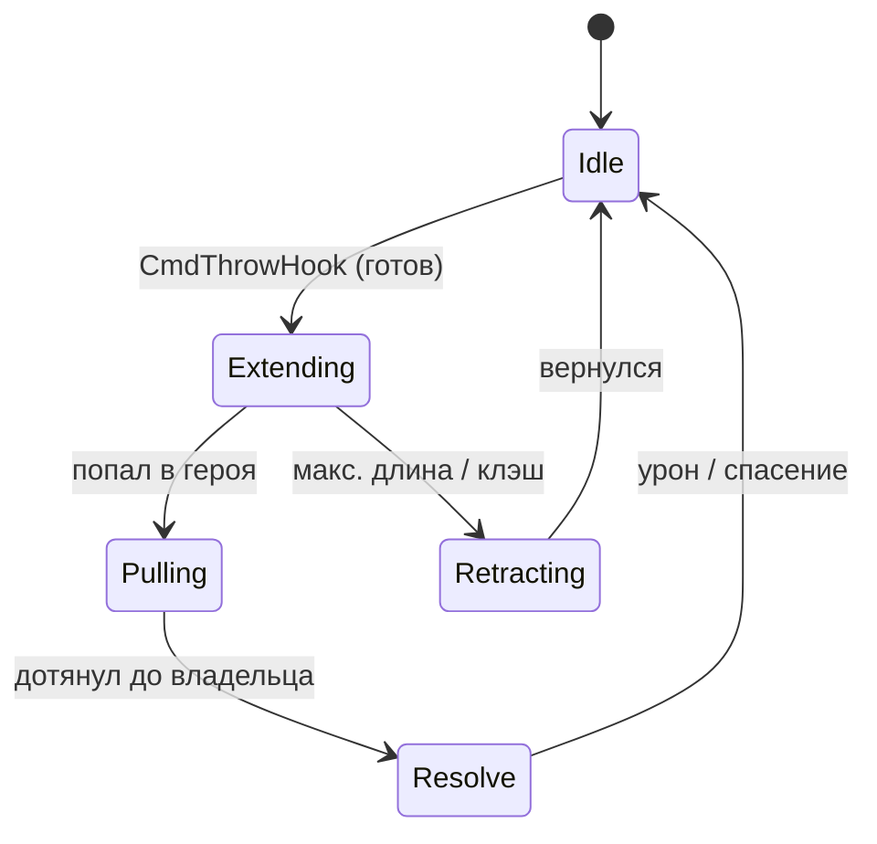
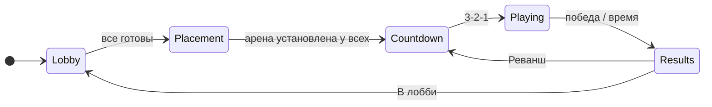
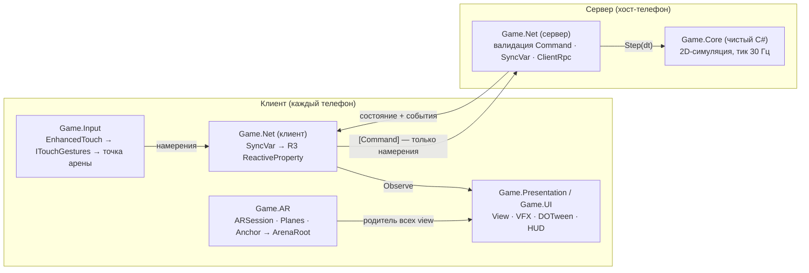

# Pudge Wars AR — технический дизайн-документ

Мультиплеерная дуэль на крюках в дополненной реальности. Обзор аналогов, требования, обоснование стека, архитектура, сетевой протокол.

- **Версия:** 1.4
- **Статус:** Утверждён к реализации (учебный проект)
- **Дата:** 24 октября 2026
- **Платформа:** Android (ARCore). iOS не поддерживается.
- **Движок и стек:** Unity 6.6 · URP · AR Foundation · Mirror · VContainer · R3 · UniTask · DOTween · Alchemy · Input System (EnhancedTouch)
- **Связанный документ:** «Pudge Wars AR — план реализации и чек-лист по этапам» (`pudge_wars_ar_checklist.md`)

## Содержание

- [1. Введение](#1-введение)
- [2. Обзор продукта](#2-обзор-продукта)
- [3. Обзор существующих решений](#3-обзор-существующих-решений)
- [4. Рамки проекта](#4-рамки-проекта)
- [5. Функциональные требования](#5-функциональные-требования)
- [6. Игровой дизайн](#6-игровой-дизайн)
- [7. Нефункциональные требования](#7-нефункциональные-требования)
- [8. Технологический стек](#8-технологический-стек)
- [9. Обоснование выбора технологий](#9-обоснование-выбора-технологий)
- [10. Архитектура](#10-архитектура)
- [11. Модули](#11-модули)
- [12. Сетевой протокол](#12-сетевой-протокол)
- [13. Данные и конфигурация](#13-данные-и-конфигурация)
- [14. UX в дополненной реальности](#14-ux-в-дополненной-реальности)
- [15. Тестирование](#15-тестирование)
- [16. Риски](#16-риски)
- [17. Этапы реализации](#17-этапы-реализации)

## 1. Введение

### 1.1 Назначение документа

Документ фиксирует требования к игре Pudge Wars AR и технические решения, на которых строится реализация: анализ аналогов, обоснование выбора технологий, архитектуру, состав модулей, сетевой протокол и модели данных. Порядок работ и пошаговые действия вынесены в отдельный документ «План реализации и чек-лист по этапам».

Требования имеют идентификаторы (FR-…, NFR-…) и приоритет по MoSCoW: **M** — обязательно для MVP, **S** — желательно, **C** — при наличии времени. Колонка «Этап» ссылается на этапы плана реализации.

### 1.2 Цели проекта

- Сделать играбельный матч Pudge Wars для 2–6 игроков у одного стола в AR по локальной сети.
- Отработать на практике чистую архитектуру Unity-проекта: DI, реактивные биндинги, асинхронные сценарии, разделение симуляции и представления.
- Получить опыт серверно-авторитарного мультиплеера и AR-разработки под мобильные устройства.

### 1.3 Термины и сокращения

| Термин | Определение |
|---|---|
| Арена | Игровое поле 24×14 игровых единиц, разделённое рекой на две половины. |
| ArenaRoot | Корневой Transform арены в сцене. Все игровые объекты — его дочерние. В AR его позицию и масштаб задаёт игрок. |
| Игровая единица (ед.) | Единица длины симуляции. Не равна метру; соответствие задаётся масштабом ArenaRoot. |
| Координаты арены | 2D-координаты (x, y) в плоскости арены: x — локальная ось X, y — локальная ось Z ArenaRoot. |
| Хост | Устройство, на котором одновременно работают сервер и клиент Mirror. |
| Тик | Один шаг серверной симуляции фиксированной длительности (1/30 с). |
| Намерение | Действие, которое клиент просит выполнить сервер (переместиться, бросить хук, купить улучшение). |
| Хук | Крюк: снаряд, который летит по прямой и притягивает героя, в которого попал. |
| Клэш | Столкновение двух летящих хуков; оба возвращаются. |
| Плоский режим | Режим без AR: арена в начале координат, обычная камера сверху. Для разработки и как запасной вариант. |
| MPPM | Multiplayer Play Mode — запуск нескольких игроков в одном редакторе Unity. |
| MVP | Минимальная играбельная версия: всё с приоритетом M. |

### 1.4 История изменений

| Версия | Дата | Изменения |
|---|---|---|
| 1.0 | 10.10.2026 | Первая версия. Ввод на EnhancedTouch (LeanTouch отклонён, раздел 7.2). |
| 1.1 | 11.10.2026 | Убрана поддержка iOS: единственная платформа — Android (ARCore). Корень игровых файлов — `Assets/Game/` вместо `Assets/_Project/` (раздел 8.3). В стек добавлены ObservableCollections, Eflatun.SceneReference, Unity Pipeline (раздел 7.1). |
| 1.2 | 11.10.2026 | Папки тестов — `Edit Mode/` и `Play Mode/` (с пробелом, как создаёт Unity; раздел 8.3). Game.Core оставлена с Override References = выкл.: предкомпилированные DLL (R3, ObservableCollections, DOTween) ей видны, запрет на них держится договорённостью и ревью (раздел 8.2, NFR-09). Game.Core ссылается на Alchemy — для атрибутов инспектора на ScriptableObject-конфигах (разделы 7.1, 8.2). |
| 1.3 | 16.10.2026 | Добавлены обзор существующих решений (раздел 3) и обоснование выбора технологий (раздел 9); разделы перенумерованы. Убраны трудно проверяемые нефункциональные требования (FPS на «среднем» устройстве, нагрев, «управляемость» при плохой сети, точность совмещения в сантиметрах), оставшиеся NFR перенумерованы. Убраны критерии приёмки MVP. Примеры кода и приложения А–Г заменены описанием решений в разделах 10–12. |
| 1.4 | 24.10.2026 | Ввод: добавлен интерфейс `ILocalHero` (позиция своего героя для InputRouter), уточнены члены `IArenaSpace`, InputRouter публикует состояние прицела для AimLineView, второй палец отменяет свайп (раздел 11.3). DragThreshold задаётся в dp (раздел 13). Game.Tests ссылается и на Game.Input — для тестов InputRouter (раздел 10.2). |

## 2. Обзор продукта

### 2.1 Концепция

Две команды героев-мясников стоят на противоположных берегах реки, которую нельзя пересечь. Единственный способ взаимодействия — бросок крюка. Попадание во врага притягивает его и наносит урон; попадание в союзника спасает его. За убийства начисляется золото, которое тратится на улучшения крюка.

Арена размещается на реальном столе с помощью AR. Игроки стоят вокруг стола и управляют своими героями касаниями экрана телефона.

### 2.2 Сценарий использования

1. Хост создаёт игру в меню. Остальные игроки в той же Wi-Fi-сети видят её в списке и подключаются.
2. В лобби игроки выбирают команду и нажимают «Готов».
3. Каждый игрок сканирует стол и ставит арену (или все совмещают её по маркеру).
4. Отсчёт 3-2-1, матч длится до 15 убийств команды или 8 минут.
5. Экран результатов: «Реванш» или «В лобби».

### 2.3 Игровой цикл

Перемещение по своей половине → прицеливание и бросок крюка → притягивание и урон → убийство и золото → улучшение крюка → снова бросок.

### 2.4 Целевые устройства

| Платформа | Требование |
|---|---|
| Android | Устройство из списка поддерживаемых ARCore; минимальная версия Android — по XR Project Validation (не ниже API 24). Единственная целевая платформа. |
| Редактор | Плоский режим + MPPM для сетевой отладки; XR Simulation для потока установки арены. |

## 3. Обзор существующих решений

Проект стоит на пересечении трёх областей: игры с механикой крюка, мобильные арены с прицельными умениями и многопользовательский AR за одним столом. Ниже разобраны представители каждой области и технологии совместного AR, а в конце — выводы для проекта.

### 3.1 Оригинальная механика: Pudge Wars

**Pudge Wars** — пользовательская карта для Warcraft III, позже перенесённая в Dota 2 как пользовательская игра (Arcade). Две команды Pudge разделены рекой и сражаются только крюками; за убийства начисляется золото на улучшения и предметы.

| Достоинства | Недостатки |
|---|---|
| Простое правило «один бросок — один исход», понятное за минуту | Только ПК, нужен клиент игры-основы |
| Высокий потолок мастерства: упреждение, клэши, спасение союзников | Управление рассчитано на мышь и горячие клавиши |
| Короткий цикл «бросок → результат», интересно наблюдать | Игроки не находятся в одном физическом пространстве |
| Механика проверена годами существования сообщества | Использует чужую интеллектуальную собственность (персонажи, ассеты) |

**Что берём:** правила арены с рекой, машину состояний хука, клэш, экономику улучшений крюка. **Чего избегаем:** персонажей и ассетов Dota 2, сложной системы предметов в MVP.

### 3.2 Мобильные арены с прицельными умениями

**Brawl Stars** (Supercell) — командные бои 3×3 с короткими матчами и прицеливанием виртуальным стиком. **League of Legends: Wild Rift** (Riot Games) — мобильная MOBA, где есть прямые аналоги крюка (например, захват Блицкранка), а прицеливание сделано перетаскиванием от кнопки умения с линией траектории.

| Достоинства | Недостатки |
|---|---|
| Отработанные схемы сенсорного прицеливания: линия траектории, отмена броска возвратом пальца | Игра только через интернет, нужны серверы и матчмейкинг |
| Короткие матчи и быстрый вход — подходят для телефона | Камера и поле фиксированы, нет связи с реальным пространством |
| Помощь в прицеливании и щедрые хитбоксы компенсируют неточность пальца | Большой объём контента и монетизации, недостижимый для учебного проекта |

**Что берём:** свайп с линией прицела и отменой (FR-IN-02, FR-IN-03), помощь в прицеливании (FR-IN-05), увеличенный радиус хука. **Чего избегаем:** виртуальных стиков — в AR экран занят видом стола, а стик закрывает арену.

### 3.3 Настольные AR-игры

| Приложение | Суть | Достоинства | Недостатки |
|---|---|---|---|
| **The Machines** (Directive Games, 2017, iOS) | Стратегия в реальном времени на столе, мультиплеер | Показала, что соревновательная игра на столе в AR возможна; арена как «миниатюра» хорошо читается | Только iOS; быстро потеряла аудиторию — AR-режим воспринимался как демонстрация технологии |
| **Angry Birds AR: Isle of Pigs** (Rovio / Resolution Games, 2019) | Головоломка с разрушаемыми конструкциями на столе | Хорошо использует обход объекта с телефоном — разные ракурсы дают преимущество | Одиночная игра; длительное удержание телефона утомляет |
| **Minecraft Earth** (Mojang / Microsoft, 2019–2021) | Строительство на столе и совместная игра в AR | Совместное AR-пространство для нескольких игроков | Закрыта в 2021 году; зависимость от облачных сервисов и выхода на улицу |
| **Spaceteam** (2012, iOS / Android) | Кооперативная игра для компании в одной комнате по локальной сети | Доказывает ценность игры «лицом к лицу» с телефонами; подключение без аккаунтов | Нет AR и общего игрового поля |

**Выводы:** у настольных AR-игр три типичные проблемы — утомление от удержания телефона, зависимость от облака и ощущение «технодемо». Поэтому матч ограничен 8 минутами, игра не требует интернета и аккаунтов, а AR служит способом собрать игроков вокруг стола, а не самоцелью: та же игра доступна в плоском режиме.

### 3.4 Технологии совместного AR

Чтобы все игроки видели арену в одном месте стола, нужно согласовать системы координат устройств.

| Подход | Принцип | Достоинства | Недостатки |
|---|---|---|---|
| **Независимая установка** (каждый ставит арену сам) | Синхронизируются только координаты арены | Не требует ничего, кроме локальной сети; устойчиво к ошибкам трекинга | Арены на телефонах не совпадают физически |
| **Маркер** (распознавание изображения) | Арена ставится по позе напечатанной картинки | Работает офлайн, точность достаточная для стола, есть в AR Foundation | Нужен распечатанный маркер; качество зависит от освещения |
| **ARCore Cloud Anchors** | Якорь сохраняется в облаке Google и находится другими устройствами | Без маркера, кроссплатформенно | Нужен интернет, проект Google Cloud и ключ API; задержка резолва |
| **ARKit Collaborative Session** | Устройства обмениваются картами окружения | Точное общее пространство без облака | Только iOS |
| **Niantic Lightship (Shared AR)** | Готовый сервис совместных сессий поверх AR Foundation | Комнаты, синхронизация, совместное позиционирование «из коробки» | Внешний сервис с регистрацией и лицензионными условиями; привязка к поставщику |

**Решение:** в MVP — независимая установка (раздел 10.1), затем маркер (этап 5), Cloud Anchors — по желанию (этап 7). Архитектура «AR — проектор» делает совмещение улучшением, а не условием работы игры.

### 3.5 Итог: место проекта среди аналогов

| Критерий | Pudge Wars (ПК) | Мобильные арены | Настольные AR-игры | **Pudge Wars AR** |
|---|---|---|---|---|
| Игроки в одном физическом месте | Нет | Нет | Частично | **Да** |
| Работа без интернета | Нет | Нет | Редко | **Да (LAN)** |
| Механика крюка | Да | Частично | Нет | **Да** |
| Управление под касания | Нет | Да | Да | **Да** |
| Порог входа (аккаунты, установка) | Высокий | Средний | Средний | **Низкий** |

Ниша проекта — короткая соревновательная игра для компании за одним столом: проверенная механика Pudge Wars, адаптированное под палец управление и AR как способ общего физического присутствия.

## 4. Рамки проекта

| Входит в MVP | Следующие версии | Вне рамок проекта |
|---|---|---|
| Матч 1×1 и 2×2 по Wi-Fi<br>Хук, движение, HP, смерть, респавн<br>Счёт и условия победы<br>4 улучшения крюка<br>Лобби с поиском игр в сети<br>AR-установка арены каждым игроком<br>Плоский режим | Матчи 3×3<br>Совмещение арены по маркеру<br>Препятствия на арене<br>Предметы (Blink, Shield)<br>Headshot<br>Компенсация лагов<br>Cloud Anchors | Игра через интернет, матчмейкинг<br>Миграция хоста<br>Античит<br>Аккаунты, прогрессия, монетизация<br>Персонажи и ассеты Dota 2 (чужая IP) |

> **Обоснование.** Игра по интернету исключена сознательно. Она требует relay-сервера, обхода NAT, предсказания и компенсации лагов. Для AR-игры у одного стола локальной сети достаточно. Архитектура не закрывает путь к онлайну: симуляция не зависит от сетевой библиотеки.

## 5. Функциональные требования

### 5.1 AR и размещение арены

| ID | Требование | Пр. | Этап |
|---|---|---|---|
| FR-AR-01 | При запуске игра проверяет поддержку AR (`ARSession.CheckAvailability`). Если AR недоступен — предлагает плоский режим. | M | 4 |
| FR-AR-02 | Экран сканирования показывает подсказку и ждёт обнаружения горизонтальной плоскости. | M | 4 |
| FR-AR-03 | Полупрозрачный контур арены следует за точкой пересечения луча из центра экрана с плоскостью. | M | 4 |
| FR-AR-04 | Тап фиксирует позицию арены; к ArenaRoot добавляется ARAnchor. | M | 4 |
| FR-AR-05 | До подтверждения игрок может менять масштаб (pinch) в диапазоне 1 ед. = 2…8 см и поворачивать арену (twist). | M | 4 |
| FR-AR-06 | После подтверждения визуализация плоскостей скрывается, ARPlaneManager выключается. | M | 4 |
| FR-AR-07 | До установки арены игровые объекты скрыты (ArenaRoot неактивен визуально). | M | 4 |
| FR-AR-08 | При потере трекинга экран затемняется и показывается подсказка; матч на сервере продолжается. | M | 4 |
| FR-AR-09 | Режим совмещения по маркеру: ArenaRoot ставится по позе распознанного изображения. | S | 5 |
| FR-AR-10 | Кнопка «Перевыровнять» повторно привязывает арену к маркеру во время матча. | S | 5 |
| FR-AR-11 | Совмещение через Cloud Anchors. | C | 7 |

### 5.2 Сеть и лобби

| ID | Требование | Пр. | Этап |
|---|---|---|---|
| FR-NET-01 | Игрок может создать игру (режим хоста). | M | 2 |
| FR-NET-02 | Список игр в локальной сети обновляется автоматически (NetworkDiscovery). | M | 2 |
| FR-NET-03 | Подключение по ручному вводу IP-адреса. | M | 2 |
| FR-NET-04 | При подключении сверяется версия протокола; при несовпадении клиент получает понятную ошибку. | M | 2 |
| FR-NET-05 | В лобби отображаются игроки, их команды и готовность. Игрок выбирает команду и отмечает «Готов». | M | 3 |
| FR-NET-06 | Хост запускает матч, когда все готовы и в каждой команде есть хотя бы один игрок. | M | 3 |
| FR-NET-07 | При отключении хоста клиенты видят экран «Хост отключился» и возвращаются в меню. | M | 2 |
| FR-NET-08 | При отключении клиента его герой удаляется, матч продолжается; если команда опустела — победа другой команды. | M | 3 |
| FR-NET-09 | Максимум 6 игроков (3×3); MVP проверяется на 2×2. | S | 3 |

### 5.3 Геймплей

| ID | Требование | Пр. | Этап |
|---|---|---|---|
| FR-GP-01 | Герой движется к указанной точке со скоростью из HeroConfig; точка ограничивается половиной арены его команды. | M | 1 |
| FR-GP-02 | Бросок хука в указанном направлении при готовности (перезарядка истекла, герой жив и не притягивается). | M | 1 |
| FR-GP-03 | Хук летит по прямой со скоростью Speed до дальности Range; коллизии проверяются по всему пути за тик (swept). | M | 1 |
| FR-GP-04 | Попадание во врага: урон Damage, цель прикрепляется к кончику хука и притягивается к владельцу. | M | 1 |
| FR-GP-05 | Попадание в союзника: притягивание без урона. | M | 1 |
| FR-GP-06 | Притягиваемый герой не может двигаться и бросать хук. | M | 1 |
| FR-GP-07 | Клэш: если кончики двух летящих хуков сближаются меньше суммы радиусов, оба переходят в возврат. | M | 1 |
| FR-GP-08 | Хук возвращается к текущей позиции владельца (владелец может двигаться, пока хук в полёте). | M | 1 |
| FR-GP-09 | При HP ≤ 0 герой погибает, через RespawnTime возрождается в точке своей команды с полным HP. | M | 3 |
| FR-GP-10 | Убийца получает KillGold, участники помощи (урон по жертве за последние 10 с) — AssistGold. | M | 3 |
| FR-GP-11 | Улучшения: дальность, скорость, радиус, урон — по 4 уровня, цены из EconomyConfig. Покупка возможна в любой момент матча. | M | 3 |
| FR-GP-12 | Победа: команда набрала KillsToWin убийств или по истечении MatchDuration — команда с большим счётом (ничья допустима). | M | 3 |
| FR-GP-13 | Headshot: попадание в героя, которого уже тянет другой хук, — мгновенное убийство. | C | 7 |
| FR-GP-14 | Препятствия (колонны), от которых хук возвращается. | C | 7 |

### 5.4 Управление

| ID | Требование | Пр. | Этап |
|---|---|---|---|
| FR-IN-01 | Тап по арене — движение героя в точку. | M | 1 |
| FR-IN-02 | Свайп, начатый рядом со своим героем (радиус захвата ~1.5 ед.), показывает линию прицела длиной Range; отпускание — бросок. | M | 1 |
| FR-IN-03 | Возврат пальца к герою во время прицеливания отменяет бросок. | S | 1 |
| FR-IN-04 | Альтернативная схема: кнопка «Хук» + тап по точке. Переключается в настройках. | S | 6 |
| FR-IN-05 | Помощь в прицеливании: направление подтягивается к ближайшему врагу в конусе ±4°. Отключается в настройках. | S | 6 |
| FR-IN-06 | Касания, начатые над UI, не передаются в игровой ввод. | M | 1 |
| FR-IN-07 | В редакторе мышь эмулирует касание (TouchSimulation). | M | 0 |

### 5.5 Интерфейс

| ID | Требование | Пр. | Этап |
|---|---|---|---|
| FR-UI-01 | Главное меню: «Создать игру», «Найти игру», «Подключиться по IP», «Настройки», переключатель AR / плоский режим. | M | 2 |
| FR-UI-02 | Экран лобби (FR-NET-05). | M | 3 |
| FR-UI-03 | Подсказки установки арены: сканирование, наведение, подтверждение. | M | 4 |
| FR-UI-04 | HUD: HP, индикатор перезарядки хука, золото, счёт команд, таймер матча. | M | 3 |
| FR-UI-05 | Магазин улучшений с текущими уровнями и ценами; недоступные позиции неактивны. | M | 3 |
| FR-UI-06 | Лента убийств. | S | 3 |
| FR-UI-07 | Экран результатов: победитель, статистика игроков (убийства, смерти, попадания хуком), кнопки «Реванш» и «В лобби». | M | 3 |
| FR-UI-08 | Индикатор своего героя за краем экрана; кольцо цвета команды под ногами. | S | 6 |
| FR-UI-09 | HP-бары над героями, повёрнутые к камере. | M | 3 |
| FR-UI-10 | Отладочный оверлей (только development-сборки): FPS, пинг, тик, фаза матча, состояние трекинга. | M | 0 |

## 6. Игровой дизайн

### 6.1 Арена

```text
          ←────────────────── 24 ед. ──────────────────→
        ┌──────────────────────┬──────┬──────────────────────┐  ↑
        │      Команда A       │      │      Команда B       │  │
        │          ●           │ Р    │           ●          │  │
        │          ● ─ ─ ─ ─ ─ │ Е ─ ─│─ ─ ─ ─ ─ ●   (хук)   │ 14 ед.
        │          ●           │ К    │           ●          │  │
        │                      │ А    │                      │  │
        └──────────────────────┴──────┴──────────────────────┘  ↓
                        река: 3.5 ед., |x| < 1.75
        ≈ 96 × 56 см на столе при масштабе 1 ед. = 4 см
```

- Размер 24×14 ед. Центр арены — начало координат арены; ось x направлена от команды A к команде B.
- Река: полоса шириной 3.5 ед. по центру (|x| < 1.75). Герои в неё не заходят, хуки над ней летят свободно.
- Половина команды A: x ∈ [−12 + r; −1.75 − r], команды B: x ∈ [1.75 + r; 12 − r], y ∈ [−7 + r; 7 − r], где r — радиус героя.
- Точки появления: по 3 на команду, x = ±8, y ∈ {−4, 0, 4}.

### 6.2 Машина состояний хука



| Фаза | Поведение | Выход |
|---|---|---|
| Idle | Хук у владельца, идёт перезарядка | CmdThrowHook при готовности → Extending |
| Extending | Длина растёт на Speed·dt; проверяются коллизии отрезка «прошлый кончик → новый» с героями и кончиками других хуков | Попадание → Pulling; клэш или Range → Retracting |
| Pulling | Кончик движется к текущей позиции владельца со скоростью Speed; цель жёстко привязана к кончику | Расстояние до владельца ≤ сумме радиусов → Resolve |
| Retracting | Пустой кончик возвращается к владельцу | Дошёл до владельца → Idle |
| Resolve | Мгновенная фаза: урон (враг) или ничего (союзник), снятие обездвиживания | → Idle |

Урон наносится в момент попадания (вход в Pulling), а не в Resolve: так ощущение удара совпадает с визуальным контактом. Если цель погибла от урона — фаза Pulling продолжается с телом для зрелищности, а затем Resolve без эффекта.

### 6.3 Баланс (стартовые значения)

| Параметр | Значение | Улучшение (за уровень, 4 ур.) |
|---|---|---|
| HP героя | 1000 | — |
| Скорость героя | 3.2 ед/с | — |
| Радиус героя | 0.5 ед | — |
| Дальность хука | 12 ед | +1.5 |
| Скорость хука | 20 ед/с | +4 |
| Радиус хука | 0.35 ед | +0.08 |
| Урон хука | 175 | +75 |
| Перезарядка хука | 3.0 с | — |
| Респавн | 4 с | — |
| Золото за убийство / помощь | 150 / 50 | — |
| Стартовое золото | 0 | — |
| Цена уровня улучшения | 100 / 200 / 300 / 400 | — |
| Победа | 15 убийств или 8 минут | — |

> **Примечание.** Значения — отправная точка, все хранятся в ScriptableObject-конфигах. Целиться пальцем в AR сложнее, чем мышью, поэтому радиус хука щедрее, чем в оригинальной карте. Баланс правится по результатам плейтестов на этапе 6.

### 6.4 Фазы матча



| Фаза | Сервер | Клиенты |
|---|---|---|
| Lobby | Принимает подключения, назначает слоты и команды | Выбор команды, «Готов» |
| Placement | Ждёт сообщения «арена установлена» от всех клиентов (таймаут 120 с — затем исключает не успевших) | Установка арены (FR-AR-*) |
| Countdown | Создаёт героев, задаёт CountdownEnd (NetworkTime) | Отсчёт 3-2-1 |
| Playing | Тик симуляции, валидация команд, MatchEnd (NetworkTime) | Ввод, отображение, HUD |
| Results | Фиксирует победителя и статистику | Экран результатов |

## 7. Нефункциональные требования

В документ включены только требования, которые проверяются однозначно: тестом, настройкой проекта или замером штатным инструментом.

| ID | Требование | Метрика / проверка |
|---|---|---|
| NFR-01 | Отсутствие аллокаций в кадре во время матча | ≈ 0 B GC Alloc в Profiler в фазе Playing |
| NFR-02 | Draw calls / треугольники в кадре | < 100 / < 150 тыс. (Frame Debugger, статистика рендера) |
| NFR-03 | Сетевой трафик | < 20 КБ/с на клиента в матче 3×3 (статистика Mirror) |
| NFR-04 | Детерминированность симуляции | Одинаковые входные данные дают одинаковое состояние (EditMode-тест) |
| NFR-05 | Покрытие ядра тестами | Все правила Game.Core из раздела 6 покрыты EditMode-тестами |
| NFR-06 | Границы модулей | Game.Core не ссылается на Mirror, AR Foundation, Input System; проверяется настройками asmdef. Предкомпилированные DLL (R3, ObservableCollections, DOTween) Core видит автоматически — их отсутствие проверяется ревью (раздел 10.2) |
| NFR-07 | Время от запуска до лобби | < 5 с на устройстве |
| NFR-08 | Язык интерфейса | Русский; строки вынесены в отдельный ресурс для будущей локализации |

## 8. Технологический стек

| Технология | Назначение | Правила использования |
|---|---|---|
| **Unity 6.6, URP** | Движок и рендер | AR Background Renderer Feature в мобильном URP-ассете. Настройки по XR Project Validation. |
| **AR Foundation** + ARCore | Плоскости, raycast, якоря, распознавание изображений | Только в Game.AR. XR Simulation для редактора. |
| **Mirror** (KCP-транспорт) | Мультиплеер: хост, синхронизация, RPC, NetworkDiscovery | Только в Game.Net. Сервер авторитарен. |
| **VContainer** | DI, композиция приложения | Иерархия LifetimeScope (раздел 10.4). Сетевые объекты создаются через IObjectResolver. |
| **R3** | Состояние → UI/View, шина событий, потоки ввода | Не используется внутри серверного тика. |
| **UniTask** | Асинхронные сценарии (загрузка, AR, подключение, отсчёт) | Всегда с CancellationToken. Не используется как игровой таймер. |
| **DOTween** | Косметические анимации, UI | Не двигает объекты, влияющие на геймплей. SetLink на каждый твин. |
| **Alchemy** | Атрибуты инспектора, отладочные кнопки | Сериализация Alchemy в сети не используется. В Game.Core — только атрибуты инспектора на ScriptableObject-конфигах; симуляция Alchemy не использует. |
| **Input System** (EnhancedTouch) | Касания и жесты | Доступ только через ITouchGestures (раздел 11.3). |
| **Unity.Mathematics** | 2D-математика симуляции | float2 и math.* в Game.Core. |
| **Unity Test Framework** | EditMode / PlayMode тесты | Game.Tests. |
| **Multiplayer Play Mode** | Несколько игроков в одном редакторе | Основной инструмент отладки этапов 2–3. |
| **ObservableCollections** (+ R3) | Реактивные коллекции для UI (списки лобби, лента убийств) | Ставится через NuGetForUnity вместе с ядром R3. Не используется в Game.Core. |
| **Eflatun.SceneReference** | Ссылки на сцены в инспекторе и конфигах | Используется SceneLoader'ом вместо строковых имён сцен. |
| **Unity Pipeline** (экспериментальный) | Управление редактором из CLI / агента: сборка, тесты, Play Mode | Только инструмент разработки, в коде игры не используется. |

## 9. Обоснование выбора технологий

Общие критерии выбора: работа на Android с ARCore; бесплатность и открытая лицензия; отсутствие обязательных облачных сервисов; совместимость с архитектурой «DI + реактивные биндинги + чистое ядро»; зрелость и наличие документации; минимум аллокаций в игровом цикле. Для каждой технологии ниже указаны задача, альтернативы и причина выбора.

### 9.1 Движок: Unity 6.6

**Задача:** кроссплатформенный игровой движок с поддержкой мобильного AR, сцен, анимаций, UI и сборки под Android.

| Альтернатива | Достоинства | Недостатки для проекта |
|---|---|---|
| Unreal Engine 5 | Мощный рендер, Blueprints, встроенная сетевая репликация | Тяжёлые мобильные сборки; AR-плагины развиваются медленнее; C++ и долгая итерация для одного разработчика |
| Godot 4 | Открытый, лёгкий, быстрый запуск | Поддержка ARCore — сторонние плагины без гарантии развития; меньше готовых сетевых и DI-библиотек |
| Нативная разработка (Kotlin + ARCore SDK) | Минимальный размер, прямой доступ к ARCore | Нет игрового движка: рендер, анимации, UI и сеть пришлось бы писать самому; Sceneform больше не развивается |

**Почему Unity:** официальная поддержка ARCore через AR Foundation, XR Simulation и Multiplayer Play Mode позволяют вести большую часть работы в редакторе без телефона; C# и экосистема открытых библиотек (Mirror, VContainer, R3, UniTask) дают нужную архитектуру без собственных фреймворков. Версия 6.x выбрана как актуальная линейка с поддержкой Android-инструментария и новых пакетов (MPPM, XR).

### 9.2 Рендер: Universal Render Pipeline

| Альтернатива | Недостатки для проекта |
|---|---|
| Built-in Render Pipeline | Развитие свёрнуто, новые возможности Unity (Render Graph, ряд AR-функций, Shader Graph-примеры) выходят для URP |
| High Definition RP | Не поддерживает мобильные устройства |

**Почему URP:** штатный конвейер для мобильных платформ, SRP Batcher снижает число draw calls (NFR-02), AR Background Renderer Feature выводит изображение камеры, Shader Graph позволяет сделать воду и материалы команд без ручных шейдеров.

### 9.3 AR: AR Foundation + ARCore

| Альтернатива | Достоинства | Недостатки для проекта |
|---|---|---|
| ARCore SDK for Unity | Прямой доступ к ARCore | Объявлен устаревшим в пользу AR Foundation + ARCore Extensions |
| Vuforia Engine | Сильное распознавание изображений и объектов | Коммерческое лицензирование, водяной знак в бесплатной версии, свой стек поверх ARCore |
| Niantic Lightship ARDK | Meshing, семантика, совместные сессии | Требует регистрации и ключа, условия использования сервиса; функции сверх нужного проекту |
| WebAR (браузерные решения) | Без установки приложения | Ограниченная производительность и трекинг; нет локальной сети между браузерами без сервера |

**Почему AR Foundation:** официальный пакет Unity, покрывает все нужные функции (плоскости, raycast, якоря, распознавание изображений), имеет XR Simulation для отладки в редакторе, а ARCore Extensions добавляют Cloud Anchors без смены API. Абстракция AR Foundation оставляет возможность вернуть iOS без переписывания Game.AR.

### 9.4 Сеть: Mirror с транспортом KCP

| Альтернатива | Достоинства | Недостатки для проекта |
|---|---|---|
| Netcode for GameObjects | Официальный, интеграция с Unity Relay и Lobby | Для LAN с хостом-телефоном выигрыша нет; поиск игр в локальной сети нужно делать самому. Имеет смысл при переходе к онлайну |
| FishNet | Встроенное предсказание на клиенте, высокая производительность | Главное преимущество нужно при пинге 80+ мс; в LAN достаточно интерполяции |
| Photon Fusion / PUN 2 | Облачная инфраструктура, матчмейкинг | Зависимость от облака даже для игры за одним столом; лимиты бесплатного тарифа; тяжёлая модель программирования (Fusion) |
| Свой протокол на Unity Transport / LiteNetLib | Полный контроль над трафиком | Синхронизацию, RPC, спавн объектов и поиск игр пришлось бы писать вручную |

**Почему Mirror:** открытая библиотека (MIT) с многолетней историей и большим сообществом; серверно-авторитарная модель с режимом хоста; встроенные NetworkDiscovery (UDP broadcast для FR-NET-02), NetworkAuthenticator (FR-NET-04), NetworkTransform с интерполяцией и LatencySimulation для проверки плохой сети. Spawn-хендлеры позволяют создавать сетевые объекты через DI (раздел 10.5).

**Транспорт KCP** выбран вместо Telepathy (TCP) — у TCP при потерях растёт задержка из-за повторной передачи всего потока — и вместо сторонних UDP-транспортов: KCP входит в Mirror по умолчанию, даёт надёжный и ненадёжный каналы поверх UDP и низкую задержку.

### 9.5 Внедрение зависимостей: VContainer

| Альтернатива | Недостатки для проекта |
|---|---|
| Zenject / Extenject | Медленнее при разрешении зависимостей, больше аллокаций, развитие практически остановилось |
| Reflex | Быстрый, но меньше сообщество и примеров интеграции |
| Ручная композиция / Service Locator | Скрытые зависимости, ручное управление временем жизни, сложнее тестировать |

**Почему VContainer:** высокая скорость разрешения и минимум аллокаций, иерархия LifetimeScope совпадает с иерархией сцен (Root → Menu → Match), точки входа (IStartable, ITickable, IDisposable) избавляют от лишних MonoBehaviour, есть официальная интеграция с UniTask, а метод `IObjectResolver.Instantiate` решает задачу внедрения в сетевые префабы.

### 9.6 Реактивность: R3 и ObservableCollections

| Альтернатива | Недостатки для проекта |
|---|---|
| UniRx | Предшественник R3 от того же автора, больше не развивается |
| События C# / UnityEvent | Нет операторов (фильтрация, объединение, троттлинг), ручная отписка, легко получить утечку подписок |
| Опрос состояния в Update | Лишняя работа каждый кадр, логика UI размазана по MonoBehaviour |

**Почему R3:** современная реализация реактивных расширений, переработанная с упором на производительность и интеграцию с Unity (FrameProvider, TimeProvider); ReactiveProperty естественно продолжает SyncVar-хуки Mirror (раздел 11.4), а Observable подходит для потоков жестов. **ObservableCollections** из той же экосистемы дают реактивные списки для лобби и ленты убийств без ручного сравнения коллекций; стандартный `ObservableCollection<T>` из .NET с R3 не интегрирован.

### 9.7 Асинхронность: UniTask

| Альтернатива | Недостатки для проекта |
|---|---|
| Корутины | Нет возвращаемого значения и нормальной обработки исключений, отмена только через остановку MonoBehaviour |
| System.Threading.Tasks.Task | Аллокации на каждый вызов, продолжения через контекст синхронизации, нет привязки к PlayerLoop |
| Awaitable (встроен в Unity) | Меньше комбинаторов (WhenAll, WhenAny, таймауты), меньше интеграций со сторонними библиотеками |

**Почему UniTask:** структурный тип без аллокаций, работает на PlayerLoop Unity, поддерживает CancellationToken во всех операциях, имеет интеграции с VContainer и DOTween. Подходит для линейных сценариев «сканировать → поставить арену → дождаться остальных → отсчёт».

### 9.8 Анимации: DOTween

| Альтернатива | Достоинства | Недостатки для проекта |
|---|---|---|
| PrimeTween | Создание твинов без аллокаций | Моложе, меньше примеров и интеграций |
| LeanTween | Простой API | Практически не развивается |
| Animator / Timeline | Визуальная настройка | Избыточны для коротких процедурных эффектов UI и всплывающих цифр |

**Почему DOTween:** зрелая библиотека с последовательностями, широким набором easing-функций и `SetLink`, привязывающим твин к времени жизни объекта. Используется только для косметики, поэтому на геймплей не влияет. Чтобы соблюсти NFR-01, включается переиспользование твинов; если профайлер покажет аллокации в фазе Playing, замена на PrimeTween затронет только Presentation и UI.

### 9.9 Инспектор: Alchemy

| Альтернатива | Недостатки для проекта |
|---|---|
| Odin Inspector | Платная лицензия |
| NaughtyAttributes | Построен на IMGUI, развивается медленно |
| Собственные редакторы (CustomEditor) | Много шаблонного кода на каждый конфиг |

**Почему Alchemy:** бесплатная библиотека атрибутов (MIT) на UI Toolkit: группировка, кнопки отладки, условное отображение полей конфигов без написания редакторов. Атрибуты не меняют рантайм-поведение, поэтому их использование в ScriptableObject-конфигах Game.Core не нарушает чистоту симуляции.

### 9.10 Ввод: Input System (EnhancedTouch)

| Альтернатива | Недостатки для проекта |
|---|---|
| Старый Input Manager | Устаревший API, нет TouchSimulation и событийной модели |
| LeanTouch | Статические события и MonoBehaviour-компоненты плохо стыкуются с DI и R3; готовые компоненты для игрового ввода не нужны |
| Платные пакеты жестов | Лицензия; закрытые распознаватели, которые сложно настроить под AR |

**Почему EnhancedTouch:** штатный API Input System с опросом активных касаний и эмуляцией касаний мышью в редакторе (FR-IN-07). Собственный распознаватель жестов за интерфейсом ITouchGestures покрывает тап, свайп, pinch и twist, пороги задаются в InputConfig, а реализацию легко подменить в тестах.

### 9.11 Математика симуляции: Unity.Mathematics и собственная геометрия

| Альтернатива | Недостатки для проекта |
|---|---|
| Vector2 / Mathf | Привязаны к UnityEngine, неудобны в чистом ядре |
| System.Numerics | Хуже интеграция с остальным API Unity |
| Unity Physics / Physics2D для коллизий хука | Чувствительны к масштабу арены в AR, привязаны к Transform и FixedUpdate, избыточны для проверки «круг против отрезка» |

**Почему Unity.Mathematics:** типы float2 и функции math.* с HLSL-подобным синтаксисом, независимые от сцены; совместимость с Burst на случай оптимизации. Коллизии реализуются собственной 2D-геометрией (Geo2D): несколько функций, полностью покрытых тестами и работающих в координатах арены. Симуляция выполняется только на сервере, поэтому побитовая детерминированность между устройствами не требуется — достаточно воспроизводимости на одном устройстве (NFR-04).

### 9.12 Инструменты разработки и тестирования

| Инструмент | Альтернативы | Почему выбран |
|---|---|---|
| **Unity Test Framework** | Внешний NUnit-проект вне Unity; ручное тестирование | Штатный, запускает EditMode-тесты ядра и PlayMode-тесты из редактора и командной строки |
| **Multiplayer Play Mode** | ParrelSync (клоны проекта); несколько отдельных сборок | Официальный пакет: до четырёх игроков в одном редакторе без копирования проекта, быстрые итерации по сети |
| **XR Simulation** | Отладка только на устройстве | Поток установки арены проверяется в редакторе на виртуальных окружениях |
| **Eflatun.SceneReference** | Строковые имена сцен; индексы Build Settings; Addressables | Ссылка на сцену проверяется в инспекторе и не ломается при переименовании; Addressables избыточны для трёх сцен |
| **NuGetForUnity** | Ручное копирование DLL | Нужен для установки ядра R3 и ObservableCollections из NuGet с учётом зависимостей |
| **Unity Pipeline** | Запуск Unity в batchmode со скриптами; сторонние серверы управления редактором | Позволяет запускать сборку, тесты и Play Mode из командной строки и агентов разработки; экспериментальный статус допустим, так как в игру не входит |

### 9.13 Платформа: только Android

Поддержка iOS исключена: для неё нужны устройства Apple, Mac для сборки и платная учётная запись разработчика. ARKit Collaborative Session — единственное существенное преимущество iOS для проекта — не работает между платформами. AR Foundation сохраняет возможность добавить iOS позже без изменения архитектуры.

## 10. Архитектура

### 10.1 Ключевой принцип: AR — проектор

У каждого телефона своя мировая система координат AR, заданная положением телефона в момент старта сессии. Мировые координаты разных устройств несравнимы. Поэтому:

- Симуляция ведётся в координатах арены (2D, игровые единицы) и ничего не знает об AR.
- Каждый клиент сам размещает ArenaRoot; все игровые объекты — его дочерние.
- По сети передаются только координаты арены.
- Высота не моделируется: всё, что выше плоскости арены, — визуал.
- Масштаб — свойство ArenaRoot.localScale на конкретном устройстве, на симуляцию не влияет.



> По сети передаются только координаты арены в игровых единицах. Мировые координаты AR в сеть не попадают.

Следствия: игра работает без совмещения пространств между телефонами (совмещение — улучшение, а не условие); плоский режим реализуется подменой одного сервиса; ядро тестируется без сцены.

### 10.2 Сборки и правила зависимостей

| Сборка | Содержимое | Может ссылаться на |
|---|---|---|
| **Game.Core** | MatchSimulation, HookSimulation, HeroMovement, Combat, Economy, MatchRules, Geo2D, структуры состояний, данные конфигов, ScriptableObject-конфиги | Unity.Mathematics, Alchemy (только атрибуты инспектора на ScriptableObject-конфигах), UnityEngine (только для ScriptableObject). Без MonoBehaviour-логики, Transform, Physics |
| **Game.Net** | PudgeNetworkManager, NetworkBehaviour-адаптеры, сообщения, VersionAuthenticator, NetworkPrefabFactory, ServerTickRunner | Core, Mirror, R3, VContainer, UniTask |
| **Game.AR** | IArenaAnchorProvider и реализации, ArenaPlacementFlow, MarkerAlignment, TrackingMonitor | AR Foundation, UniTask, VContainer, R3, Game.Input |
| **Game.Input** | ITouchGestures, EnhancedTouchGestures, IArenaSpace, InputRouter, AimAssist | Input System, Core, R3, VContainer |
| **Game.Presentation** | HeroView, HookView, VFX, FlatCamera, индикаторы | Core, Net, R3, DOTween |
| **Game.UI** | Экраны и презентеры | Core, Net, R3, DOTween, UniTask |
| **Game.App** | LifetimeScope'ы, точки входа, SceneLoader | Все сборки |
| **Game.Tests** | EditMode / PlayMode тесты | Core, Net, Input |

У Game.Core включены только ссылки на сборки (asmdef), Override References выключен. Поэтому ей автоматически доступны предкомпилированные DLL проекта — R3 и ObservableCollections из NuGet, DOTween. Компилятор их не запрещает; `using R3`, `using ObservableCollections`, `using DG.Tweening` в Core недопустимы и отсекаются на ревью. Mirror, AR Foundation и Input System подключены через asmdef и в Core недоступны физически.

Game.Input не ссылается на Game.Net: InputRouter публикует намерения в интерфейс `IPlayerCommands`, объявленный в Core, а реализацию (отправку Command) регистрирует Game.Net.

### 10.3 Структура папок

Все файлы игры лежат в `Assets/Game/`. Вне её — только сторонние пакеты и служебные папки, которые создают Unity и плагины (Mirror, Plugins, Packages, XR, Settings, Resources и т. п.).

```text
Assets/Game/
  Scripts/
    Core/          Hook/ Hero/ Combat/ Economy/ Match/ Geometry/ Config/ Commands/
    Net/           Adapters/ Messages/ Spawning/ Auth/ PudgeNetworkManager.cs
    AR/            Session/ Placement/ Alignment/
    Input/         Gestures/ Routing/
    Presentation/  Views/ Vfx/ FlatCamera/ Indicators/
    UI/            Menu/ Lobby/ Hud/ Shop/ Results/
    App/           Scopes/ EntryPoints/ Scenes/
  Configs/         HookConfig, HeroConfig, EconomyConfig, ArenaConfig, MatchConfig, InputConfig
    Input/         InputSystem_Actions
    Rendering/     URP-ассеты (Mobile/PC), Volume-профили
  Prefabs/         Network/ Arena/ Vfx/ UI/
  Art/             Models/ Materials/ Textures/ Audio/
  Scenes/          Boot.unity  Menu.unity  Match.unity
  Tests/           Edit Mode/ Play Mode/
```

### 10.4 Композиция (VContainer)

| Scope | Сцена / время жизни | Регистрации |
|---|---|---|
| RootLifetimeScope | Boot, всё время работы приложения | Конфиги, SceneLoader, Settings, ILogger, PudgeNetworkManager (компонент), NetworkPrefabList |
| MenuLifetimeScope | Menu | Презентеры меню, DiscoveryService, ConnectService |
| MatchLifetimeScope | Match, один сетевой сеанс | IArenaAnchorProvider (AR или Flat), ArenaPlacementFlow, IArenaSpace, ITouchGestures, InputRouter, NetworkPrefabFactory, MatchSimulation, ServerTickRunner, MatchEventBus, HUD-презентеры |

Сцены: **Boot** (точка входа, загружает Menu), **Menu** — offline-сцена Mirror, **Match** — online-сцена Mirror. Фазы Lobby → Results происходят внутри сцены Match, без смены сцен.

### 10.5 Создание сетевых объектов через DI

Mirror создаёт объекты на клиентах сам. Чтобы они получали зависимости, все сетевые префабы регистрируются с собственными spawn-хендлерами, которые создают объект через `IObjectResolver` внутри ArenaRoot. Сервер создаёт объекты тем же путём, затем вызывает `NetworkServer.Spawn`.

Эту работу выполняет **NetworkPrefabFactory** — точка входа VContainer в MatchLifetimeScope:

- При старте для каждого префаба из NetworkPrefabList регистрирует в `NetworkClient` пару хендлеров «создать / удалить».
- Хендлер создания на клиенте инстанцирует префаб через `IObjectResolver` дочерним объектом ArenaRoot и выставляет локальные позицию и поворот из сообщения о спавне.
- Серверный метод создания инстанцирует префаб тем же способом и передаёт объект в `NetworkServer.Spawn` (с владельцем-соединением для героев игроков).
- Хендлер удаления уничтожает объект; при завершении скоупа фабрика снимает регистрацию всех префабов.

Правила для сетевых объектов:

- Зависимости в NetworkBehaviour — через `[Inject] void Construct(...)`.
- Подписки на SyncVar и инициализация из сетевого состояния — в `OnStartClient`, а не в Construct.
- Игроки создаются вручную в `OnServerAddPlayer` (autoCreatePlayer выключен).

## 11. Модули

### 11.1 Game.Core — симуляция

| Тип | Ответственность |
|---|---|
| `MatchSimulation` | Владеет массивами HeroState и HookState, очередью намерений и буфером событий. Метод `Step(float dt)`. |
| `HeroMovement` | Движение к цели, ограничение половиной команды. |
| `HookSimulation` | Машина состояний хука, коллизии с героями, клэш. |
| `Combat` | Урон, смерть, история урона для помощи. |
| `Economy` | Начисление золота, проверка и применение покупок. |
| `MatchRules` | Счёт, условия победы, респавн. |
| `Geo2D` | SweptCircle, клампинг к прямоугольнику, отрезок–круг. |

Порядок шага симуляции:

1. Применить намерения из очереди (с валидацией).
2. Движение героев (кроме притягиваемых и мёртвых).
3. Шаг хуков: Extending → коллизии → клэши; Pulling / Retracting.
4. Разрешение попаданий: урон, смерти, золото.
5. Таймеры: перезарядки, респавн, окончание матча.
6. Сформировать события тика (HookThrown, HookHit, HookClash, HeroDied, HeroRespawned, GoldChanged, MatchEnded).

**Коллизии хука (фаза Extending).** За тик кончик хука проходит отрезок от прошлого положения до нового (длина увеличивается на Speed·dt, но не больше Range). Этот отрезок, «утолщённый» на радиус хука, проверяется против кругов всех живых героев, кроме владельца (функция `Geo2D.SweptCircle`): находится ближайшая к центру героя точка отрезка и её доля пути t; попадание — если расстояние от центра до этой точки не больше суммы радиусов. Из всех попаданий выбирается герой с минимальным t — тот, кого хук коснулся первым. Есть попадание — фаза Pulling с этим героем; нет, но достигнута дальность — Retracting. Проверка по всему отрезку исключает «пролёт сквозь» героя при большой скорости хука и низкой частоте тика.

### 11.2 Game.AR

| Интерфейс | Член | Назначение |
|---|---|---|
| `IArenaAnchorProvider` (AR или плоский режим) | `AcquireArenaPoseAsync` | Асинхронный поток установки арены с поддержкой отмены; возвращает позу ArenaRoot |
| | `IsTracking` | Реактивный признак наличия трекинга (для FR-AR-08) |
| `IArenaSpace` | `Root` | Transform ArenaRoot |
| | `TryScreenToArena` | Перевод экранной точки в координаты арены (раздел 11.3) |
| | `ArenaToWorld` | Перевод координат арены в мировые для отображения |

- **ARArenaAnchorProvider** — сканирование, превью, тап, pinch/twist, ARAnchor.
- **FlatArenaAnchorProvider** — ArenaRoot в начале координат, камера сверху под 55–60°.
- **MarkerAlignment** (этап 5) — поза ArenaRoot по ARTrackedImage.
- Выбор реализации — в MatchLifetimeScope по настройке пользователя; в редакторе по умолчанию плоский режим.

### 11.3 Game.Input

| Интерфейс | Член | Назначение |
|---|---|---|
| `ITouchGestures` | `Tap` | Поток тапов (экранная точка) |
| | `Drag` | Поток перетаскиваний с фазами Began / Moved / Ended / Cancelled |
| | `PinchTwist` | Поток изменений масштаба и угла двумя пальцами |
| `IPlayerCommands` (объявлен в Core, реализован в Net) | `MoveTo` | Движение в точку арены |
| | `ThrowHook` | Бросок хука в направлении |
| | `BuyUpgrade` | Покупка улучшения |
| `ILocalHero` (объявлен в Core, реализован в Net; на этапе 1 — офлайн-драйвером) | `TryGetPosition` | Позиция своего героя в координатах арены; `false`, если героя нет или он мёртв |
| `IArenaSpace` | `TryScreenToArena` | Экранная точка → точка арены; `false`, если луч не пересекает плоскость арены |
| | `ArenaToWorld` | Точка арены → мировая позиция на плоскости ArenaRoot (для view) |

- **EnhancedTouchGestures** (ITickable) читает `Touch.activeTouches`, распознаёт жесты по порогам из InputConfig (сдвиг для свайпа, максимальное время тапа), отбрасывает касания, начатые над UI. Тап и свайп распознаются по первому пальцу; второй палец отменяет свайп и включает PinchTwist.
- **InputRouter** превращает жесты в намерения: тап → MoveTo; свайп от героя → прицел → ThrowHook. Позиция героя берётся из `ILocalHero` при каждом событии жеста. Состояние прицела (активен, направление, палец в зоне отмены) публикуется как `ReadOnlyReactiveProperty<AimState>` — его отображает AimLineView.
- Экранная точка переводится в арену лучом на математическую плоскость ArenaRoot (`Plane.Raycast`), а не AR-raycast'ом: одинаково работает в AR и плоском режиме. Луч из камеры через экранную точку пересекается с плоскостью, проходящей через ArenaRoot перпендикулярно его оси Y; точка пересечения переводится в локальное пространство ArenaRoot (это учитывает масштаб и поворот арены), и её локальные X и Z дают координаты арены. Если луч параллелен плоскости или направлен от неё — точка не определяется.

### 11.4 Game.Net

| Компонент | Ответственность |
|---|---|
| `PudgeNetworkManager` | Наследник NetworkManager: создание игроков, обработка отключений, переход сцен. |
| `VersionAuthenticator` | NetworkAuthenticator: сверка версии протокола при подключении (FR-NET-04). |
| `MatchStateNet` | Фаза матча, счёт, таймеры, лобби-слоты. |
| `HeroNet` | Команды игрока, HP/золото/улучшения, HookNetState, ClientRpc событий хука. |
| `ServerTickRunner` | Фиксированный шаг симуляции; после шага переносит состояние в сетевые компоненты. |
| `NetworkPrefabFactory` | Создание сетевых объектов через DI (раздел 10.5). |

**Тик сервера.** ServerTickRunner — ITickable, работающий только при активном сервере. Время кадра накапливается в аккумуляторе, и пока в нём есть шаг 1/30 с, вызывается `MatchSimulation.Step`. Аккумулятор ограничен четырьмя шагами за кадр — защита от «спирали смерти», когда долгий кадр порождает всё больше шагов. После шагов состояние симуляции переносится в сетевые компоненты через интерфейс IMatchStateSink.

**Мост SyncVar → R3.** Каждое синхронизируемое значение (HP, золото, уровни) хранится в SyncVar и дублируется в ReactiveProperty, наружу отдаётся только ReadOnlyReactiveProperty. На сервере сеттер пишет значение в оба места сразу; на клиенте хук SyncVar обновляет ReactiveProperty; в `OnStartClient` ReactiveProperty инициализируется текущим значением SyncVar (для поздно подключившихся); при уничтожении объекта ReactiveProperty освобождается. Так UI и View подписываются на одно и то же свойство и на хосте, и на клиенте.

### 11.5 Presentation и UI

- **HeroView** читает позицию из Transform (синхронизирует NetworkTransform), анимации — по состоянию.
- **HookView** каждый кадр вычисляет положение кончика из HookNetState и NetworkTime; цепь — LineRenderer или звенья из пула.
- **MatchEventBus** (R3 Subject'ы) раздаёт события в VFX, звук, ленту убийств.
- Презентеры UI подписываются на ReadOnlyReactiveProperty сетевых адаптеров.

## 12. Сетевой протокол

### 12.1 Топология и время

- Хост-режим Mirror, транспорт KCP, порт по умолчанию 7777.
- Поиск игр — NetworkDiscovery (UDP broadcast). Запасной путь — ввод IP; рекомендуется раздача точки доступа с телефона хоста.
- Серверный тик 30 Гц (собственный аккумулятор, не FixedUpdate). sendRate NetworkManager = 30.
- Все моменты времени (броски, конец отсчёта, конец матча) передаются как значения `NetworkTime.time`.
- Хост вышел — сеанс завершён; миграции хоста нет.

### 12.2 Команды клиента

| Command | Параметры | Серверная валидация |
|---|---|---|
| CmdSelectTeam | Team team | Фаза Lobby; в команде есть место |
| CmdSetReady | bool ready | Фаза Lobby |
| CmdArenaPlaced | — | Фаза Placement |
| CmdMoveTo | Vector2 arenaPoint | Фаза Playing; герой жив и не притягивается; точка клампится к половине команды |
| CmdThrowHook | Vector2 direction, double clientTime | Фаза Playing; жив; не притягивается; хук в Idle; перезарядка истекла; direction нормализуется, нулевой — отклоняется |
| CmdBuyUpgrade | UpgradeId id | Фаза Playing; уровень < 4; хватает золота |
| CmdRequestRematch | — | Фаза Results; только хост |

Отклонённые команды логируются на сервере с причиной (development-сборки).

### 12.3 Синхронизируемое состояние

| Данные | Механизм | Примечание |
|---|---|---|
| Позиция и поворот героя | NetworkTransform (Unreliable), локальное пространство координат | Герой — дочерний ArenaRoot |
| HP, золото, уровни улучшений, K/D | SyncVar + hook → ReactiveProperty (R3) | На сервере значение пишется одновременно в SyncVar и ReactiveProperty |
| Состояние хука | SyncVar\<HookNetState> | Для поздно подключившихся и восстановления после потерь |
| Фаза матча, счёт, CountdownEnd, MatchEnd | SyncVar в MatchStateNet | Таймеры — моменты NetworkTime, а не убывающие числа |
| Лобби: слоты, команды, готовность | SyncList в MatchStateNet | — |
| События: попадание, клэш, смерть | ClientRpc | Для мгновенных VFX и звука |

### 12.4 Состояние хука

Состояние хука передаётся структурой **HookNetState**:

| Поле | Тип | Смысл |
|---|---|---|
| Phase | HookPhase (byte): Idle, Extending, Retracting, Pulling | Текущая фаза |
| Origin | Vector2 | Координаты арены в момент броска |
| Dir | Vector2 | Нормализованное направление |
| StartTime | double | NetworkTime броска |
| TurnTime | double | NetworkTime разворота (попадание / дальность / клэш) |
| TurnLength | float | Длина хука в момент разворота |
| TargetNetId | uint | Притягиваемый герой (0 — нет) |

Клиент вычисляет кончик хука в любой кадр: в фазе Extending — `Origin + Dir · min((now − StartTime) · Speed, Range)`; после разворота — движение от точки разворота к текущей позиции владельца. Поэтому хук не требует NetworkTransform и передаётся несколькими десятками байт за бросок.

### 12.5 Отзывчивость

- **Свой бросок** отображается сразу (косметическое предсказание): клиент запускает анимацию по своему направлению, затем сверяет её с HookNetState. Если сервер бросок отклонил — анимация отменяется.
- **Чужие герои** — интерполяция снимков NetworkTransform.
- **Своё движение** — серверное в MVP; локальное предсказание вводится, только если плейтесты покажут «вязкость».
- **Компенсация лагов** — вне MVP (FR приоритета C).

## 13. Данные и конфигурация

Все настраиваемые значения хранятся в ScriptableObject-ассетах (Game.Core/Config) и регистрируются в RootLifetimeScope как экземпляры. Симуляция получает неизменяемые структуры данных через `ToData()`, а не ссылки на ассеты.

| Конфиг | Поля |
|---|---|
| HookConfig | Range, Speed, Radius, Damage, Cooldown, приросты за уровень (RangePerLevel, SpeedPerLevel, RadiusPerLevel, DamagePerLevel), MaxLevel |
| HeroConfig | MaxHp, MoveSpeed, Radius, RespawnTime |
| EconomyConfig | KillGold, AssistGold, AssistWindow, StartGold, UpgradePrices[] |
| ArenaConfig | Size (24×14), RiverWidth, SpawnPoints[TeamA], SpawnPoints[TeamB], Obstacles[] (этап 7) |
| MatchConfig | TickRate, KillsToWin, MatchDuration, CountdownDuration, PlacementTimeout, MaxPlayers |
| InputConfig | TapMaxTime, DragThreshold (в dp: пиксели при 160 dpi, на устройстве умножаются на Screen.dpi / 160), HeroGrabRadius, AimAssistAngle, ArenaScaleMin/Max |
| NetworkPrefabList | Список сетевых префабов для регистрации spawn-хендлеров |

## 14. UX в дополненной реальности

- **Находимость своего героя:** кольцо цвета команды под ногами, стрелка на краю экрана, если герой вне кадра.
- **Читаемость с любой стороны стола:** контрастные модели без мелких деталей, HP-бары повёрнуты к камере.
- **Ощущение предметов на столе:** blob-тени под героями обязательны; реальные тени и окклюзия рук — вне MVP.
- **Ориентация экрана** фиксированная (портрет); поворот во время AR запрещён.
- **Потеря трекинга** не останавливает матч — игрок видит подсказку и продолжает после восстановления.
- **Обратная связь:** тряска камеры не применяется в AR (камера — это телефон), вместо неё — вспышка, вибрация устройства, звук.

## 15. Тестирование

### Уровни тестирования

| Уровень | Объект | Инструмент |
|---|---|---|
| Unit (EditMode) | Geo2D, HookSimulation, HeroMovement, Combat, Economy, MatchRules | Unity Test Framework |
| Сетевые (редактор) | Лобби, создание объектов, синхронизация хука, отключения, плохая сеть | MPPM + LatencySimulation |
| AR (редактор) | Поток установки арены, жесты | XR Simulation |
| На устройствах | Трекинг, Wi-Fi, производительность, нагрев, совмещение | 2+ телефона, Profiler по сети |
| Плейтест | Понятность, баланс, удобство управления | Сессии с людьми, протокол замечаний |

## 16. Риски

| Риск | Вер. | Влияние | Меры |
|---|---|---|---|
| Wi-Fi блокирует broadcast или трафик между клиентами | Выс. | Нельзя подключиться | Ввод IP; точка доступа с телефона хоста; понятное сообщение об ошибке |
| Дрейф трекинга, арена «плывёт» | Сред. | Неудобство | ARAnchor; отключение плоскостей; текстурированная поверхность; игра не зависит от точности |
| «Попал, но не засчиталось» | Сред. | Раздражение | Мгновенный визуал броска; щедрый радиус; отладочные хитбоксы; позже — компенсация лагов |
| Перегрев и падение FPS | Сред. | Неиграбельно | targetFrameRate, отключённые плоскости и окклюзия, профилирование с этапа 4 |
| Хост свернул приложение | Сред. | Матч прерван | Обработка OnApplicationPause, корректное завершение у клиентов |
| Разные версии сборок | Сред. | Непонятные ошибки | VersionAuthenticator |
| Разрастание объёма работ | Выс. | Проект не завершён | Строгое следование рамкам раздела 4 |

## 17. Этапы реализации

Подробные шаги, проверки и критерии готовности каждого этапа — в документе «План реализации и чек-лист по этапам». Оценки даны для одного разработчика при нагрузке 10–12 часов в неделю.

| Этап | Содержание | Результат | Срок |
|---|---|---|---|
| 0. Каркас | Проект, пакеты, asmdef, сцены, скоупы, конфиги, ввод, тестовая сборка на устройство | Boot → Menu → Match без ошибок; пустая сборка запускается на телефоне | 1 нед. |
| 1. Ядро офлайн | Game.Core, плоский режим, ввод, тесты | Одиночная игра против манекена в редакторе | 2 нед. |
| 2. Сеть | Mirror + DI, команды, синхронизация, поиск игр, версия | Два игрока в MPPM играют друг против друга | 2–3 нед. |
| 3. Правила матча | Лобби, фазы, смерть, счёт, экономика, HUD, результаты | Полный матч 2×2 в плоском режиме | 2 нед. |
| 4. AR | AR-сессия, установка арены, ввод в AR, трекинг | Матч на двух телефонах | 2 нед. |
| 5. Совмещение | Маркер, привязка арены, перевыравнивание | Арена в одном месте стола на обоих телефонах | 1–2 нед. |
| 6. Полировка | Графика, VFX, звук, UX, баланс, оптимизация | Требования приоритета M выполнены, сборка готова к показу | 2–3 нед. |
| 7. Развитие | Препятствия, предметы, 3×3, компенсация лагов, Cloud Anchors | По интересу | — |
