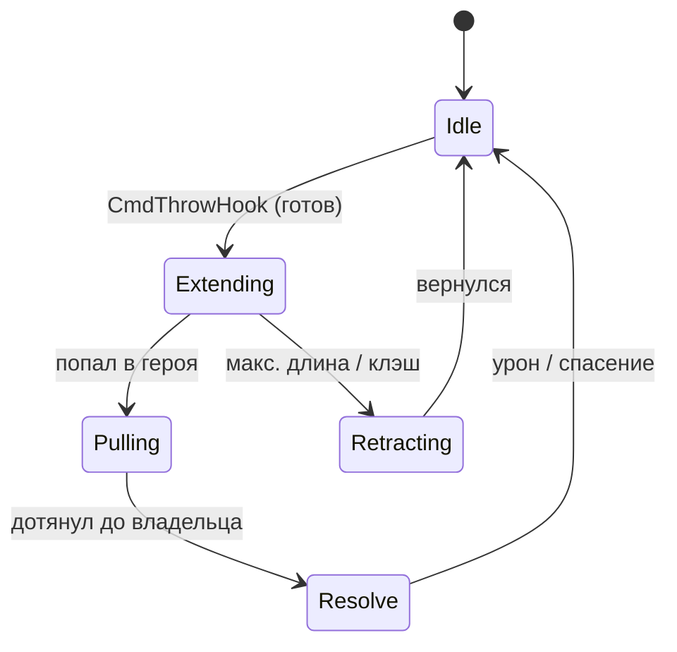
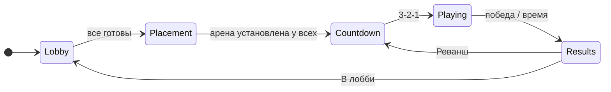
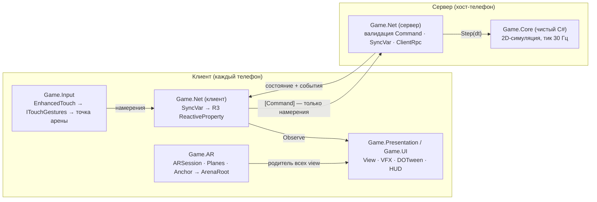

# Pudge Wars AR — технический дизайн-документ

Мультиплеерная дуэль на крюках в дополненной реальности. Требования, архитектура, сетевой протокол, критерии приёмки.

- **Версия:** 1.1
- **Статус:** Утверждён к реализации (учебный проект)
- **Дата:** 11 октября 2026
- **Платформа:** Android (ARCore). iOS не поддерживается.
- **Движок и стек:** Unity 6.6 · URP · AR Foundation · Mirror · VContainer · R3 · UniTask · DOTween · Alchemy · Input System (EnhancedTouch)
- **Связанный документ:** «Pudge Wars AR — план реализации и чек-лист по этапам» (`pudge_wars_ar_checklist.md`)

## Содержание

- [1. Введение](#1-введение)
- [2. Обзор продукта](#2-обзор-продукта)
- [3. Рамки проекта](#3-рамки-проекта)
- [4. Функциональные требования](#4-функциональные-требования)
- [5. Игровой дизайн](#5-игровой-дизайн)
- [6. Нефункциональные требования](#6-нефункциональные-требования)
- [7. Технологический стек](#7-технологический-стек)
- [8. Архитектура](#8-архитектура)
- [9. Модули](#9-модули)
- [10. Сетевой протокол](#10-сетевой-протокол)
- [11. Данные и конфигурация](#11-данные-и-конфигурация)
- [12. UX в дополненной реальности](#12-ux-в-дополненной-реальности)
- [13. Тестирование и приёмка](#13-тестирование-и-приёмка)
- [14. Риски](#14-риски)
- [15. Этапы реализации](#15-этапы-реализации)
- [Приложение А. Создание сетевых объектов через DI](#приложение-а-создание-сетевых-объектов-через-di)
- [Приложение Б. Коллизии хука](#приложение-б-коллизии-хука)
- [Приложение В. Тик сервера и мост SyncVar → R3](#приложение-в-тик-сервера-и-мост-syncvar--r3)
- [Приложение Г. Экран → координаты арены](#приложение-г-экран--координаты-арены)

## 1. Введение

### 1.1 Назначение документа

Документ фиксирует требования к игре Pudge Wars AR и технические решения, на которых строится реализация: архитектуру, состав модулей, сетевой протокол, модели данных и критерии приёмки. Порядок работ и пошаговые действия вынесены в отдельный документ «План реализации и чек-лист по этапам».

Требования имеют идентификаторы (FR-…, NFR-…) и приоритет по MoSCoW: **M** — обязательно для MVP, **S** — желательно, **C** — при наличии времени. Колонка «Этап» ссылается на этапы плана реализации.

### 1.2 Цели проекта

- Сделать играбельный матч Pudge Wars для 2–6 игроков у одного стола в AR по локальной сети.
- Отработать на практике чистую архитектуру Unity-проекта: DI, реактивные биндинги, асинхронные сценарии, разделение симуляции и представления.
- Получить опыт серверно-авторитарного мультиплеера и AR-разработки под мобильные устройства.

### 1.3 Термины и сокращения

| Термин | Определение |
|---|---|
| Арена | Игровое поле 24×14 игровых единиц, разделённое рекой на две половины. |
| ArenaRoot | Корневой Transform арены в сцене. Все игровые объекты — его дочерние. В AR его позицию и масштаб задаёт игрок. |
| Игровая единица (ед.) | Единица длины симуляции. Не равна метру; соответствие задаётся масштабом ArenaRoot. |
| Координаты арены | 2D-координаты (x, y) в плоскости арены: x — локальная ось X, y — локальная ось Z ArenaRoot. |
| Хост | Устройство, на котором одновременно работают сервер и клиент Mirror. |
| Тик | Один шаг серверной симуляции фиксированной длительности (1/30 с). |
| Намерение | Действие, которое клиент просит выполнить сервер (переместиться, бросить хук, купить улучшение). |
| Хук | Крюк: снаряд, который летит по прямой и притягивает героя, в которого попал. |
| Клэш | Столкновение двух летящих хуков; оба возвращаются. |
| Плоский режим | Режим без AR: арена в начале координат, обычная камера сверху. Для разработки и как запасной вариант. |
| MPPM | Multiplayer Play Mode — запуск нескольких игроков в одном редакторе Unity. |
| MVP | Минимальная играбельная версия: всё с приоритетом M. |

### 1.4 История изменений

| Версия | Дата | Изменения |
|---|---|---|
| 1.0 | 10.10.2026 | Первая версия. Ввод на EnhancedTouch (LeanTouch отклонён, раздел 7.2). |
| 1.1 | 11.10.2026 | Убрана поддержка iOS: единственная платформа — Android (ARCore). Корень игровых файлов — `Assets/Game/` вместо `Assets/_Project/` (раздел 8.3). В стек добавлены ObservableCollections, Eflatun.SceneReference, Unity Pipeline (раздел 7.1). |

## 2. Обзор продукта

### 2.1 Концепция

Две команды героев-мясников стоят на противоположных берегах реки, которую нельзя пересечь. Единственный способ взаимодействия — бросок крюка. Попадание во врага притягивает его и наносит урон; попадание в союзника спасает его. За убийства начисляется золото, которое тратится на улучшения крюка.

Арена размещается на реальном столе с помощью AR. Игроки стоят вокруг стола и управляют своими героями касаниями экрана телефона.

### 2.2 Сценарий использования

1. Хост создаёт игру в меню. Остальные игроки в той же Wi-Fi-сети видят её в списке и подключаются.
2. В лобби игроки выбирают команду и нажимают «Готов».
3. Каждый игрок сканирует стол и ставит арену (или все совмещают её по маркеру).
4. Отсчёт 3-2-1, матч длится до 15 убийств команды или 8 минут.
5. Экран результатов: «Реванш» или «В лобби».

### 2.3 Игровой цикл

Перемещение по своей половине → прицеливание и бросок крюка → притягивание и урон → убийство и золото → улучшение крюка → снова бросок.

### 2.4 Целевые устройства

| Платформа | Требование |
|---|---|
| Android | Устройство из списка поддерживаемых ARCore; минимальная версия Android — по XR Project Validation (не ниже API 24). Единственная целевая платформа. |
| Редактор | Плоский режим + MPPM для сетевой отладки; XR Simulation для потока установки арены. |

## 3. Рамки проекта

| Входит в MVP | Следующие версии | Вне рамок проекта |
|---|---|---|
| Матч 1×1 и 2×2 по Wi-Fi<br>Хук, движение, HP, смерть, респавн<br>Счёт и условия победы<br>4 улучшения крюка<br>Лобби с поиском игр в сети<br>AR-установка арены каждым игроком<br>Плоский режим | Матчи 3×3<br>Совмещение арены по маркеру<br>Препятствия на арене<br>Предметы (Blink, Shield)<br>Headshot<br>Компенсация лагов<br>Cloud Anchors | Игра через интернет, матчмейкинг<br>Миграция хоста<br>Античит<br>Аккаунты, прогрессия, монетизация<br>Персонажи и ассеты Dota 2 (чужая IP) |

> **Обоснование.** Игра по интернету исключена сознательно. Она требует relay-сервера, обхода NAT, предсказания и компенсации лагов. Для AR-игры у одного стола локальной сети достаточно. Архитектура не закрывает путь к онлайну: симуляция не зависит от сетевой библиотеки.

## 4. Функциональные требования

### 4.1 AR и размещение арены

| ID | Требование | Пр. | Этап |
|---|---|---|---|
| FR-AR-01 | При запуске игра проверяет поддержку AR (`ARSession.CheckAvailability`). Если AR недоступен — предлагает плоский режим. | M | 4 |
| FR-AR-02 | Экран сканирования показывает подсказку и ждёт обнаружения горизонтальной плоскости. | M | 4 |
| FR-AR-03 | Полупрозрачный контур арены следует за точкой пересечения луча из центра экрана с плоскостью. | M | 4 |
| FR-AR-04 | Тап фиксирует позицию арены; к ArenaRoot добавляется ARAnchor. | M | 4 |
| FR-AR-05 | До подтверждения игрок может менять масштаб (pinch) в диапазоне 1 ед. = 2…8 см и поворачивать арену (twist). | M | 4 |
| FR-AR-06 | После подтверждения визуализация плоскостей скрывается, ARPlaneManager выключается. | M | 4 |
| FR-AR-07 | До установки арены игровые объекты скрыты (ArenaRoot неактивен визуально). | M | 4 |
| FR-AR-08 | При потере трекинга экран затемняется и показывается подсказка; матч на сервере продолжается. | M | 4 |
| FR-AR-09 | Режим совмещения по маркеру: ArenaRoot ставится по позе распознанного изображения. | S | 5 |
| FR-AR-10 | Кнопка «Перевыровнять» повторно привязывает арену к маркеру во время матча. | S | 5 |
| FR-AR-11 | Совмещение через Cloud Anchors. | C | 7 |

### 4.2 Сеть и лобби

| ID | Требование | Пр. | Этап |
|---|---|---|---|
| FR-NET-01 | Игрок может создать игру (режим хоста). | M | 2 |
| FR-NET-02 | Список игр в локальной сети обновляется автоматически (NetworkDiscovery). | M | 2 |
| FR-NET-03 | Подключение по ручному вводу IP-адреса. | M | 2 |
| FR-NET-04 | При подключении сверяется версия протокола; при несовпадении клиент получает понятную ошибку. | M | 2 |
| FR-NET-05 | В лобби отображаются игроки, их команды и готовность. Игрок выбирает команду и отмечает «Готов». | M | 3 |
| FR-NET-06 | Хост запускает матч, когда все готовы и в каждой команде есть хотя бы один игрок. | M | 3 |
| FR-NET-07 | При отключении хоста клиенты видят экран «Хост отключился» и возвращаются в меню. | M | 2 |
| FR-NET-08 | При отключении клиента его герой удаляется, матч продолжается; если команда опустела — победа другой команды. | M | 3 |
| FR-NET-09 | Максимум 6 игроков (3×3); MVP проверяется на 2×2. | S | 3 |

### 4.3 Геймплей

| ID | Требование | Пр. | Этап |
|---|---|---|---|
| FR-GP-01 | Герой движется к указанной точке со скоростью из HeroConfig; точка ограничивается половиной арены его команды. | M | 1 |
| FR-GP-02 | Бросок хука в указанном направлении при готовности (перезарядка истекла, герой жив и не притягивается). | M | 1 |
| FR-GP-03 | Хук летит по прямой со скоростью Speed до дальности Range; коллизии проверяются по всему пути за тик (swept). | M | 1 |
| FR-GP-04 | Попадание во врага: урон Damage, цель прикрепляется к кончику хука и притягивается к владельцу. | M | 1 |
| FR-GP-05 | Попадание в союзника: притягивание без урона. | M | 1 |
| FR-GP-06 | Притягиваемый герой не может двигаться и бросать хук. | M | 1 |
| FR-GP-07 | Клэш: если кончики двух летящих хуков сближаются меньше суммы радиусов, оба переходят в возврат. | M | 1 |
| FR-GP-08 | Хук возвращается к текущей позиции владельца (владелец может двигаться, пока хук в полёте). | M | 1 |
| FR-GP-09 | При HP ≤ 0 герой погибает, через RespawnTime возрождается в точке своей команды с полным HP. | M | 3 |
| FR-GP-10 | Убийца получает KillGold, участники помощи (урон по жертве за последние 10 с) — AssistGold. | M | 3 |
| FR-GP-11 | Улучшения: дальность, скорость, радиус, урон — по 4 уровня, цены из EconomyConfig. Покупка возможна в любой момент матча. | M | 3 |
| FR-GP-12 | Победа: команда набрала KillsToWin убийств или по истечении MatchDuration — команда с большим счётом (ничья допустима). | M | 3 |
| FR-GP-13 | Headshot: попадание в героя, которого уже тянет другой хук, — мгновенное убийство. | C | 7 |
| FR-GP-14 | Препятствия (колонны), от которых хук возвращается. | C | 7 |

### 4.4 Управление

| ID | Требование | Пр. | Этап |
|---|---|---|---|
| FR-IN-01 | Тап по арене — движение героя в точку. | M | 1 |
| FR-IN-02 | Свайп, начатый рядом со своим героем (радиус захвата ~1.5 ед.), показывает линию прицела длиной Range; отпускание — бросок. | M | 1 |
| FR-IN-03 | Возврат пальца к герою во время прицеливания отменяет бросок. | S | 1 |
| FR-IN-04 | Альтернативная схема: кнопка «Хук» + тап по точке. Переключается в настройках. | S | 6 |
| FR-IN-05 | Помощь в прицеливании: направление подтягивается к ближайшему врагу в конусе ±4°. Отключается в настройках. | S | 6 |
| FR-IN-06 | Касания, начатые над UI, не передаются в игровой ввод. | M | 1 |
| FR-IN-07 | В редакторе мышь эмулирует касание (TouchSimulation). | M | 0 |

### 4.5 Интерфейс

| ID | Требование | Пр. | Этап |
|---|---|---|---|
| FR-UI-01 | Главное меню: «Создать игру», «Найти игру», «Подключиться по IP», «Настройки», переключатель AR / плоский режим. | M | 2 |
| FR-UI-02 | Экран лобби (FR-NET-05). | M | 3 |
| FR-UI-03 | Подсказки установки арены: сканирование, наведение, подтверждение. | M | 4 |
| FR-UI-04 | HUD: HP, индикатор перезарядки хука, золото, счёт команд, таймер матча. | M | 3 |
| FR-UI-05 | Магазин улучшений с текущими уровнями и ценами; недоступные позиции неактивны. | M | 3 |
| FR-UI-06 | Лента убийств. | S | 3 |
| FR-UI-07 | Экран результатов: победитель, статистика игроков (убийства, смерти, попадания хуком), кнопки «Реванш» и «В лобби». | M | 3 |
| FR-UI-08 | Индикатор своего героя за краем экрана; кольцо цвета команды под ногами. | S | 6 |
| FR-UI-09 | HP-бары над героями, повёрнутые к камере. | M | 3 |
| FR-UI-10 | Отладочный оверлей (только development-сборки): FPS, пинг, тик, фаза матча, состояние трекинга. | M | 0 |

## 5. Игровой дизайн

### 5.1 Арена

```text
          ←────────────────── 24 ед. ──────────────────→
        ┌──────────────────────┬──────┬──────────────────────┐  ↑
        │      Команда A       │      │      Команда B       │  │
        │          ●           │ Р    │           ●          │  │
        │          ● ─ ─ ─ ─ ─ │ Е ─ ─│─ ─ ─ ─ ─ ●   (хук)   │ 14 ед.
        │          ●           │ К    │           ●          │  │
        │                      │ А    │                      │  │
        └──────────────────────┴──────┴──────────────────────┘  ↓
                        река: 3.5 ед., |x| < 1.75
        ≈ 96 × 56 см на столе при масштабе 1 ед. = 4 см
```

- Размер 24×14 ед. Центр арены — начало координат арены; ось x направлена от команды A к команде B.
- Река: полоса шириной 3.5 ед. по центру (|x| < 1.75). Герои в неё не заходят, хуки над ней летят свободно.
- Половина команды A: x ∈ [−12 + r; −1.75 − r], команды B: x ∈ [1.75 + r; 12 − r], y ∈ [−7 + r; 7 − r], где r — радиус героя.
- Точки появления: по 3 на команду, x = ±8, y ∈ {−4, 0, 4}.

### 5.2 Машина состояний хука



| Фаза | Поведение | Выход |
|---|---|---|
| Idle | Хук у владельца, идёт перезарядка | CmdThrowHook при готовности → Extending |
| Extending | Длина растёт на Speed·dt; проверяются коллизии отрезка «прошлый кончик → новый» с героями и кончиками других хуков | Попадание → Pulling; клэш или Range → Retracting |
| Pulling | Кончик движется к текущей позиции владельца со скоростью Speed; цель жёстко привязана к кончику | Расстояние до владельца ≤ сумме радиусов → Resolve |
| Retracting | Пустой кончик возвращается к владельцу | Дошёл до владельца → Idle |
| Resolve | Мгновенная фаза: урон (враг) или ничего (союзник), снятие обездвиживания | → Idle |

Урон наносится в момент попадания (вход в Pulling), а не в Resolve: так ощущение удара совпадает с визуальным контактом. Если цель погибла от урона — фаза Pulling продолжается с телом для зрелищности, а затем Resolve без эффекта.

### 5.3 Баланс (стартовые значения)

| Параметр | Значение | Улучшение (за уровень, 4 ур.) |
|---|---|---|
| HP героя | 1000 | — |
| Скорость героя | 3.2 ед/с | — |
| Радиус героя | 0.5 ед | — |
| Дальность хука | 12 ед | +1.5 |
| Скорость хука | 20 ед/с | +4 |
| Радиус хука | 0.35 ед | +0.08 |
| Урон хука | 175 | +75 |
| Перезарядка хука | 3.0 с | — |
| Респавн | 4 с | — |
| Золото за убийство / помощь | 150 / 50 | — |
| Стартовое золото | 0 | — |
| Цена уровня улучшения | 100 / 200 / 300 / 400 | — |
| Победа | 15 убийств или 8 минут | — |

> **Примечание.** Значения — отправная точка, все хранятся в ScriptableObject-конфигах. Целиться пальцем в AR сложнее, чем мышью, поэтому радиус хука щедрее, чем в оригинальной карте. Баланс правится по результатам плейтестов на этапе 6.

### 5.4 Фазы матча



| Фаза | Сервер | Клиенты |
|---|---|---|
| Lobby | Принимает подключения, назначает слоты и команды | Выбор команды, «Готов» |
| Placement | Ждёт сообщения «арена установлена» от всех клиентов (таймаут 120 с — затем исключает не успевших) | Установка арены (FR-AR-*) |
| Countdown | Создаёт героев, задаёт CountdownEnd (NetworkTime) | Отсчёт 3-2-1 |
| Playing | Тик симуляции, валидация команд, MatchEnd (NetworkTime) | Ввод, отображение, HUD |
| Results | Фиксирует победителя и статистику | Экран результатов |

## 6. Нефункциональные требования

| ID | Требование | Метрика / проверка |
|---|---|---|
| NFR-01 | Частота кадров в матче на устройстве среднего класса | Стабильные 30 FPS (60 на флагманах), профайлер на устройстве |
| NFR-02 | Отсутствие аллокаций в кадре во время матча | ≈ 0 B GC Alloc в Profiler в фазе Playing |
| NFR-03 | Draw calls / треугольники в кадре | < 100 / < 150 тыс. |
| NFR-04 | Нагрев: матч 8 минут без троттлинга, ведущего к падению FPS ниже 25 | Тест на устройстве, 2 матча подряд |
| NFR-05 | Играбельность при плохой сети | Задержка 150 мс и 5% потерь (LatencySimulation) — игра остаётся управляемой, без рассинхрона |
| NFR-06 | Сетевой трафик | < 20 КБ/с на клиента в матче 3×3 |
| NFR-07 | Детерминированность симуляции | Одинаковые входные данные дают одинаковое состояние (EditMode-тест) |
| NFR-08 | Покрытие ядра тестами | Все правила Game.Core из раздела 5 покрыты EditMode-тестами |
| NFR-09 | Границы модулей | Game.Core не ссылается на Mirror, AR Foundation, Input System; проверяется настройками asmdef |
| NFR-10 | Время от запуска до лобби | < 5 с на устройстве |
| NFR-11 | Язык интерфейса | Русский; строки вынесены в отдельный ресурс для будущей локализации |
| NFR-12 | Точность совмещения по маркеру | Расхождение арены между двумя телефонами ≤ 2 см |

## 7. Технологический стек

### 7.1 Используемые технологии

| Технология | Назначение | Правила использования |
|---|---|---|
| **Unity 6.6, URP** | Движок и рендер | AR Background Renderer Feature в мобильном URP-ассете. Настройки по XR Project Validation. |
| **AR Foundation** + ARCore | Плоскости, raycast, якоря, распознавание изображений | Только в Game.AR. XR Simulation для редактора. |
| **Mirror** (KCP-транспорт) | Мультиплеер: хост, синхронизация, RPC, NetworkDiscovery | Только в Game.Net. Сервер авторитарен. |
| **VContainer** | DI, композиция приложения | Иерархия LifetimeScope (раздел 8.4). Сетевые объекты создаются через IObjectResolver. |
| **R3** | Состояние → UI/View, шина событий, потоки ввода | Не используется внутри серверного тика. |
| **UniTask** | Асинхронные сценарии (загрузка, AR, подключение, отсчёт) | Всегда с CancellationToken. Не используется как игровой таймер. |
| **DOTween** | Косметические анимации, UI | Не двигает объекты, влияющие на геймплей. SetLink на каждый твин. |
| **Alchemy** | Атрибуты инспектора, отладочные кнопки | Сериализация Alchemy в сети не используется. |
| **Input System** (EnhancedTouch) | Касания и жесты | Доступ только через ITouchGestures (раздел 9.3). |
| **Unity.Mathematics** | 2D-математика симуляции | float2 и math.* в Game.Core. |
| **Unity Test Framework** | EditMode / PlayMode тесты | Game.Tests. |
| **Multiplayer Play Mode** | Несколько игроков в одном редакторе | Основной инструмент отладки этапов 2–3. |
| **ObservableCollections** (+ R3) | Реактивные коллекции для UI (списки лобби, лента убийств) | Ставится через NuGetForUnity вместе с ядром R3. Не используется в Game.Core. |
| **Eflatun.SceneReference** | Ссылки на сцены в инспекторе и конфигах | Используется SceneLoader'ом вместо строковых имён сцен. |
| **Unity Pipeline** (экспериментальный) | Управление редактором из CLI / агента: сборка, тесты, Play Mode | Только инструмент разработки, в коде игры не используется. |

### 7.2 Рассмотренные и отклонённые альтернативы

| Альтернатива | Причина отказа |
|---|---|
| Netcode for GameObjects | Нет выигрыша для LAN с хостом-телефоном; смена знакомой библиотеки без пользы. Имеет смысл при переходе к онлайну через Unity Relay. |
| FishNet | Главное преимущество — встроенное предсказание — нужно при пинге 80+ мс; в LAN достаточно интерполяции. |
| Photon Fusion | Платные лимиты, зависимость от облака даже для игры за одним столом, тяжёлая модель программирования. |
| LeanTouch | Статические события и MonoBehaviour-компоненты плохо стыкуются с DI/R3; готовые компоненты для игрового ввода не нужны; EnhancedTouch с собственным распознавателем жестов покрывает все сценарии (тап, свайп, pinch, twist). |
| Unity Physics для коллизий хука | Не детерминирована между устройствами, чувствительна к масштабу арены в AR, избыточна для коллизий «круг против отрезка». |
| ARKit Collaborative Session | Только iOS; проект ориентирован только на Android. |

## 8. Архитектура

### 8.1 Ключевой принцип: AR — проектор

У каждого телефона своя мировая система координат AR, заданная положением телефона в момент старта сессии. Мировые координаты разных устройств несравнимы. Поэтому:

- Симуляция ведётся в координатах арены (2D, игровые единицы) и ничего не знает об AR.
- Каждый клиент сам размещает ArenaRoot; все игровые объекты — его дочерние.
- По сети передаются только координаты арены.
- Высота не моделируется: всё, что выше плоскости арены, — визуал.
- Масштаб — свойство ArenaRoot.localScale на конкретном устройстве, на симуляцию не влияет.



> По сети передаются только координаты арены в игровых единицах. Мировые координаты AR в сеть не попадают.

Следствия: игра работает без совмещения пространств между телефонами (совмещение — улучшение, а не условие); плоский режим реализуется подменой одного сервиса; ядро тестируется без сцены.

### 8.2 Сборки и правила зависимостей

| Сборка | Содержимое | Может ссылаться на |
|---|---|---|
| **Game.Core** | MatchSimulation, HookSimulation, HeroMovement, Combat, Economy, MatchRules, Geo2D, структуры состояний, данные конфигов, ScriptableObject-конфиги | Unity.Mathematics, UnityEngine (только для ScriptableObject). Без MonoBehaviour-логики, Transform, Physics |
| **Game.Net** | PudgeNetworkManager, NetworkBehaviour-адаптеры, сообщения, VersionAuthenticator, NetworkPrefabFactory, ServerTickRunner | Core, Mirror, R3, VContainer, UniTask |
| **Game.AR** | IArenaAnchorProvider и реализации, ArenaPlacementFlow, MarkerAlignment, TrackingMonitor | AR Foundation, UniTask, VContainer, R3, Game.Input |
| **Game.Input** | ITouchGestures, EnhancedTouchGestures, IArenaSpace, InputRouter, AimAssist | Input System, Core, R3, VContainer |
| **Game.Presentation** | HeroView, HookView, VFX, FlatCamera, индикаторы | Core, Net, R3, DOTween |
| **Game.UI** | Экраны и презентеры | Core, Net, R3, DOTween, UniTask |
| **Game.App** | LifetimeScope'ы, точки входа, SceneLoader | Все сборки |
| **Game.Tests** | EditMode / PlayMode тесты | Core, Net |

Game.Input не ссылается на Game.Net: InputRouter публикует намерения в интерфейс `IPlayerCommands`, объявленный в Core, а реализацию (отправку Command) регистрирует Game.Net.

### 8.3 Структура папок

Все файлы игры лежат в `Assets/Game/`. Вне её — только сторонние пакеты и служебные папки, которые создают Unity и плагины (Mirror, Plugins, Packages, XR, Settings, Resources и т. п.).

```text
Assets/Game/
  Scripts/
    Core/          Hook/ Hero/ Combat/ Economy/ Match/ Geometry/ Config/ Commands/
    Net/           Adapters/ Messages/ Spawning/ Auth/ PudgeNetworkManager.cs
    AR/            Session/ Placement/ Alignment/
    Input/         Gestures/ Routing/
    Presentation/  Views/ Vfx/ FlatCamera/ Indicators/
    UI/            Menu/ Lobby/ Hud/ Shop/ Results/
    App/           Scopes/ EntryPoints/ Scenes/
  Configs/         HookConfig, HeroConfig, EconomyConfig, ArenaConfig, MatchConfig, InputConfig
    Input/         InputSystem_Actions
    Rendering/     URP-ассеты (Mobile/PC), Volume-профили
  Prefabs/         Network/ Arena/ Vfx/ UI/
  Art/             Models/ Materials/ Textures/ Audio/
  Scenes/          Boot.unity  Menu.unity  Match.unity
  Tests/           EditMode/ PlayMode/
```

### 8.4 Композиция (VContainer)

| Scope | Сцена / время жизни | Регистрации |
|---|---|---|
| RootLifetimeScope | Boot, всё время работы приложения | Конфиги, SceneLoader, Settings, ILogger, PudgeNetworkManager (компонент), NetworkPrefabList |
| MenuLifetimeScope | Menu | Презентеры меню, DiscoveryService, ConnectService |
| MatchLifetimeScope | Match, один сетевой сеанс | IArenaAnchorProvider (AR или Flat), ArenaPlacementFlow, IArenaSpace, ITouchGestures, InputRouter, NetworkPrefabFactory, MatchSimulation, ServerTickRunner, MatchEventBus, HUD-презентеры |

Сцены: **Boot** (точка входа, загружает Menu), **Menu** — offline-сцена Mirror, **Match** — online-сцена Mirror. Фазы Lobby → Results происходят внутри сцены Match, без смены сцен.

### 8.5 Создание сетевых объектов через DI

Mirror создаёт объекты на клиентах сам. Чтобы они получали зависимости, все сетевые префабы регистрируются с собственными spawn-хендлерами, которые создают объект через `IObjectResolver` внутри ArenaRoot. Сервер создаёт объекты тем же путём, затем вызывает `NetworkServer.Spawn`. Код — в приложении А.

- Зависимости в NetworkBehaviour — через `[Inject] void Construct(...)`.
- Подписки на SyncVar и инициализация из сетевого состояния — в `OnStartClient`, а не в Construct.
- Игроки создаются вручную в `OnServerAddPlayer` (autoCreatePlayer выключен).

## 9. Модули

### 9.1 Game.Core — симуляция

| Тип | Ответственность |
|---|---|
| `MatchSimulation` | Владеет массивами HeroState и HookState, очередью намерений и буфером событий. Метод `Step(float dt)`. |
| `HeroMovement` | Движение к цели, ограничение половиной команды. |
| `HookSimulation` | Машина состояний хука, коллизии с героями, клэш. |
| `Combat` | Урон, смерть, история урона для помощи. |
| `Economy` | Начисление золота, проверка и применение покупок. |
| `MatchRules` | Счёт, условия победы, респавн. |
| `Geo2D` | SweptCircle, клампинг к прямоугольнику, отрезок–круг. |

Порядок шага симуляции:

1. Применить намерения из очереди (с валидацией).
2. Движение героев (кроме притягиваемых и мёртвых).
3. Шаг хуков: Extending → коллизии → клэши; Pulling / Retracting.
4. Разрешение попаданий: урон, смерти, золото.
5. Таймеры: перезарядки, респавн, окончание матча.
6. Сформировать события тика (HookThrown, HookHit, HookClash, HeroDied, HeroRespawned, GoldChanged, MatchEnded).

### 9.2 Game.AR

_Интерфейсы AR-слоя_

```csharp
public interface IArenaAnchorProvider            // AR или плоский режим
{
    UniTask<Pose> AcquireArenaPoseAsync(CancellationToken ct);   // поток установки
    ReadOnlyReactiveProperty<bool> IsTracking { get; }
}

public interface IArenaSpace
{
    Transform Root { get; }                      // ArenaRoot
    bool TryScreenToArena(Vector2 screen, out float2 arenaPoint);
    Vector3 ArenaToWorld(float2 p);
}
```

- **ARArenaAnchorProvider** — сканирование, превью, тап, pinch/twist, ARAnchor.
- **FlatArenaAnchorProvider** — ArenaRoot в начале координат, камера сверху под 55–60°.
- **MarkerAlignment** (этап 5) — поза ArenaRoot по ARTrackedImage.
- Выбор реализации — в MatchLifetimeScope по настройке пользователя; в редакторе по умолчанию плоский режим.

### 9.3 Game.Input

_Интерфейсы ввода_

```csharp
public interface ITouchGestures
{
    Observable<Vector2> Tap { get; }                         // экранная точка
    Observable<DragGesture> Drag { get; }                    // Began / Moved / Ended / Cancelled
    Observable<(float scaleDelta, float angleDelta)> PinchTwist { get; }
}

public interface IPlayerCommands                           // объявлен в Core, реализован в Net
{
    void MoveTo(float2 arenaPoint);
    void ThrowHook(float2 direction);
    void BuyUpgrade(UpgradeId id);
}
```

- **EnhancedTouchGestures** (ITickable) читает `Touch.activeTouches`, распознаёт жесты по порогам из InputConfig (сдвиг для свайпа, максимальное время тапа), отбрасывает касания, начатые над UI.
- **InputRouter** превращает жесты в намерения: тап → MoveTo; свайп от героя → прицел → ThrowHook.
- Экранная точка переводится в арену лучом на математическую плоскость ArenaRoot (`Plane.Raycast`), а не AR-raycast'ом: одинаково работает в AR и плоском режиме.

### 9.4 Game.Net

| Компонент | Ответственность |
|---|---|
| `PudgeNetworkManager` | Наследник NetworkManager: создание игроков, обработка отключений, переход сцен. |
| `VersionAuthenticator` | NetworkAuthenticator: сверка версии протокола при подключении (FR-NET-04). |
| `MatchStateNet` | Фаза матча, счёт, таймеры, лобби-слоты. |
| `HeroNet` | Команды игрока, HP/золото/улучшения, HookNetState, ClientRpc событий хука. |
| `ServerTickRunner` | Фиксированный шаг симуляции; после шага переносит состояние в сетевые компоненты. |
| `NetworkPrefabFactory` | Создание сетевых объектов через DI (приложение А). |

### 9.5 Presentation и UI

- **HeroView** читает позицию из Transform (синхронизирует NetworkTransform), анимации — по состоянию.
- **HookView** каждый кадр вычисляет положение кончика из HookNetState и NetworkTime; цепь — LineRenderer или звенья из пула.
- **MatchEventBus** (R3 Subject'ы) раздаёт события в VFX, звук, ленту убийств.
- Презентеры UI подписываются на ReadOnlyReactiveProperty сетевых адаптеров.

## 10. Сетевой протокол

### 10.1 Топология и время

- Хост-режим Mirror, транспорт KCP, порт по умолчанию 7777.
- Поиск игр — NetworkDiscovery (UDP broadcast). Запасной путь — ввод IP; рекомендуется раздача точки доступа с телефона хоста.
- Серверный тик 30 Гц (собственный аккумулятор, не FixedUpdate). sendRate NetworkManager = 30.
- Все моменты времени (броски, конец отсчёта, конец матча) передаются как значения `NetworkTime.time`.
- Хост вышел — сеанс завершён; миграции хоста нет.

### 10.2 Команды клиента

| Command | Параметры | Серверная валидация |
|---|---|---|
| CmdSelectTeam | Team team | Фаза Lobby; в команде есть место |
| CmdSetReady | bool ready | Фаза Lobby |
| CmdArenaPlaced | — | Фаза Placement |
| CmdMoveTo | Vector2 arenaPoint | Фаза Playing; герой жив и не притягивается; точка клампится к половине команды |
| CmdThrowHook | Vector2 direction, double clientTime | Фаза Playing; жив; не притягивается; хук в Idle; перезарядка истекла; direction нормализуется, нулевой — отклоняется |
| CmdBuyUpgrade | UpgradeId id | Фаза Playing; уровень < 4; хватает золота |
| CmdRequestRematch | — | Фаза Results; только хост |

Отклонённые команды логируются на сервере с причиной (development-сборки).

### 10.3 Синхронизируемое состояние

| Данные | Механизм | Примечание |
|---|---|---|
| Позиция и поворот героя | NetworkTransform (Unreliable), локальное пространство координат | Герой — дочерний ArenaRoot |
| HP, золото, уровни улучшений, K/D | SyncVar + hook → ReactiveProperty (R3) | На сервере значение пишется одновременно в SyncVar и ReactiveProperty |
| Состояние хука | SyncVar\<HookNetState> | Для поздно подключившихся и восстановления после потерь |
| Фаза матча, счёт, CountdownEnd, MatchEnd | SyncVar в MatchStateNet | Таймеры — моменты NetworkTime, а не убывающие числа |
| Лобби: слоты, команды, готовность | SyncList в MatchStateNet | — |
| События: попадание, клэш, смерть | ClientRpc | Для мгновенных VFX и звука |

### 10.4 Состояние хука

_HookNetState_

```csharp
public enum HookPhase : byte { Idle, Extending, Retracting, Pulling }

public struct HookNetState
{
    public HookPhase Phase;
    public Vector2   Origin;        // координаты арены в момент броска
    public Vector2   Dir;           // нормализованное направление
    public double    StartTime;     // NetworkTime броска
    public double    TurnTime;      // NetworkTime разворота (попадание / дальность / клэш)
    public float     TurnLength;    // длина хука в момент разворота
    public uint      TargetNetId;   // притягиваемый герой (0 — нет)
}
```

Клиент вычисляет кончик хука в любой кадр: в фазе Extending — `Origin + Dir · min((now − StartTime) · Speed, Range)`; после разворота — движение от точки разворота к текущей позиции владельца. Поэтому хук не требует NetworkTransform и передаётся несколькими десятками байт за бросок.

### 10.5 Отзывчивость

- **Свой бросок** отображается сразу (косметическое предсказание): клиент запускает анимацию по своему направлению, затем сверяет её с HookNetState. Если сервер бросок отклонил — анимация отменяется.
- **Чужие герои** — интерполяция снимков NetworkTransform.
- **Своё движение** — серверное в MVP; локальное предсказание вводится, только если плейтесты покажут «вязкость».
- **Компенсация лагов** — вне MVP (FR приоритета C).

## 11. Данные и конфигурация

Все настраиваемые значения хранятся в ScriptableObject-ассетах (Game.Core/Config) и регистрируются в RootLifetimeScope как экземпляры. Симуляция получает неизменяемые структуры данных через `ToData()`, а не ссылки на ассеты.

| Конфиг | Поля |
|---|---|
| HookConfig | Range, Speed, Radius, Damage, Cooldown, приросты за уровень (RangePerLevel, SpeedPerLevel, RadiusPerLevel, DamagePerLevel), MaxLevel |
| HeroConfig | MaxHp, MoveSpeed, Radius, RespawnTime |
| EconomyConfig | KillGold, AssistGold, AssistWindow, StartGold, UpgradePrices[] |
| ArenaConfig | Size (24×14), RiverWidth, SpawnPoints[TeamA], SpawnPoints[TeamB], Obstacles[] (этап 7) |
| MatchConfig | TickRate, KillsToWin, MatchDuration, CountdownDuration, PlacementTimeout, MaxPlayers |
| InputConfig | TapMaxTime, DragThreshold (в пикселях с учётом DPI), HeroGrabRadius, AimAssistAngle, ArenaScaleMin/Max |
| NetworkPrefabList | Список сетевых префабов для регистрации spawn-хендлеров |

## 12. UX в дополненной реальности

- **Находимость своего героя:** кольцо цвета команды под ногами, стрелка на краю экрана, если герой вне кадра.
- **Читаемость с любой стороны стола:** контрастные модели без мелких деталей, HP-бары повёрнуты к камере.
- **Ощущение предметов на столе:** blob-тени под героями обязательны; реальные тени и окклюзия рук — вне MVP.
- **Ориентация экрана** фиксированная (портрет); поворот во время AR запрещён.
- **Потеря трекинга** не останавливает матч — игрок видит подсказку и продолжает после восстановления.
- **Обратная связь:** тряска камеры не применяется в AR (камера — это телефон), вместо неё — вспышка, вибрация устройства, звук.

## 13. Тестирование и приёмка

### 13.1 Уровни тестирования

| Уровень | Объект | Инструмент |
|---|---|---|
| Unit (EditMode) | Geo2D, HookSimulation, HeroMovement, Combat, Economy, MatchRules | Unity Test Framework |
| Сетевые (редактор) | Лобби, создание объектов, синхронизация хука, отключения, плохая сеть | MPPM + LatencySimulation |
| AR (редактор) | Поток установки арены, жесты | XR Simulation |
| На устройствах | Трекинг, Wi-Fi, производительность, нагрев, совмещение | 2+ телефона, Profiler по сети |
| Плейтест | Понятность, баланс, удобство управления | Сессии с людьми, протокол замечаний |

### 13.2 Критерии приёмки MVP

- Два телефона в одной Wi-Fi-сети: создание игры, обнаружение, лобби, установка арены, полный матч 1×1 и 2×2 до экрана результатов и реванша.
- Все требования с приоритетом M выполнены.
- NFR-01, 02, 04, 05, 07, 08, 09 выполнены.
- Сторонний игрок понимает игру после 1 минуты объяснений и завершает матч без помощи.
- Нет падений и рассинхронизации за 5 полных матчей подряд.

## 14. Риски

| Риск | Вер. | Влияние | Меры |
|---|---|---|---|
| Wi-Fi блокирует broadcast или трафик между клиентами | Выс. | Нельзя подключиться | Ввод IP; точка доступа с телефона хоста; понятное сообщение об ошибке |
| Дрейф трекинга, арена «плывёт» | Сред. | Неудобство | ARAnchor; отключение плоскостей; текстурированная поверхность; игра не зависит от точности |
| «Попал, но не засчиталось» | Сред. | Раздражение | Мгновенный визуал броска; щедрый радиус; отладочные хитбоксы; позже — компенсация лагов |
| Перегрев и падение FPS | Сред. | Неиграбельно | targetFrameRate, отключённые плоскости и окклюзия, профилирование с этапа 4 |
| Хост свернул приложение | Сред. | Матч прерван | Обработка OnApplicationPause, корректное завершение у клиентов |
| Разные версии сборок | Сред. | Непонятные ошибки | VersionAuthenticator |
| Разрастание объёма работ | Выс. | Проект не завершён | Строгое следование рамкам раздела 3 |

## 15. Этапы реализации

Подробные шаги, проверки и критерии готовности каждого этапа — в документе «План реализации и чек-лист по этапам». Оценки даны для одного разработчика при нагрузке 10–12 часов в неделю.

| Этап | Содержание | Результат | Срок |
|---|---|---|---|
| 0. Каркас | Проект, пакеты, asmdef, сцены, скоупы, конфиги, ввод, тестовая сборка на устройство | Boot → Menu → Match без ошибок; пустая сборка запускается на телефоне | 1 нед. |
| 1. Ядро офлайн | Game.Core, плоский режим, ввод, тесты | Одиночная игра против манекена в редакторе | 2 нед. |
| 2. Сеть | Mirror + DI, команды, синхронизация, поиск игр, версия | Два игрока в MPPM играют друг против друга | 2–3 нед. |
| 3. Правила матча | Лобби, фазы, смерть, счёт, экономика, HUD, результаты | Полный матч 2×2 в плоском режиме | 2 нед. |
| 4. AR | AR-сессия, установка арены, ввод в AR, трекинг | Матч на двух телефонах | 2 нед. |
| 5. Совмещение | Маркер, привязка арены, перевыравнивание | Арена в одном месте стола на обоих телефонах | 1–2 нед. |
| 6. Полировка | Графика, VFX, звук, UX, баланс, оптимизация | Критерии приёмки MVP выполнены | 2–3 нед. |
| 7. Развитие | Препятствия, предметы, 3×3, компенсация лагов, Cloud Anchors | По интересу | — |

## Приложение А. Создание сетевых объектов через DI

_NetworkPrefabFactory.cs_

```csharp
public sealed class NetworkPrefabFactory : IStartable, IDisposable
{
    readonly IObjectResolver _resolver;
    readonly NetworkPrefabList _prefabs;
    readonly IArenaSpace _arena;

    public NetworkPrefabFactory(IObjectResolver r, NetworkPrefabList p, IArenaSpace a)
        { _resolver = r; _prefabs = p; _arena = a; }

    public void Start()
    {
        foreach (var prefab in _prefabs.Items)
            NetworkClient.RegisterPrefab(prefab, msg => SpawnClient(prefab, msg), Despawn);
    }

    GameObject SpawnClient(GameObject prefab, SpawnMessage msg)
    {
        var go = _resolver.Instantiate(prefab, _arena.Root);
        go.transform.SetLocalPositionAndRotation(msg.position, msg.rotation);
        return go;
    }

    public GameObject SpawnServer(GameObject prefab, NetworkConnectionToClient owner = null)
    {
        var go = _resolver.Instantiate(prefab, _arena.Root);
        NetworkServer.Spawn(go, owner);
        return go;
    }

    static void Despawn(GameObject go) => Object.Destroy(go);

    public void Dispose()
    {
        foreach (var prefab in _prefabs.Items) NetworkClient.UnregisterPrefab(prefab);
    }
}
```

## Приложение Б. Коллизии хука

_Geo2D.cs и фрагмент HookSimulation.cs_

```csharp
public static class Geo2D
{
    // Пересекает ли отрезок a→b, утолщённый на r, круг (c, rc)? t — доля пути до ближайшей точки.
    public static bool SweptCircle(float2 a, float2 b, float r, float2 c, float rc, out float t)
    {
        float2 ab = b - a;
        float len2 = math.lengthsq(ab);
        t = len2 > 1e-6f ? math.saturate(math.dot(c - a, ab) / len2) : 0f;
        float2 closest = a + ab * t;
        float R = r + rc;
        return math.lengthsq(c - closest) <= R * R;
    }
}

// Фрагмент HookSimulation.Step для фазы Extending
float2 prev = h.Tip;
float  next = math.min(h.Length + cfg.Speed * dt, cfg.Range);
float2 tip  = h.Origin + h.Dir * next;

int best = -1; float bestT = 1f;
for (int i = 0; i < heroes.Length; i++)
{
    if (heroes[i].Id == h.OwnerId || !heroes[i].Alive) continue;
    if (Geo2D.SweptCircle(prev, tip, cfg.Radius, heroes[i].Pos, heroes[i].Radius, out var t)
        && t < bestT) { best = i; bestT = t; }
}
h.Length = next; h.Tip = tip;
if (best >= 0)              { h.Phase = HookPhase.Pulling; h.TargetId = heroes[best].Id; }
else if (next >= cfg.Range)   h.Phase = HookPhase.Retracting;
```

## Приложение В. Тик сервера и мост SyncVar → R3

_ServerTickRunner.cs_

```csharp
public sealed class ServerTickRunner : ITickable
{
    const float Dt = 1f / 30f;
    const int MaxStepsPerFrame = 4;            // защита от «спирали смерти»
    readonly MatchSimulation _sim;
    readonly IMatchStateSink _sink;           // переносит состояние в NetworkBehaviour'ы
    float _acc;

    public ServerTickRunner(MatchSimulation sim, IMatchStateSink sink) { _sim = sim; _sink = sink; }

    public void Tick()
    {
        if (!NetworkServer.active) return;
        _acc = math.min(_acc + Time.deltaTime, Dt * MaxStepsPerFrame);
        while (_acc >= Dt) { _sim.Step(Dt); _acc -= Dt; }
        _sink.Publish(_sim);
    }
}
```

_HeroNet.cs (фрагмент)_

```csharp
public sealed class HeroNet : NetworkBehaviour
{
    [SyncVar(hook = nameof(OnHpSync))] int _hp;
    readonly ReactiveProperty<int> _hpRx = new();
    public ReadOnlyReactiveProperty<int> Hp => _hpRx;

    [Server] public void SetHp(int value) { _hp = value; _hpRx.Value = value; }
    void OnHpSync(int _, int value) => _hpRx.Value = value;
    public override void OnStartClient() => _hpRx.Value = _hp;
    void OnDestroy() => _hpRx.Dispose();
}
```

## Приложение Г. Экран → координаты арены

_ArenaSpace.TryScreenToArena_

```csharp
public bool TryScreenToArena(Vector2 screen, out float2 arenaPoint)
{
    var ray   = _camera.ScreenPointToRay(screen);
    var plane = new Plane(Root.up, Root.position);
    if (plane.Raycast(ray, out var dist))
    {
        var local = Root.InverseTransformPoint(ray.GetPoint(dist));   // учитывает масштаб
        arenaPoint = new float2(local.x, local.z);
        return true;
    }
    arenaPoint = default;
    return false;
}
```
